Harness switch · guidance · `harness-trust-v1` · needs `dialogue-auto-advance-v1` · off by default · bundle arm only

# Harness trust

> Markdown twin of [harness-trust-v1.html](../harness-trust-v1.html), generated from the HTML by `just explainer-twins`. The HTML is the source; edit it, not this file.

The model keeps losing true facts to what it remembers about Pokémon games: run 4caa read MAY's "head back to the LAB" and then decided the lab was in Rustboro. This switch moves the trust from the middle of a long system prompt to the places Qwen weighs most: the last lines of the system prompt, and the first lines of every tool result.

## What changes, in three places


*The prompt sets the order once; each result restates the facts it ranks first; the note fires only when the player's own moves lead away.*

## The header, on a recorded result

Run 4caa, turn 272, the press that showed MAY's line on ROUTE103. The off result is unchanged; on adds these lines on top, then a blank line, then the same result.

Off

```
pressed A
Dialogue auto-advance: …
14. turn 272 · ROUTE103 (map 0/18) · at 9,3 · MAY: "Well, it's time to head back to
the LAB."
…
```

On

```
Read from game memory, always true:
Story goal: "Well, it's time to head back to the LAB." (MAY, turn 272) -> "LAB" = PROF. BIRCH'S POKéMON LAB (map 1/4). Way in: door in LITTLEROOT TOWN (map 0/9) at (7,16).
Story characters on this map (from its own object list): none.

pressed A
…
```

The Story goal is the latest line a story character spoke that names a place, whole, resolved by `story-destinations-v1`'s resolver against the game's own map table (GET /pokebench/places). Before any such line it says `Story goal: no story character has named a place yet in this run.`; if the map table cannot be read it says so. The characters line copies only the on-this-map part of `character-presence-v1`'s readout line. With `exit-reachability-v1` on, a third line lists the warps and edges the server's flood reaches on foot, for example on run 4198's ROUTE103 state (MAY at (10,3), player at (16,7)):

```
Exits you can walk to from where you stand: SOUTH edge -> OLDALE TOWN (map 0/10).
```

Altering Cave and the EAST edge are across water there, so they are not listed. Without that switch the line is never shown.

## The trust order

```
Trust order (this puts "Game evidence first" in order): when sources disagree, believe them in this order.
1. The latest thing a story character told you. Each result starts with it as the Story goal line, read from game memory, with the place it names.
2. The other facts read from game memory in the result: where you are, who is on this map, the exits and the map.
3. Never your memory of Pokémon games, guides or walkthroughs. When it disagrees with 1 or 2, it is wrong about this game.
A SUPERVISOR note under the header says when your last two moves took you farther from the place the Story goal line names.
```

With `game-evidence-priority-v1` off the first line reads `Trust order: when sources disagree, believe them in this order.` It names no place, person or step.

## When the walk-away note fires



*Within a map, the distance counts tiles across and down to each way off it that leads into the goal map, or one map-table step closer to it. A move counts as away only when none of those ways got closer and the nearest is farther; the note names a way that got farther, with its own two numbers. Across a warp or edge, it is the count of map-table steps. Numbers from the 4caa T272 state's 80×22 topology, as the tests use them.*

```
SUPERVISOR: Your last two moves took you farther from PROF. BIRCH'S POKéMON LAB (map 1/4), the place in MAY's line above (turn 272): on ROUTE103 (map 0/18) you went from (9,13) to (9,10), and this map's SOUTH edge (to OLDALE TOWN (map 0/10)) went from 8 to 11 tiles away, counting tiles across and down; then on ROUTE103 (map 0/18) you went from (9,10) to (9,7), and this map's SOUTH edge (to OLDALE TOWN (map 0/10)) went from 11 to 14 tiles away, counting tiles across and down. Unless a story character has told you something newer, the Story goal line is where to go.
```

| Situation | Counts as |
|---|---|
| Same map, farther from the way toward the goal | a move away |
| Through one warp or edge to a map more steps from the goal | a move away |
| Closer to any way toward the goal, or fewer map-table steps | starts the count over |
| Standing still, a sideways step, a battle | nothing |
| Whiteout, fly, a scripted or dynamic warp (not one map-table step) | starts the count over; never a move |
| Inside the goal map, an unresolved goal, a map without its size | nothing |
| A newer story line that names a place | a new goal, a new count |

The goal survives a whiteout: the line is kept, and the next result after it shows it again. The note is a plain fact ("farther … counting tiles across and down"), so a route that must loop around water can draw it; the facts it states stay true.

## On battle actions: `harness-trust-v2`

With `battle-move-tool-v1` on, battle_action results are game-tool results too. `harness-trust-v2` (needs this switch, off by default, bundle arm only) starts them with the same header, so the Story goal stays in front of the model through a battle. A battle_action result never counts as one of the player's own moves for the walk-away note. Off: battle_action results are unchanged.

## Wiring


*The header wrapper is outermost in `playGameTools`, so it is the first thing in each result; the trust order is the last thing in the system prompt.*

## Status

- Tests from the 4caa, sh02, 0e05 and 4198 recordings, the production factory and one run through the pinned pi loop that delivers the header and the note to the next model request.
- Registered as a pending experiment (`experiments/harness-trust.json`), bundle arm only; not queued, not measured.
- Decision probes at the recorded forks run only when no trial is on the GPU lanes.
