Harness switch · guard · `heal-before-trainers-v1` · needs `low-hp-trainer-warning-v1` · bundle arm only · off by default

# Heal before trainers

> Markdown twin of [heal-before-trainers-v1.html](../heal-before-trainers-v1.html), generated from the HTML by `just explainer-twins`. The HTML is the source; edit it, not this file.

A simple v1 of "heal before trainer fights" (Operator, 2026-10-17). On the free field, when a trainer the player has not beaten is loaded on the current map and the party is weak, the tool result says so and names the nearest place the player has been to that heals the party. Everything it says comes from game memory, the ROM's map table and the game's own text.

## The run that prompted it

Run `2026-10-17T13-15-36_qwen36-gpu1_e046` on ROUTE104. TORCHIC was at 17/38 HP. It beat the RICH_BOY (WINSTON) and dropped to 14/38, walked east, talked to the LASS at (31,24) and battled her at 14/38. SCRATCH ran out of PP during the battle (EMBER still had 13), TORCHIC fainted, and the run whited out to OLDALE TOWN, losing ₽2584.



*Replaying e046's recorded tool-result states through the production code: the warning fires at seq 16066 and 16287 and nowhere else in this stretch (test "replays e046").*

## What the model reads, off and on

Off (today): the readout's general battle-triage line only

```
Party (player): TORCHIC Lv13 HP 14/38 · moves SCRATCH PP 4, GROWL PP 39, FOCUS ENERGY PP 30, EMBER PP 13 · nickname TORCHIC
Your TORCHIC has 14/38 HP (below half). Talking to the nurse at a POKéMON CENTER heals your whole party; so does talking to MOM at home.
```

On: the same result gains this paragraph at seq 16287 (exact text from the test)

```
SUPERVISOR: A trainer you have not beaten is on this map: object 3, sprite LASS, at (31,24). Your party is weak for a battle: TORCHIC, your lead, has 14/38 HP (below half). In a trainer battle the game says "No! There's no running from a TRAINER battle!" If your party faints, you black out: you lose half your money (₽2584 of ₽5168) and wake up back at the last POKéMON CENTER you entered, or at home. The nearest place you have been to that heals your party is the POKéMON CENTER in OLDALE TOWN (map 2/2), 4 map changes from here in the game's map table; its nurse says "We restore your tired POKéMON to full health."
```

The trainer is named only by object id, sprite and tile, as the readout already lists it: the game does not show "LASS HALEY" until the battle starts. Other weaknesses read `WURMPLE has fainted (0/15 HP)` or `TORCHIC, your lead, has no PP left for its damaging moves (SCRATCH, EMBER), and the game says "There's no PP left for this move!"`. MOM's version: `… is your house in LITTLEROOT TOWN (map 1/0), 6 map changes from here in the game's map table, where MOM says "I think you should rest a bit." and heals your party.`

## When it fires


*All three must hold on the tool result's own state. "The lead" is the first party Pokémon that can battle. "Damaging" is power above 0 in the game's move table. Status conditions and items are not judged in v1.*

It names each trainer once while the party stays weak on that map; a trainer that loads later is named on its own. After any trainer battle it names every unbeaten trainer again (as at seq 16287), and it re-arms after the player leaves the map or the party reads as not weak. A wild battle does not repeat it. With `low-hp-trainer-warning-v2` on, a story battle's opponent (ROXANNE) is left to that warning; with v1 or v2 the two paragraphs can both appear, v1/v2 first.

## The nearest place that heals


*Fewest map changes (warps and map connections, either way) in the ROM's map table from GET /pokebench/places. It does not know whether a path needs Cut or Surf, or crosses ledges the wrong way.*

- **A POKéMON CENTER the player has been to:** any `… POKEMON CENTER 1F` map a tool result showed the player in this run, plus the center of the town in the save's last heal location (every center's 1F runs `setrespawn HEAL_LOCATION_<TOWN>` as it loads, so that town's center was entered, even before a checkpoint start).
- **MOM at home:** the player's house 1F (`BRENDANS` or `MAYS HOUSE 1F` from the saved gender), named only while talking to her heals: `PlayersHouse_1F_EventScript_Mom` reaches `…MomHealsParty` once `FLAG_RESCUED_BIRCH` is set, unless she first registers in the POKéNAV or gives the AMULET COIN, or the late-game houses state is 4.
- The closest wins; a POKéMON CENTER wins a tie with home. With no map table, or no place, it says "Heal before you battle: the nurse at a POKéMON CENTER heals your whole party" (", and so does MOM at home" while she heals).

## Game grounding (pret/pokeemerald 731ad5bf)

| Fact | Where the game keeps it | e046 seq 16287 |
|---|---|---|
| Trainer objects | `SaveBlock1.objectEventTemplates` (+0xC70), script pointer at +0x10; a script starting `5C type id:u16` is `trainerbattle` (battle types 0–8) | object 3: `5C 00 5C 02` = TRAINER_HALEY_1 (604) |
| Beaten? | flag `TRAINER_FLAGS_START (0x500) + id`, as `GetTrainerFlagFromScriptPointer` reads it | 604 clear; RICH_BOY (136) set |
| Loaded and shown | `gObjectEvents`, active, not invisible, this map | LASS at (31,24) |
| Damaging move | `gBattleMoves[move].power` &gt; 0 | SCRATCH 40, EMBER 40, GROWL 0, FOCUS ENERGY 0 |
| Last heal | `SaveBlock1.lastHealLocation` (+0x1C) | OLDALE TOWN (0/10) |
| Home, MOM | `SaveBlock2.playerGender`; flags 0x52, 0x12F, 0xD8, 0x85, badge 5; vars 0x4082, 0x408C | BRENDANS HOUSE 1F; MOM heals |
| Quoted words | `sText_NoRunningFromTrainers`, `sText_NoPPLeft` (src/battle_message.c); `gText_WouldYouLikeToRestYourPkmn`; `PlayersHouse_1F_Text_YouShouldRestABit` |  |

A pytest reads e046's real RAM (seq 16066 and 16287) with Operator's ROM through the production reader and gets exactly the facts pokeemerald's source names for those objects and moves. The facts reach the agent as `heal_before_trainers` in the state JSON, only while the switch is on; the readout text never changes.

## Measured on 14 recorded runs

Raw-RAM replay of the 14 finished runs of 2026-10-16 20:49 to 2026-10-17 13:15 (11,357 game-tool results), through the production arm:

| What | Count |
|---|---|
| Warnings | 32, in 7 of 14 runs (0.28% of tool results); every one for a lead below half HP |
| Trainer battles started weak | 12 of 42 trainer battles; all 12 warned first |
| … of those, lost | 1 (e046, the LASS); 11 won without healing |
| Warnings followed by no trainer battle | 10 |
| Warnings followed by healing (party read not weak) before the next trainer battle | 7 |
| Warnings repeated within 10 turns on one map as more trainers loaded | runs dc5a (3 in 5 turns) and eae2 (3 in 8 turns) |

So in hindsight most warnings were not needed: the weak party won 11 of 12 such battles. The fainted and out-of-PP rules never fired in these runs.

## Wiring

- Preset → `FeatureSet` → `serverFeatureEnv`: the game server reads the facts only with the switch (`SERVER_FEATURES`, default off).
- `playGameTools` → `withLowHpTrainerWarning`, now one wrapper over a rule list: v1 or v2, then this rule. Its paragraph follows any other text the result gained; the state source also serves the map table.
- Recorded as `heal_before_trainers_warning` (Activity History SUPERVISOR row "Heal before trainers warning added to the … result"); no timeline mark.
- Off: no paragraph, no event, no `heal_before_trainers` in the state, no map-table read; v1 and v2 read exactly as before.

## Status

- Tests: e046 replay, every condition, the arm, v1/v2 unchanged with the switch off, the event schema, Activity History, delivery through the pinned pi loop, and the real-ROM reader check.
- Pending experiment `heal-before-trainers`, not designed and not queued; meant for the bundle arm.
- Not yet reviewed when this page was written; not run live.
