Harness switch · guard · `heal-before-trainers-v2` · needs `heal-before-trainers-v1` · game server and agent · bundle arm only · off by default

# Heal before trainers v2

> Markdown twin of [heal-before-trainers-v2.html](../heal-before-trainers-v2.html), generated from the HTML by `just explainer-twins`. The HTML is the source; edit it, not this file.

v1 only saw trainers the game had loaded near the camera, and only knew POKéMON CENTERs the player had walked into. In run b300 it named one YOUNGSTER in the RUSTBORO CITY GYM, missed the HIKER who beat it and the Gym Leader, and sent it to a house 8 map changes away, past a POKéMON CENTER its own results had listed as an exit. v2 reads the map's whole object list, names a story battle's opponent below full HP, and remembers every POKéMON CENTER a result has shown.

## What b300 saw

Run `2026-10-20T13-54-28_qwen36-gpu0_b300`. Result 14717 arrived in RUSTBORO CITY with TORCHIC at 25/33; its exits line listed `(16,38) -> RUSTBORO CITY POKEMON CENTER 1F (map 11/5)` and `(27,19) -> RUSTBORO CITY GYM (map 11/3)`. It walked into the gym (result 14882), beat JOSH and stood at (5,15) with TORCHIC at 11/35 when v1 fired (seq 15195). The game had loaded JOSH and TOMMY, not MARC or ROXANNE.



*Object tiles from the gym's templates (`data/maps/RustboroCity_Gym/map.json`) as the server read them from b300's raw RAM at state 15196 (pytest `test_b300_v2_lists_roxanne_and_marc_unloaded`). Red ringed: named by v2. Blue: the only trainer v1 named.*

## What the model reads, off and on

Off: heal-before-trainers-v1 at seq 15195, byte for byte (the recorded paragraph; the OFF replay test reproduces it)

```
SUPERVISOR: A trainer you have not beaten is on this map: object 3, sprite YOUNGSTER, at (3,9). Your party is weak for a battle: TORCHIC, your lead, has 11/35 HP (below half). In a trainer battle the game says "No! There's no running from a TRAINER battle!" If your party faints, you black out: you lose half your money (₽3222 of ₽6444) and wake up back at the last POKéMON CENTER you entered, or at home. The nearest place you have been to that heals your party is your house in LITTLEROOT TOWN (map 1/0), 8 map changes from here in the game's map table, where MOM says "I think you should rest a bit." and heals your party.
```

On, entering the gym (result 14882, TORCHIC 25/33, not weak): v1 said nothing

```
SUPERVISOR: A trainer you have not beaten is on this map: the Gym Leader ROXANNE, object 1, sprite ROXANNE, at (5,2) (not loaded now: the tile the map places it on). Your party is not at full HP: TORCHIC 25/33. Heal to full before a story battle. In a trainer battle the game says "No! There's no running from a TRAINER battle!" If your party faints, you black out: you lose half your money (₽3142 of ₽6284) and wake up back at the last POKéMON CENTER you entered, or at home. The nearest place you know of that heals your party is the POKéMON CENTER in RUSTBORO CITY (map 11/5), 2 map changes from here in the game's map table; you have not entered it, but an earlier result listed it as an exit at (16,38) in RUSTBORO CITY; its nurse says "We restore your tired POKéMON to full health."
```

On, after JOSH (result 15198, TORCHIC 11/35)

```
SUPERVISOR: Trainers you have not beaten are on this map: the Gym Leader ROXANNE, object 1, sprite ROXANNE, at (5,2) (not loaded now: the tile the map places it on); object 3, sprite YOUNGSTER, at (3,9); object 5, sprite HIKER, at (1,6) (not loaded now: the tile the map places it on). Your party is not at full HP: TORCHIC 11/35. Heal to full before a story battle. Your party is weak for a battle: TORCHIC, your lead, has 11/35 HP (below half). In a trainer battle the game says "No! There's no running from a TRAINER battle!" If your party faints, you black out: you lose half your money (₽3222 of ₽6444) and wake up back at the last POKéMON CENTER you entered, or at home. The nearest place you know of that heals your party is the POKéMON CENTER in RUSTBORO CITY (map 11/5), 2 map changes from here in the game's map table; you have not entered it, but an earlier result listed it as an exit at (16,38) in RUSTBORO CITY; its nurse says "We restore your tired POKéMON to full health."
```

Result 14717 in RUSTBORO CITY gets nothing from this switch: the city has no trainers. Exact texts come from the replay test over b300's 18 recorded tool results 14698-15600.

## Three changes

| What | v1 (off) | v2 (on) |
|---|---|---|
| Trainers | objects the game has loaded and shows (`gObjectEvents`) | every template in `SaveBlock1.objectEventTemplates`: a loaded object at its tile now, an unloaded one at its template tile (marked "not loaded now"), a template its flag hides left out. Same trainer test: script starts with `trainerbattle` (0x5C, field battle type), trainer flag 0x500 + id clear. |
| Threshold | lead below half HP, a fainted Pokémon, or the lead out of PP for its damaging moves, for every trainer | the Gym Leader ROXANNE while any party Pokémon is below max HP, as low-hp-trainer-warning-v2 does (the Route 103 rival never passes the trainer test: `Route103_EventScript_Rival` starts with `lockall`, so the server never lists it; a lead out of PP at full HP no longer names ROXANNE); every other trainer as in v1. With low-hp-trainer-warning-v2 on and the opponent's object loaded, that warning keeps it. |
| Heal places | centers entered, the last heal location's center, home while MOM heals | also every POKéMON CENTER 1F that a delivered game-tool result listed as an exit or warp destination: a warp of the result's map leads to it and the result's text names its map id (`map 11/5`). A result whose tool threw shows nothing. |

## The nearest place that heals


*Fewest map changes in the ROM's map table (GET /pokebench/places), as in v1. b300 had entered no POKéMON CENTER (game stats: `used_pokecenter 0`), and its saved last heal location was RED's house.*

## When it repeats

- Each trainer is named once per map while its condition holds; a trainer battle names every unbeaten one again (v1's rule).
- A party read as not weak re-arms the other trainers; a story opponent waits for the whole party at full HP. Another map re-arms everything.

## Wiring


*The server switch rides the same `POKEBENCH_FEATURES_OFF` list as every server switch. The agent arm lives in `playGameTools`, inside the same wrapper as v1.*

- Event `heal_before_trainers_warning` gains `loaded` and `story` per trainer, `hurt`, and `shown` on the heal place; `weak` may be empty when only a story opponent is named. Activity History SUPERVISOR row; no timeline mark.
- auto-talk-v1 still reads only loaded trainers.
- Off: v1 byte for byte: same state JSON (no unloaded trainers, no `loaded`), same text, same events.

## Status

- Tests: pytest on b300 RAM windows with Operator's ROM (ROXANNE 265, JOSH 320, TOMMY 321, MARC 571 match `include/constants/opponents.h`), the b300 replay on and off, thresholds, the arm, the event, and `playGameTools`.
- Pending experiment `experiments/heal-before-trainers-v2.json`, not queued. No measured runs.
