Harness switch · in-game-naming-readout-v1 · bundle · default OFF

# Nickname screens get the naming readout

> Markdown twin of [in-game-naming-readout-v1.html](../in-game-naming-readout-v1.html), generated from the HTML by `just explainer-twins`. The HTML is the source; edit it, not this file.

The player-name screen at the start of the game has always come with a readout of what has been typed and where the cursor is. Naming screens opened during play, like a Pokémon's nickname, had none: the model saw only the screenshot. With this switch on, they get the same readout, read from the game's own naming memory.

## What went wrong

Showcase bundle run `2026-10-16T00-34-26_qwen36-gpu1_show`. PROF. BIRCH offered a nickname for TORCHIC at turn 252 and the model said YES. It wanted "MOM", and 78 turns later (turn 330) the name read " ,VQ". Its reasoning kept misreading the tiny letters in the screenshot ("I have typed MP"), while the game knew exactly what was typed and which key was selected. That information was in the recorded state but never in the text the model got.



The uppercase keyboard as the game lays it out (zero-based columns 0 to 7, the side buttons at column 8). At turn 330 the cursor was on B, column 1 row 0, and the name was " ,VQ". The ON readout states both; OFF the model had to guess them from pixels.

## Before and after

OFF

```
Screen: naming
Dialog: detailed menu text unprovided
Menu: detailed controls unprovided
Story: … Birch rescue complete
Player: ASH
Location: LITTLEROOT TOWN PROFESSOR BIRCHS LAB
```

ON

```
Screen: naming
Dialog: detailed menu text unprovided
Menu: detailed controls unprovided
Story: … Birch rescue complete
Name being edited: ' ,VQ'
Naming keyboard: uppercase; cursor column 1, row 0 (zero-based); selected key 'B'
Naming input: ready
A selects the current key; B deletes; SELECT changes page; START moves to OK.Player: ASH
Location: LITTLEROOT TOWN PROFESSOR BIRCHS LAB
```

The recorded readout at turn 330 (state seq 8548), rendered again from the run's raw RAM with the switch off and on. The OFF text is byte-for-byte what the model saw. The four added lines are the same ones the player-name screen already prints.

## Where the values come from

| Line | Game memory (pret/pokeemerald `naming_screen.c`) |
|---|---|
| Name being edited | `sNamingScreen->textBuffer` (pointer at 0x02039F94, buffer at +0x1800) |
| Keyboard page | `currentPage` at +0x1E22 |
| Cursor column, row and selected key | The cursor sprite's position in `gSprites` |
| Input ready | The naming screen's state at +0x1E10 |

Same reader as the player-name readout (`env/pokebench_env/naming.py`). The switch only lets it run when the naming screen opens during play (callback 0x080E4F59 with the field loaded). It needs `naming-cursor-v1`, which prints the lines.

## Checked on the real game

A live game server loaded at Birch's nickname question: YES opens the editor, and with the switch on the readout shows `Name being edited: ''`, the uppercase page, column 0, row 0, key 'A', input ready. With it off there are no naming lines. Tests replay three recorded moments of the showcase run (turns 253, 254 and 330) and check the OFF text byte for byte.

## Status

- **Not done**: No measured runs. The experiment entry is pending, not queued.
