Harness switch · guard · `ineffective-loops-v1` · no dependency · off by default · for the bundle arm

# Ineffective loops

> Markdown twin of [ineffective-loops-v1.html](../ineffective-loops-v1.html), generated from the HTML by `just explainer-twins`. The HTML is the source; edit it, not this file.

Two kinds of repetition today's loop guard misses. A navigate_to or press loop whose targets alternate but keep ending on the same one or two tiles now raises a loop-guard warning and the supervisor briefing. An observe of an open menu or prompt today's field fingerprint cannot see (the START menu and others) that has not changed now counts toward the observation guard. Off: alternating loops go unflagged, and only the interfaces today's fingerprint sees (naming screens, BOY/GIRL, name and clock prompts, and ready messages with interaction detection on) count unchanged observes, with the generic warning.

## Why

From the overnight run analysis (hypothesis: "count repeated unchanged observes, and alternating 2–3 target loops that end on one tile, as ineffective") and the recorded events. Turn T, seq numbers are event seqs; all replayed through the real loop guard with each run's own switches.

| Run | Loop | Loop guard today | With this switch |
|---|---|---|---|
| `4caa` Route 103 | T199–T248: about 50 navigate_to calls to targets across the water ((79,9), (40,12), (45,6) …), ending on (23,12), (23,13) or (21,8) | warning T219 (one target, 4 times), recovered T221 | warning T212 (seq 5121), held to T215; T219 as today |
| `4caa` Route 102 ledge | T550–T571: DOWN,LEFT / RIGHT,DOWN alternating between (34,9) and (35,9) | nothing (only the same-plan note at T571) | warnings T555 (seq 15059) and T571 (seq 15332) |
| `7ccf` Oldale west | T198–T244: the Maniac stops the player at (1,10); the model walks back to (2,10) and tries (0,10), (0,11), DOWN, LEFT again. Not a push-back: the model walks back itself. | warning T244 | warning T215 (seq 5334), held until T245 |
| all 2026-10-15/16 runs | observes of a ready START or other menu the field fingerprint cannot see, unchanged 3+ times | never counted (naming screens and the BOY/GIRL, name and clock prompts already count, with the generic warning) | none recorded (0 of 69 runs); tested on the one recorded START-menu observe (b41f seq 144) |

## What counts as a loop



*Layout illustrative; the tiles and inputs on the left are the recorded ones. Left: the newest tile has ended three moves, the moves since the first of those ended on two tiles, and a target was named again after a different one. Right: the player keeps returning to T but reaches a new tile each time, so the loop spans more than two tiles and is not counted.*


*How one completed call feeds the few-target loop check. The threshold 3 is the loop policy's `cycleRepeats`; the episode recovers only on a tile not among the last 16 results or a story milestone, as push-back episodes do.*

## Waiting observes

Today an observe counts as unchanged only when the field fingerprint equals the previous call's: the free field, ready naming screens, the BOY/GIRL, name and clock prompts, and (with interaction detection) ready messages. A ready START menu or any other menu it cannot see has no fingerprint, so observing it forever never counts. With this switch an observe outside battle counts as unchanged when the game is waiting for input (a ready menu or prompt with no diagnostic, a ready naming screen, or a ready message on the locked field) and the player's place, facing, lock, interface, dialogue, message, story, party, money, badges and name equal the previous game call's. The fourth such observe in a row records an observation warning with this text (naming screens and prompts that already counted now get it instead of the generic one). As for loops, with the supervisor on the model is shown the supervisor briefing instead; with it off, this text as `LOOP GUARD (observation): …`:

```
Repeated observations show the same open menu, prompt or message waiting for your input: observing again does not change it. Decide from what the game shows which input it needs, or choose a different approach using observed evidence.
```

Never counted: the game acting (truck ride, scripts, door animations, text still printing), battles (battle-observation-loop-v1's job), a menu whose highlight moved. A waiting state not among the last 16 recovers the episode.

## What the model sees

The loop guard records a `cycle` warning with this text. With `loop-guard-supervisor-v1` on (as in the bundle and the experiment's incumbent) the model is not shown it: the supervisor briefing replaces it at the next model call and again every 6 calls while the loop lasts. With the supervisor off, the model sees it as `LOOP GUARD (cycle): …` at the next model call.

```
Your recent moves name different targets but keep ending on the same one or two tiles, with no new map, tile or story milestone in between: switching between these few targets is not getting anywhere. Reassess what stops you there using observed evidence, then choose a different route or destination.
```

Diagnostics go where loop-guard events already go: the run's `loop_guard` events, Activity History and the raw inspector. The notices reuse the existing `cycle` and `observation` loop-guard kinds, so the TIMELINE draws them with its existing loop-guard mark, as it draws every loop-guard warning today; this switch adds no timeline marks, lanes, labels or colors and changes no viewer event or timeline rendering code (only the explainer mapping in panels.ts). Whether these warnings should be kept off the timeline is an open question for Operator.

## Measured on recorded runs

Every 2026-10-15/16 run (69, no probes or human runs; the two newest were still live), replayed OFF (the run's own switches) and ON (the same plus this switch).

| Runs | Count | Warnings today | Warnings added | Runs with one |
|---|---|---|---|---|
| qwen gpu0 (bundle arm) | 17 | 47 | 36 | 10 |
| qwen gpu1 (control, showcases) | 19 | 200 | 92 | 13 |
| think-fast | 33 | 185 | 92 | 21 |
| all | 69 | 432 | 220 (0 waiting-observe) | 44 |

Hand check of 36 added warnings across 13 runs: 33 in stretches where the player stayed on one or two tiles for 3+ moves with no new map or milestone; 3 true but followed by progress within 1–2 turns (8b01 T337, 2a25 T9, show T173). False positives found and removed during the sweep: the Pokémon Center heal (4caa T456; a new conversation now clears the moves) and arrive-then-bump or turn-to-a-sign sequences (960a T7, 4caa T481, 8b01 T151, sh02 T412; the targets must alternate), inputs while a script held the controls (now not moves) and stairs bounces (823c T18; any call ending on another map now restarts the moves).

## Wiring


*The switch travels from the run's preset to the loop detector; only the highlighted box changes behavior. Off reproduces today's notices exactly (tested on all three fixtures).*

## Status

- Tests `packages/agent/src/ineffective-loops.test.ts` (fixtures from 4caa, 7ccf, b41f) and the live factory test.
- Pending experiment `experiments/ineffective-loops.json` (not queued). No measured runs yet; nothing here says the switch helps.
