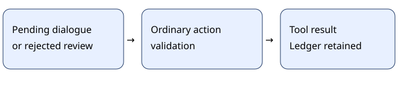

# Advisory instruction goals

> Markdown twin of [instruction-goal-advisory-v1.html](../instruction-goal-advisory-v1.html), generated from the HTML by `just explainer-twins`. The HTML is the source; edit it, not this file.

Keep memory. Let gameplay continue.

## What changes

With the instruction ledger enabled, pending dialogue and rejected bookkeeping no longer prevent a game-changing tool from reaching its ordinary validation.

## ON and OFF

OFF: the existing ledger gate requires pending dialogue review and blocks an action with a rejected attached review.

Invalid reviews remain rejected and leave the ledger unchanged. Unexpected errors and recording failures still stop the call. A successful review remains atomic. This switch never chooses a goal, route or button.

## Approved configuration

| Setting | Control | Bundle |
|---|---|---|
| instruction-goal-advisory-v1 | OFF | ON |
| Instruction goal ledger | OFF | OFF |
| Cutscene journal | OFF | ON |

This switch is intentionally inactive while instruction-goal-ledger-v1 is OFF. It can be tested independently after explicitly enabling the ledger in a future configuration. Generic defaults are OFF. Existing runs keep their recorded code and settings.

Evidence and limits

Qwen bundle 9e33 made 883 consecutive rejected goal reviews from 06:44 to 11:18 on October 25, 2026. These switches address bookkeeping behavior; they do not establish improved story progress. No new gameplay experiment was launched. Current screenshots, native evidence and ordinary input validation remain authoritative.

