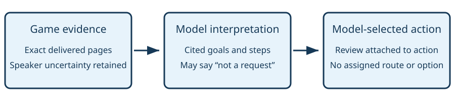

# Instruction goals

> Markdown twin of [instruction-goal-ledger-v1.html](../instruction-goal-ledger-v1.html), generated from the HTML by `just explainer-twins`. The HTML is the source; edit it, not this file.

instruction-goal-ledger-v1

## Remember requests without choosing the plan

The game supplies exact dialogue. The playing model interprets it, chooses goals, and records why it changes its plan. The harness preserves those records and distinguishes model completion claims from native proof.

**Default OFF. Bundle ON only.** OFF preserves the previous prompt, tools, readouts and input path. This switch is independent of menu-option-tool-v1. The legacy catalog-based objective-tracking-v1 must be OFF, so only one goal owner is active.

## One decision, three distinct owners



New field dialogue requires interpretation before game-changing input. Observation and evidence retrieval remain available. A review may be attached to an action as `goal_review`, or submitted through `review_goals`.

## The recorded PokéNav failure

Control `2026-10-24T08-12-35_qwen36-gpu1_0517`, seq 39430 and 39462: the unnamed scientist says “Test it out. Please give our PRESIDENT a call.” and “Please select the POKéNAV.” The original model repeatedly canceled. Those quoted pages are recorded evidence; the example goal below is an illustrative model interpretation, not an output from that original run.

```
{"reviewed":[{"episode":39462,"interpretation":"The scientist asks me to select POKéNAV"}],
 "updates":[{"id":"select","title":"Select POKéNAV",
 "sources":[{"episode":39462,"page":0}],"parent":null,
 "status":"active","reason":"The scientist asked",
 "completion":"POKéNAV opens"}]}
```

Episode IDs are delivered result sequence numbers. Pages are zero-based. Source text and attribution are preserved whole. The earlier episode would also need reviewing before an action proceeds.

## Lifecycle and retirement

| State | Meaning |
|---|---|
| open / active | Unfinished goal selected or retained by the model. |
| deferred / blocked | Still unfinished; the model records why it is waiting. |
| reported_complete | Model claim with newer delivered observation evidence. This does not grade the run. |
| superseded / abandoned | Explicit plan change with reason; supersession names another goal. Neither is successful completion. |
| native_verified | Separate verification label only when the model sets native_source_completion:true and the shared source-audited owner proves the cited instruction task complete from paired delivered state. This verifies that source condition, not the model’s title. Unknown tasks stay provisional. |

Age, arrival, repetitions and another active goal do not complete a task. Parent and child goals have independent lifecycles. Unknown evidence never becomes completion.

## Persistence and bounds

Structured reviews are recorded in the existing `ledger_context.instruction_goals` event before game input. Context compaction does not erase the ledger; history replay reconstructs it. No new timeline category is added. Activity History and the raw event inspector show the existing ledger events.

The decision header shows up to 12 unfinished goals, 4 pending episodes, and 4 recently closed goals, with total counts and up to 16 recent pending episode IDs. Up to 128 unfinished goals are accepted; updates are atomic and reject overflow. Each review contains at most 16 episode interpretations and 16 goal updates. `get_instruction_goals` lists IDs in pages of 50 (offset and limit up to 100) or retrieves a complete episode or goal.

Extracted place mentions become historical context rather than an authoritative “Story goal.” The old destination-away supervisor is disabled only under this treatment.

## Proof and limits

Recorded dialogue and RAM-derived menu states ground offline tests. A scripted local HTTP model fixture exercises the pinned pi delivery path; it is not evidence of improved model behavior. There are no new gameplay trials, active-run inputs or inference calls. Broader gates, independent review, landing and served proof are recorded separately in the worklog.
