Harness switch · observation · `instruction-ledger-v2` · needs `dialogue-auto-advance-v1` · off by default · bundle arm

# Conversation ledger

> Markdown twin of [instruction-ledger-v2.html](../instruction-ledger-v2.html), generated from the HTML by `just explainer-twins`. The HTML is the source; edit it, not this file.

Every observe, press and navigate_to result on the free overworld gets one block right under the readout's Story line. It quotes the latest conversation with a person, whole, with who spoke and the turn ("MAY, turn 450"). Every line says who said it. Then it lists every room visited, newest first, with the last line heard in each and who said it. There is no model tool, no prompt line and no model-written text.

## Why a v2

The PokeBench review of 2026-10-17 (harness engineer, evaluation integrity, data scientist, ML engineer) found four problems with `instruction-ledger-v1`. Operator then decided to drop `dialogue-log-v1` and `note_contradiction` and build this switch instead. v1 itself is unchanged; it is a separate switch.

| v1 | v2 |
|---|---|
| Asks the model to call `note_contradiction`. In 36 cook runs the model called the similar optional reader `get_dialogue` 4 times in 26,293 calls. | No tool. Nothing depends on the model asking. |
| Pins the last three pages of any dialogue: signs and objects count, and a long conversation is cut to its last three pages. | Pins the latest conversation with a person, every page of it. Signs and objects never pin. |
| A room's "last heard" fills only when the newest page's seq equals the tool result's state seq. Under auto-advance they never match, so rooms read "nothing heard". | Keys "last heard" on each auto-advance page's own map. |
| Labels faced people by internal sprite ids, or not at all. | Every line says who said it, the way the game shows them: "MAY", "the woman you talked to", "the sign". |
| Appended as a trailing user message after the newest result, the last thing the model reads. | Inside the tool result, under the Story line. The current readout still follows it. |

## Before and after, recorded e962 turn 450

Run `2026-10-16T19-48-44_qwen36-gpu0_e962`. MAY's post-battle line on ROUTE 103 was turn 444. At turn 450 MAY says "Let's hurry home!" in OLDALE TOWN. At turn 451 the model decides "My home is the house at (5,7)", a house in OLDALE TOWN. With the switch on, the same result also lists LITTLEROOT TOWN and the player's own house as rooms visited, and ROUTE 103 still shows the LAB line.

Off (what the model got)

```
Story: player name confirmed; … Route 103 rival battle won
Player: RRED
Location: OLDALE TOWN
Position: X=10, Y=19, facing down
…
```

On (same result)

```
Story: player name confirmed; … Route 103 rival battle won
Conversation ledger: …
Latest conversation … (MAY, turn 450; …)
Rooms visited, newest first, …
Player: RRED
Location: OLDALE TOWN
…
```

The whole block, exactly as the tests replay it from the recorded events (fixture `instruction-ledger-v2-e962.jsonl.gz`):

```
Conversation ledger: game text you were shown, quoted whole; past text, the current screen overrides it.
Latest conversation with a person (MAY, turn 450; OLDALE TOWN (map 0/10)):
- MAY: "RRED! Over here! Let's hurry home!"
Rooms visited, newest first, with the last line heard in each:
- OLDALE TOWN (map 0/10), here turn 450: last heard turn 450, MAY: "RRED! Over here! Let's hurry home!"
- ROUTE103 (map 0/18), here turn 446: last heard turn 444, MAY: "Well, it's time to head back to the LAB."
- ROUTE101 (map 0/16), here turn 389: last heard turn 125, PROF. BIRCH: "This is not the place to chat, so come by my POKéMON LAB later, okay?"
- LITTLEROOT TOWN (map 0/9), here turn 374: last heard turn 144, the sign: "RRED's HOUSE"
- OLDALE TOWN POKEMON CENTER 1F (map 2/2), here turn 300: last heard turn 298, no speaker shown: "We hope to see you again!"
- PROF. BIRCH'S POKéMON LAB (map 1/4), here turn 160: last heard turn 159, the scientist you talked to: "The PROF enjoys MAY's help, too. There's a lot of love there."
- RRED's HOUSE 1F (map 1/0), here turn 149: last heard turn 148, MOM: "Take care, honey!"
- PROF. BIRCH'S HOUSE 1F (map 1/2), here turn 139: last heard turn 98, the girl you talked to: "RRED, I'll catch you later!"
- PROF. BIRCH'S HOUSE 2F (map 1/3), here turn 137: nothing heard
- RRED's HOUSE 2F (map 1/1), here turn 81: last heard turn 81, MOM: "Oh, you should make sure that everything's all there on your desk."
- INSIDE OF TRUCK (map 25/40), here turn 61: last heard turn 58, the box: "It's a POKéMON brand moving and delivery service."
```

## Which conversation is pinned



*One claim: the newest conversation with a person is pinned, and signs and objects never are. Recorded run `2026-10-16T16-46-59_qwen36-gpu0_2fb4`, results at seq 6401 (turn 256) and 8319 (turn 320).*

Who said a line, in this order (operator decision, Operator 2026-10-17 4:49 PM):

1. The game's own `NAME:` prefix ("MAY: Well, it's time…"), moved out of the quote. Pages that continue that message keep the name.
2. Else the person the player faced, described by how they look on screen: "the woman you talked to", "the man", "the boy", "the girl", "the old man", "the scientist", "the nurse" or "the clerk". If the game printed a name for that same sprite on that map in the same conversation (one `NAME:` prefix, one faced person), that name is used from then on. Internal sprite ids such as WOMAN_4 or RIVAL_MAY_NORMAL are never printed.
3. Signs and objects are named as such: "the sign", "the wall clock", "the box", "the item ball", "the doll". A faced POKéMON is "the POKéMON".
4. A page where the game shows no speaker (the player's own "received" lines, a nurse's goodbye with no one faced) reads "no speaker shown".

- A conversation is every field page of one auto-advance call, in order. Battle text (pages with a battle turn) never counts.
- A page counts once its tool result reached the model. The result that delivers a conversation already pins it. An error result delivers nothing.
- Before any person has spoken, the latest field page stands in, labelled "the latest field page" (in the truck: "the box").
- No character list, milestone order, map knowledge or route knowledge is used (PB4). The person words come from the sprite's look (pokeemerald `OBJ_EVENT_GFX_*`, `env/pokebench_env/event-graphics.json`), not from who matters to the story.

Recorded runs it was checked on:

| Run, seq | Pinned | Notable room line |
|---|---|---|
| 93eb 2771 (T134) | MOM, INTERVIEWER, turn 131: the TV report, ending "He lives right next door, so you should go over and introduce yourself." | INSIDE OF TRUCK: the box |
| 0e05 1286 (T76) | The same conversation, turn 74 | BRED's HOUSE 1F: "He lives right next door…" |
| e962 10160 (T445) | MAY, turn 444: four pages ending "Well, it's time to head back to the LAB." | Battle pages left out |
| defa 9920 (T402) | MAY, turn 402, in the very result that delivers it | ROUTE103: the LAB line (v1: "nothing heard") |
| 2fb4 6401 (T256) | the woman you talked to, turn 255: "Oh, MAY went out to ROUTE 103 just a little while ago." | LITTLEROOT TOWN: the sign |
| 2fb4 8319 (T320) | the man you talked to, turn 316 (the sketching man in OLDALE TOWN) | PROF. BIRCH'S HOUSE 1F: the woman's "Like father, like child…" |
| e0cc 1573, 1832, 3525 (live bundle run, v1 on) | the woman you talked to, turn 70, then the girl you talked to, turn 76 | PROF. BIRCH'S HOUSE 1F: the woman you talked to, "Our daughter is upstairs, I think." (v1 recorded "nothing heard") |

## Where "last heard" comes from



*One claim: v2 fills a room's last line from the auto-advance page records, which v1 could not. Both outcomes are asserted by the tests on the recorded fixture.*

Rooms are keyed by the game's location and map id. They are named the way the readout names them once a readout has shown the room (for example "RRED's HOUSE 1F (map 1/0)"); a room known only from a page uses the page's map name. Map ids appear when `bounded-navigation-v1` is on, as in the readout. The list is ordered by the latest turn the player was there, newest first. Nothing is clipped and there is no cap: the context window is the only bound.

## Interface format

Recorded 2fb4 seq 6401 (turn 256), as the tests replay it:

```
Conversation ledger: game text you were shown, quoted whole; past text, the current screen overrides it.
Latest conversation with a person (the woman you talked to, turn 255; PROF. BIRCH'S HOUSE 1F (map 1/2)):
- the woman you talked to: "Oh, MAY went out to ROUTE 103 just a little while ago."
- the woman you talked to: "Like father, like child. MAY can't stay quietly at home."
Rooms visited, newest first, with the last line heard in each:
- PROF. BIRCH'S HOUSE 1F (map 1/2), here turn 256: last heard turn 255, the woman you talked to: "Like father, like child. MAY can't stay quietly at home."
- LITTLEROOT TOWN (map 0/9), here turn 252: last heard turn 250, the sign: "PROF. BIRCH'S HOUSE"
- YROVE's HOUSE 1F (map 1/0), here turn 247: last heard turn 245, MOM: "Take care, honey!"
- PROF. BIRCH'S POKéMON LAB (map 1/4), here turn 223: last heard turn 222, PROF. BIRCH: "Get MAY to teach you what it means to be a TRAINER."
- ROUTE101 (map 0/16), here turn 220: last heard turn 220, PROF. BIRCH: "This is not the place to chat, so come by my POKéMON LAB later, okay?"
- PROF. BIRCH'S HOUSE 2F (map 1/3), here turn 170: last heard turn 170, the girl you talked to: "YROVE, I'll catch you later!"
- YROVE's HOUSE 2F (map 1/1), here turn 129: last heard turn 129, MOM: "Oh, you should make sure that everything's all there on your desk."
- INSIDE OF TRUCK (map 25/40), here turn 89: last heard turn 84, the box: "It's a POKéMON brand moving and delivery service."
```

- Every line starts with who said it, as listed above. The game's `NAME:` prefix is moved out of the quote.
- Line breaks in the game's text are printed as spaces. Every other character is kept.
- Battle screens, menus and the title screen get no block. A result whose readout has no Location line is unchanged.
- Record: the block is part of the recorded `tool_result` text, so forensics and replay see exactly what the model saw. There is no `ledger_context` event, because the decision probe replays `ledger_context` as a trailing user message and v2 is not one.

## Wiring


*The only box that changes behavior is highlighted. Off: it returns the very same tools and subscribes to nothing.*

## Game grounding (pret/pokeemerald 731ad5b)

- `Route103_Text_MayTimeToHeadBack`: "MAY: I think I know why my dad has an eye out for you now. … Well, it's time to head back to the LAB."
- `PlayersHouse_1F_Text_OhComeQuickly`, `PlayersHouse_1F_Text_ItsOverWeMissedHim` and `PlayersHouse_1F_Text_GoIntroduceYourselfNextDoor` (`data/maps/LittlerootTown_BrendansHouse_1F/scripts.inc`)
- `OldaleTown_Text_MayLetsGoBack`: "MAY: {PLAYER}{KUN}! Over here! Let's hurry home!"
- `RivalsHouse_1F_Text_WentOutToRoute103` has no prefix; the woman faced in PROF. BIRCH'S HOUSE 1F says it, so it reads "the woman you talked to" and is pinned while it is the latest conversation with a person.

## Status

- Tests replay five recorded runs. Gates: test, lint, build, coverage.
- Not done: the multi-model review, the merge, the experiment design and any measured run. `experiments/instruction-ledger-v2.json` is pending, not queued.
