# Instruction memory cap

> Markdown twin of [instruction-memory-cap-v1.html](../instruction-memory-cap-v1.html), generated from the HTML by `just explainer-twins`. The HTML is the source; edit it, not this file.

`instruction-memory-cap-v1` stops the OBSERVED INSTRUCTION MEMORY block from growing without limit. The block stays at or under 16,000 characters, about 6,100 Qwen3.6 tokens. The switch keeps or leaves out whole dialogue episodes, chosen by what game memory says about them, and never cuts an episode's text. Default off. It works on either memory form: the episodes `milestone-instruction-memory-v1` keeps when that switch is on (the selected JSON block shown below), or every delivered episode in the older YAML-like block when it is off. In the older block the left-out line comes right after its first line.

**53,962 → 15,965 chars**<br>
a702 turn 1301, control arm (dedup off)

**26 of 112 episodes**<br>
kept at a702 turn 1301; the rest stay in the recording

**66,676 → \~51,640 tokens**<br>
a702's failing request, against a 61,440 limit

## Why it was needed



*a702's instruction memory, switch off, replayed with the run's own code. It grows about linearly because the milestone templates stop at the Petalburg Woods rescue and the chapter list ends at ROCK_TOMB_RECEIVED (turn 578): everything heard after that is kept for good. The ledger message is re-sent every turn, so the trimmer cannot drop it. At turn 1303 the request reached 66,676 tokens against a 65,536 window, and the run ended `model_error`.*

## The rule, in order



*Every kept episode is whole. When no episode is left out and observed_locations and current are within their own limits, the block is byte for byte what it is with the switch off.*

## What decided each episode

| Turn | Before | After | Anchor | Done (left out) | Nearby | Named kept | Recency kept |
|---|---|---|---|---|---|---|---|
| a702 T700 | 28,857 | 15,981 | 1 | see report | see report | 17 of 46 kept |  |
| a702 T1301 | 53,962 | 15,965 | 0 (stale) | see report | see report | 26 of 112 kept |  |
| 88ea T400 | 19,718 | 15,789 | 1 | see report | see report | 22 of 34 kept |  |
| 88ea T800 | 25,182 | 15,999 | 1 | see report | see report | 28 of 49 kept |  |

Recorded runs, replayed. The built code's output equals the separate reference implementation (`runs/analysis/bounded-input-20261028/rule_a2.py`) byte for byte on all four turns. With the switch off it equals the block each run actually recorded. At a702 T1301 the readout's story line was DAD's T871 "a GYM LEADER named BRAWLY". KNUCKLE was already set, so that line no longer counts as the anchor, and the dad-sends-to-dewford checkpoint closes it. The checkpoints also retire the Rustboro POKéNAV tutorial (T634, T635, T663), the Devon goods theft and recovery (T580–T621), WALLY's catching tutorial and the woods TEAM AQUA scene. MR. STONE's errands (T630) stay, because the LETTER and the DEVON GOODS have not been delivered.

## Game facts it reads

| Fact | Where it comes from | Used for |
|---|---|---|
| Story line | the latest observation result's `Story line heard (…)`, `Story goal: "…" (…)` or `Latest story line naming a place (…)` line. A finished goal prints `Story goal: none.` and names no line. | step 1 |
| Badge flags | state `badges` (FLAG_BADGE01–08_GET); pret gym scripts pair ROXANNE STONE, BRAWLY KNUCKLE, WATTSON DYNAMO, FLANNERY HEAT, NORMAN BALANCE, WINONA FEATHER, TATE/LIZA MIND, JUAN RAIN | stale anchor |
| Milestones | recorded `milestone` events | the 25 templates in `milestone-memory-rules.ts` |
| Story checkpoints | `story-checkpoints.ts`: 15 scenes from the move-in to the DEVON GOODS delivery. Each one closes after milestones read from a pret flag or var (for example `VAR_RUSTBORO_CITY_STATE` for the POKéNAV tutorial, `FLAG_RECOVERED_DEVON_GOODS`, `FLAG_DELIVERED_STEVEN_LETTER`, `FLAG_BADGE02_GET`). Its scope is pret maps plus each scene's speakers. It closes only episodes heard by then whose every page is in scope. | step 2 |
| Trainer flags | state `heal_before_trainers.trainers` (trainer id, tile, defeated). The page's own recorded state gives the tile the player faced. | step 2 |
| Receipt strings | pret `obtain_item.inc`, gym `Text_Received*Badge`, `Registered … in the POKéNAV.`, `berry_tree.inc` | step 2 |
| Map links | state `topology.connections`; the readout's Exits, Warps and Unavailable lines | step 3 |
| Places, people, key items | pret `region_map_sections.json` names; story characters and gym leaders; the bag's key_items pocket; every `location` visited | step 4 |

## What the model receives

```
OBSERVED INSTRUCTION MEMORY — selected historical dialogue, not an active-goal list. Exact whole episodes; pages follow the columns below. Current observations override old text. Finished episodes, and less relevant ones over the size cap, are left out. Full archive remains in the run recording.
86 other episodes are left out and remain in the run recording.
{"columns":["speaker","speaker_source","text","map","map_id","state_event"],"episodes":[{"result":11388,"dialogue":[11385],"turn":309,"pages":[["GENTLEMAN","faced_sprite","Let's say you have six POKéMON.\nIf you catch another one…","PETALBURG CITY",[0,0],11373], …]}, …],"current":{…}}
```

Recorded example, a702 T1301 (episodes shortened here with …; the model gets them whole). When something is left out, the header's "Unknown, mixed, future and reusable dialogue stays." becomes "Finished episodes, and less relevant ones over the size cap, are left out." and one line gives the count. When nothing is left out the block is unchanged. Under the cap, observed_locations (older form, and dedup without milestone memory) keeps the newest whole entries within 2,000 characters, with earlier_locations_left_out.

## Known limits

- Story checkpoints end at the DEVON GOODS delivery in Slateport. Later scenes (the Route 110 rival, Mauville onward) are not closed yet and fall to nearby, named or recency.
- A checkpoint closes every in-scope page of its speakers on its maps up to that turn, including an incidental line from the same sprite on the same map.
- A key item still in the bag ranks any episode that names it, including the finished Rusturf Tunnel scene (DEVON GOODS).
- Stale-anchor detection covers gym leaders only. Other finished goals still anchor.
- The cap bounds this block only. The latest tool result (whole-map grid, up to about 70K chars) and the supervisor note (up to 24K) are separate, and each needs its own operator decision.

## Status

Default off in presets; turned on in both arms of `experiments/feature-configs/current.json` (Operator, 2026-10-28 9:08 AM NY: "yes cap on in both arms, its corrrectness"). Tests: `instruction-memory-cap.test.ts`, `story-checkpoints.test.ts` (audited against pret). Not yet measured in runs.
