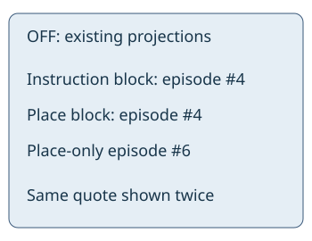
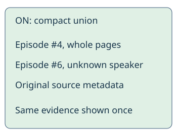

# Unique instruction memory

> Markdown twin of [instruction-memory-dedup-v1.html](../instruction-memory-dedup-v1.html), generated from the HTML by `just explainer-twins`. The HTML is the source; edit it, not this file.

`instruction-memory-dedup-v1` · default OFF · ON in the current bundle recipe; control stays OFF. Gameplay benefit unmeasured.

## One delivered episode, one copy

The instruction-memory and person/place switches can both select the same conversation. This treatment combines their projections by original delivered-result reference. It preserves the whole conversation, including additional errands, uncertain speakers and source locations.

## What stays and what can retire

- Current observations, exact dialogue, source result/dialogue/state references and the full recording remain available.
- Unknown, mixed, future and reusable dialogue is retained. Arrival and age do not prove completion.
- The existing `milestone-instruction-memory-v1` policy still owns retirement: only exact audited episodes with delivered native completion can retire.
- Place-only episodes remain, even when named-story-only instruction selection did not choose them.
- Requires `delivered-place-evidence-v1`, which depends on observed instruction memory. Inactive when the instruction-goal ledger replaces that owner.

The switch selects no task, supplies no route and presses no buttons. No new summarizer, task registry, tool or stopping rule is introduced.

## Recorded example

Frozen Qwen bundle a702, turn 894, context event 44780: the original memory has 60 selected episodes plus 12 repeated spatial episodes, totaling 50,401 characters. Existing native-proof retirement had already removed 21 of 81 archived episodes. The Letter request appears in both blocks. The compact union is 40,201 characters: 10,200 fewer (20.2%), retaining all 60 selected episodes. Character savings are not token savings or measured gameplay gains.

## Context trimming

The older estimated fitter trims conversation history before this memory is appended. Its compaction event therefore does not measure the whole outgoing request. Exact context counting fits the final provider payload. Local fake HTTP tests exercise both paths and verify the complete unique memory and current question in the request after older turns are dropped.

The historical run did not archive its final HTTP body. Source replay and local transport tests establish behavior of the matching pinned path; they cannot manufacture retrospective wire capture. No inference or gameplay runs were launched.

## OFF and evaluation

| OFF | ON |
|---|---|
| Exact existing separate instruction/place projections. | Compact union by original result reference, preserving whole evidence. |
| Existing tools, prompts, execution and default recipe. | Same tools and execution; only the injected memory projection changes. |

Before any gameplay benefit claim: independently evaluate this switch on a frozen Qwen configuration, measure native task completion, costs and false loss of useful evidence. The current recipe enables this treatment only in future bundle arms; control and manual defaults stay OFF. No evaluation is launched by this change.
