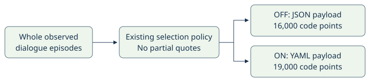

# Instruction memory YAML

> Markdown twin of [instruction-memory-yaml-v1.html](../instruction-memory-yaml-v1.html), generated from the HTML by `just explainer-twins`. The HTML is the source; edit it, not this file.

The selected instruction-memory payload becomes readable YAML. Whole game dialogue, source names, map references and progress stay intact. The current recipe enables `instruction-memory-yaml-v1` in the bundle; control stays OFF. Older presets default OFF, and active runs keep their recorded settings.

**19,000 code points**<br>
YAML delivery bound when the memory cap is ON

**320 / 320 identical**<br>
JSON-OFF comparisons against frozen main, including junk-filter and whole-game settings

**17 round trips**<br>
10 native blocks and 7 edge vectors preserve every field and text

## Format follows selection



Both bounds measure the actual delivered form. The policy is unchanged, but different formatting costs can change which whole episodes fit. The legacy form keeps its existing format and 16,000 bound. Turning the cap OFF retains the existing uncapped behavior.

## The same two whole episodes, both forms

Recorded-data excerpt from `a702`, turn 450, result events 1887, 1973. These are whole episodes selected by the YAML replay. The rest of the payload and explanatory header are omitted from this document example; this is not a complete recorded block.

### JSON layout

```
{"columns":["speaker","speaker_source","text","map","map_id","state_event"],"episodes":[{"result":1887,"dialogue":[1885],"turn":83,"pages":[["Machine","faced_target","It's a serious-looking machine.\nThe PROF must use this for research.","PROF. BIRCH'S POKéMON LAB",[1,4],1879]]},{"result":1973,"dialogue":[1971],"turn":84,"pages":[["PC","faced_target","It's a PC used for research.\nBetter not mess around with it.","PROF. BIRCH'S POKéMON LAB",[1,4],1965]]}]}
```

### YAML layout

```
episodes:
  - turn: 83
    delivered_result: 1887
    dialogue_events: [1885]
    pages:
      - speaker: Machine
        speaker_source: faced_target
        map: PROF. BIRCH'S POKéMON LAB
        map_id: [1, 4]
        state_event: 1879
        text: |-
          It's a serious-looking machine.
          The PROF must use this for research.
  - turn: 84
    delivered_result: 1973
    dialogue_events: [1971]
    pages:
      - speaker: PC
        speaker_source: faced_target
        map: PROF. BIRCH'S POKéMON LAB
        map_id: [1, 4]
        state_event: 1965
        text: |-
          It's a PC used for research.
          Better not mess around with it.
```

Within each episode, speaker, speaker source, map, map id and source-map fields carry over only when omitted on a later page. Every new episode resets them. State references and text are always explicit. A header line tells the model this rule.

## Replay evidence

| Recorded cut | Delivered YAML code points | Whole episodes kept |
|---|---|---|
| a702 T450 | 13,458 | 14 |
| a702 T700 | 18,793 | 15 |
| a702 T1301 | 18,930 | 22 |
| 88ea T400 | 18,874 | 19 |
| 88ea T800 | 18,989 | 25 |

The merged place-evidence form also matches the independent reference at a702 T450, T700 and T1301: 14,460, 18,933 and 18,981 code points. The older YAML snapshots were regenerated because main’s cap policy and wording changed. Every selected result identity and change reason is retained in the review receipts.

The 19,000 allowance comes from the earlier tokenizer study’s approximate equivalent budget. It is a character bound, not a claim of an exact token count or improved gameplay. No new inference or gameplay run was used for this implementation.

## Exact text and explicit omissions

| Value | Representation |
|---|---|
| Ordinary dialogue, including quotes, colons and # | `\|-` literal block with the complete original lines |
| Empty text, leading or trailing whitespace, blank lines, controls, Unicode line separators, lone surrogates and U+FFFE/FFFF | Quoted scalar with explicit escapes where needed |
| Ambiguous names such as YES, numeric-looking strings or syntax characters | Quoted scalar, so the YAML reader preserves a string |
| Empty episode or page collections | `[]`, preserving an empty list rather than null |

Current progress and location entries are kept or left out whole. Their existing omission markers remain visible. For example, this illustrative edge case explicitly reports whole fields left out:

```
current: null
current_left_out: true
observed_locations: []
earlier_locations_left_out: 3
```

## Scope and status

This is a format change behind a registered switch. It adds no dialogue, objective, route or retirement rule. Source archives and other ledgers stay unchanged. PyYAML 6.0.3 independently decoded the native and edge cases back to exact source fields and dialogue. Full gates, review and landing evidence belong to `docs/worklogs/active/2026-10-28_instruction-memory-yaml.md`.
