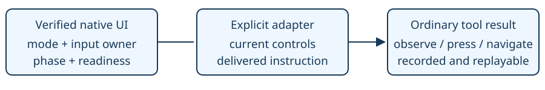

# Interface guidance

> Markdown twin of [interface-guidance-v1.html](../interface-guidance-v1.html), generated from the HTML by `just explainer-twins`. The HTML is the source; edit it, not this file.

`interface-guidance-v1` · default OFF · bundle only · independent of JIT prompting.

## The game owns the controls

In run 0517, turn 1027 delivered the scientist's MATCH CALL instructions. At turn 1101 the model opened the PokéNav; the next 40 calls pressed B. The ordinary readout said B returns. Native tutorial mode deliberately rejects B.



Native mechanics and historical dialogue have separate provenance. Neither selects an action for the model.

## OFF and ON

| OFF: existing bytes | ON: forced-call mode |
|---|---|
| UP/DOWN selects; A accepts; B returns | UP/DOWN selects; A opens MATCH CALL only; B cannot exit during this tutorial |
| No interface instruction reminder | The exact previously delivered instruction page, with speaker attribution, source turn and result event |

After the call, the native controls allow MATCH CALL or SWITCH OFF, and B exits. The call reminder expires when native mode reports the completed call.

## Recorded example and proposed delivery

Actual source: 2026-10-24T08-12-35_qwen36-gpu1_0517, dialogue event 39427, delivered result 39430, turn 1027. The speaker is a sprite attribution, not a proven personal identity.

```
Current interface instruction — speaker SCIENTIST_1 (faced_sprite), turn 1027, result event 39430:
"Test it out.\nPlease give our PRESIDENT a call."
```

The payload above illustrates ON delivery using the actual recorded words. The original run did not have this switch. A producer event alone is insufficient: the words must also occur in a successful delivered tool result. No matching delivered page means no reminder.

## Other interfaces later in the game

Extend two small owners: the native controls adapter in `interface_guidance.py`, and the delivered-dialogue rule in `interface-guidance.ts`. Each extension must qualify the active input owner, phase, mode and readiness; identify exact relevant words previously delivered; and define when they expire. Unknown, diagnostic and transitioning interfaces receive no guessed controls or walkthrough. No global dialogue archive or prompt switch must be enabled.

The first adapter covers the tutorial's forced field menu, PokéNav main menu, MATCH CALL contact list and options, plus the post-call exit phase. Ordinary PokéNav and unrelated menus remain unchanged. No automatic inputs, selected recipient, route or battle policy.

## Game source and validation

pret/pokeemerald revision `731ad5bfd6e6f265508d0efcca0ba42f9dcf5881`, US ROM SHA-1 `f3ae088181bf583e55daf962a92bb46f4f1d07b7`. Owners: `HandleMainMenuInputTutorial`, `HandleMainMenuInputEndTutorial`, `CB2_HandleMatchCallInput`, `CB2_HandleMatchCallOptionsInput`, `ScriptMenu_CreateStartMenuForPokenavTutorial`, `RustboroCity_EventScript_MatchCallTutorial`, `RustboroCity_Text_AddedMatchCallPleaseCallMrStone`.

Tests cover OFF equivalence, native mode/owner qualification, factory delivery with JIT OFF, delivered-only quotations, transition suppression and expiry. Full gates and independent review are recorded in the feature worklog. Gameplay benefit remains unmeasured. Existing measured runs remain on their frozen source.
