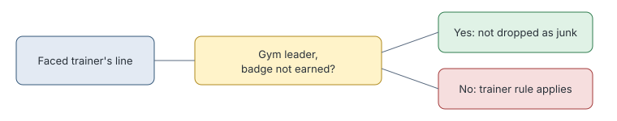

# Junk filter leader lines

> Markdown twin of [junk-filter-leader-lines-v1.html](../junk-filter-leader-lines-v1.html), generated from the HTML by `just explainer-twins`. The HTML is the source; edit it, not this file.

`junk-filter-leader-lines-v1` stops the junk filter dropping a gym leader's lines until that leader's badge is earned. The size cap still applies.

## Why it exists

The junk filter's trainer rule dropped a faced trainer's lines, and gym leaders are trainers. So replaying run ee2a with the filter on dropped WINONA's turn-60 speech, even though the memory cap deliberately keeps leader lines until the badge.

## What decides it

*Once the badge is earned, the trainer rule applies again. Earned badges are latched, because battle states can report none. Tate and Liza's printed intro pages never reached this rule.*

## Off

The trainer rule drops a leader's line like any trainer's.
