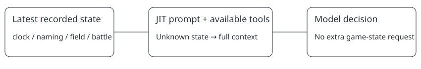

`just-in-time-prompt-v1` · DEFAULT OFF

# The current screen selects the instructions

> Markdown twin of [just-in-time-prompt-v1.html](../just-in-time-prompt-v1.html), generated from the HTML by `just explainer-twins`. The HTML is the source; edit it, not this file.

Before every live model request, the harness reads its latest recorded screen and selects matching prompt sections and tools. It does not make an extra emulator request or choose the next story goal.

## Clock

Clock controls. 
No navigation or battle tool.

## Naming

Keyboard guide. 
No navigation or battle tool.

## Field

Navigation and map rules. 
No battle tool.

## Battle

Battle rules and battle_action. 
No navigation.

**Latest recorded screen** 
↓ selects relevant instructions and tools 
↓ model chooses a game action

Unknown state keeps the full prompt.

*OFF sends the existing full request unchanged. Both arms record the exact prompt and tool hashes with the source state.*

## Unknown state keeps the full request

Ambiguous or unrecognized screens retain the complete prompt and tools. A naming interface takes priority over a lingering battle flag. Tool calls excluded from that request are blocked before execution.

## Every response carries its request receipt

The recording retains the exact selected system prompt, prompt hash, tool-schema hash, tool names, screen class and source state sequence. The existing assistant token and latency fields stay available for analysis. The feature’s OFF path returns the original request unchanged.

## Status

Implemented in the isolated experiment checkout; source tests, review and live evidence are separate gates. No experiment run has launched. The ten-minute comparison tests instructions and tool filtering together; it does not isolate prompt-length effects.
