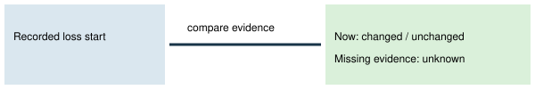

# Last leader loss comparison

> Markdown twin of [leader-loss-comparison-v1.html](../leader-loss-comparison-v1.html), generated from the HTML by `just explainer-twins`. The HTML is the source; edit it, not this file.

## Recorded loss → current party

Separately compares membership, levels, EXP and move IDs. Party snapshots retain their recorded identities; unreadable fields remain unknown. At most four delivered battle pages preserve game words. Opponent HP is last observed, never claimed to be current.

## Switch contract

ON adds the comparison on a gym field or leader battle decision. OFF preserves previous training text byte for byte. No move, route, rematch or training action is chosen or refused.

Fixture: training-fd95.jsonl.gz, leader losses at turns 501 and 538. Source: pret/pokeemerald battle_message.c sText_PkmnGainedEXP; comparison uses recorded game numbers, without predicting outcomes. Damage attribution remains unknown rather than inferred from separate HP polls.

Implementation checks only. No measured runs, promotion or launch.
