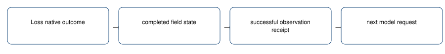

# Immediate leader loss comparison

> Markdown twin of [leader-loss-immediate-v1.html](../leader-loss-immediate-v1.html), generated from the HTML by `just explainer-twins`. The HTML is the source; edit it, not this file.

A verified loss reaches the very next decision, including outside the gym.

`leader-loss-immediate-v1` • default OFF • future applicable bundle ON / control OFF.

## What reaches the model

Loss native outcome → completed field state → successful observation receipt → next model request.

## Recorded example

The native7030 loss was delivered at event1744. The old comparison first appeared at1864, after the model had already chosen to return. The offline transport test now puts the comparison in the first model request after1744.

This is an offline replay of recorded observations, not a new game or evidence of improved play.

## Bounds and unknowns

One completed loss is offered until the next assistant decision; retries keep it available. Missing/stale/failed observations do not qualify. Canonical conversation is unchanged.

Evidence is retained in existing ledger_context rows with exact source event sequences. Nothing chooses a move or a route.

## Source and status

Game reference `731ad5bfd6e6f265508d0efcca0ba42f9dcf5881`: battle_message.c game move and critical-hit text; battle.h B_OUTCOME_LOST=2, B_OUTCOME_WON=1. Native party identity, EXP, moves and HP use the existing reader.

Offline regression and pinned-pi model-input delivery checks. The matching worklog records review and landing status. Gameplay benefit is unmeasured; no GPU queries or new runs are authorized.

OFF preserves existing training/tool/context behavior exactly. Older cook4h/6h/6h-v2 recipes lack the loss comparison dependency and remain unchanged. Frozen campaigns and current workers remain unchanged.
