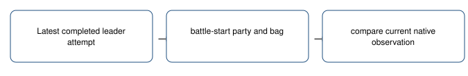

# Preparation since the last attempt

> Markdown twin of [leader-preparation-comparison-v1.html](../leader-preparation-comparison-v1.html), generated from the HTML by `just explainer-twins`. The HTML is the source; edit it, not this file.

Show changes in the facts, leaving the choice to the model.

`leader-preparation-comparison-v1` • default OFF • future applicable bundle ON / control OFF.

## What reaches the model

Latest completed leader attempt → battle-start party and bag → compare current native observation.

## Recorded example

Native7030 first loss: TORCHIC remained Lv15 with2041EXP and the same moves. Its HP was41/41 after the game restored the party. Full HP does not establish a stronger party.

This is an offline replay of recorded observations, not a new game or evidence of improved play.

## Bounds and unknowns

Baseline is the latest completed attempt, including a win, not an older loss. Party identity aligns members even after evolution or reordering. Missing or duplicate identities make comparisons unknown. Levels, EXP, moves, HP and bag quantities are factual; no readiness grade, suggested action or refused rematch. This replaces the older detailed preparation text when enabled.

Evidence is retained in existing ledger_context rows with exact source event sequences. Nothing chooses a move or a route.

## Source and status

Game reference `731ad5bfd6e6f265508d0efcca0ba42f9dcf5881`: battle_message.c game move and critical-hit text; battle.h B_OUTCOME_LOST=2, B_OUTCOME_WON=1. Native party identity, EXP, moves and HP use the existing reader.

Offline regression and pinned-pi model-input delivery checks. The matching worklog records review and landing status. Gameplay benefit is unmeasured; no GPU queries or new runs are authorized.

OFF preserves existing training/tool/context behavior exactly. Older cook4h/6h/6h-v2 recipes lack the loss comparison dependency and remain unchanged. Frozen campaigns and current workers remain unchanged.
