Harness switch · ledge-hops-v1

# Ledges are one-way doors, not walls

> Markdown twin of [ledge-hops-v1.html](../ledge-hops-v1.html), generated from the HTML by `just explainer-twins`. The HTML is the source; edit it, not this file.

Emerald's ledges are marked as collision in the map data, so our map drew them as `#` and `navigate_to` walked around them. With this switch on, the model sees which way each ledge drops, and the planner jumps down it in one press.


Pressing toward a ledge in its arrow direction jumps over it and lands two tiles away. From any other side it blocks like a wall.

Route 101 · **12** south ledges Route 102 · **16** Route 103 · **23** Route 116 · **27**

## The same spot on Route 101

Real live-map tiles from the Route 101 save (`tests/states/torchic.state`), x 5–13, y 11–15. Going from (9,12) to (9,14).

### OFF Ledges drawn as walls

6 presses L L D D R R



### ON Ledges drawn as v

1 press DOWN, lands 2 tiles on



Brick = collision, green = grass, orange band = ledge. The dashed grey path on the right is the detour the hop replaces. Live check on the real ROM: `navigate_to(9,14)` from (9,12) arrived in 1 press.

## Four ledges, four one-way rules


v South ledge

0x3B · hop DOWN


^ North ledge

0x3A · hop UP


&lt; West ledge

0x39 · hop LEFT


&gt; East ledge

0x38 · hop RIGHT

Blue: pressing in the arrow's direction jumps from the dark dot to the faded one. Red ✕: entering from the other sides is blocked (the side the arc covers is blocked too). The ledge tile is never a place you stand.

## When the planner refuses a hop

| Landing tile is… | Hop? | Why |
|---|---|---|
| known, clear, walkable | ✓ yes | cost 2 (two tiles), keeps A\* distance-consistent |
| collision, water or a door | ✕ no | not a walkable landing |
| an NPC or object | ✕ no | conservative; the game would still jump |
| a warp (even as the goal) | ✕ no | warps stay goals reached by walking only |
| outside the 15×15 window | ✕ no | never guesses unseen tiles |
| on a different elevation layer | ✕ no | same rule as ordinary steps |

After a hop press, `navigate_to` expects exactly two tiles of movement. One tile, or anything else, stops the walk as “unexpected movement”.

## What the model reads

### OFF map row 13

```
  13   N   g   .   .   .   .   #   #   #   #   g
```

No legend entry. Only “Metatile behaviors present: 0x3B” hints at it.

### ON map row 13 + legend

```
  13   N   g   .   .   .   .   v   v   v   v   g
```

“v ^ &lt; &gt; ledge: a one-way hop in the arrow's direction (move into it that way to jump over it, landing 2 tiles on); impassable from any other side;”

## Grounded in the game

| Behavior | pokeemerald | Glyph | Hop |
|---|---|---|---|
| `0x38` | `MB_JUMP_EAST` | &gt; | RIGHT |
| `0x39` | `MB_JUMP_WEST` | &lt; | LEFT |
| `0x3A` | `MB_JUMP_NORTH` | ^ | UP |
| `0x3B` | `MB_JUMP_SOUTH` | v | DOWN |

pret/pokeemerald 731ad5b: `CheckForObjectEventCollision` asks `ShouldJumpLedge` whatever the collision bit says; `GetLedgeJumpDirection` matches the tile you move into against your direction; `PlayerJumpLedge` moves two tiles. PokeAgent's Emerald code only defines these values (`pokemon_env/enums.py`); its Pokémon Red environment already draws ledges as arrows. Diagonal jumps (0x3C–0x3F) are out of scope.

## Where the switch goes


Orange boxes change behavior. Older presets that don't name the switch get it OFF, so frozen incumbents still see walls; new viewer drafts get it ON. The recorded `local_map` JSON always keeps the full ledge text.

## Status

- **Tests**: agent 896 · viewer 419 · env 1807 pass; coverage ≥90% and lint clean
- **Live proof**: recorded probe on the real ROM, Route 101: 1 press, 2 tiles
- **Review**: Claude, Grok and GPT all LGTM
- **Not done**: measured runs; no benefit is claimed yet
