Feature switch · observation · `levelup-box-v1` · default OFF

# Level-up stats box

> Markdown twin of [levelup-box-v1.html](../levelup-box-v1.html), generated from the HTML by `just explainer-twins`. The HTML is the source; edit it, not this file.

After "TORCHIC grew to LV. 6!" the game shows a box with the new stats and waits for a button, twice. The readout now names that box and its stats, and battle text auto-advance presses through both pages.

## Why

Bundle run `2026-10-16T04-51-03_qwen36-gpu0_54a7` won a WINGULL fight on Route 103 at turn 357. Auto-advance pressed B on "Wild WINGULL fainted!", "TORCHIC gained 27 EXP. Points!" and "TORCHIC grew to LV. 6!", then stopped: "the battle kept running on its own for 3 waits of 600 emulated frames". The screen showed the level-up stats box. The readout said `Dialog: none`, `input not ready` and `resolving (no input until the game asks)`. The model tried `navigate_to` three times (refused) and B once, which turned the box to page 2 with no change in the readout. Its A at turn 362 closed the box. Five turns were lost.

The box is drawn by `Cmd_drawlvlupbox` in its own window. It is not the battle message window, so the battle message detector (`battle-message-waiting-v1`) and the battle wait cannot see it.

## Before and after, on the recorded RAM

```
OFF (turn 357, state 8618, raw RAM 5093; byte-identical to what the model received)
Battle details: WILD single · turn 6 · resolving (no input until the game asks)
```

```
ON (the same RAM, re-rendered on the real ROM)
Battle details: WILD single · turn 6 · level-up stats box open, page 1 of 2 (stat increases): MAX. HP +2, ATTACK +2, DEFENSE +1, SP. ATK +1, SP. DEF +1, SPEED +1 — waiting for a button: press A or B to continue (the game takes any new button press)
```

```
ON, turn 359 (state 8640, raw RAM 5108), after the model's B
Battle details: WILD single · turn 6 · level-up stats box open, page 2 of 2 (new totals): MAX. HP 21, ATTACK 11, DEFENSE 10, SP. ATK 15, SP. DEF 11, SPEED 10 — waiting for a button: press A or B to continue (the game takes any new button press)
```

*Only the input clause of the Battle details line changes. In bundle-v-control's control arm (no battle-details-v2) the same clause comes as a new `Battle input:` line after `Battle details: unprovided`. When battle-message-waiting-v1 is also on, the box clause takes precedence.*

## The box's state machine



*Only states 6 and 8 wait for input. The readout says nothing new for the drawing and closing states, which pass on their own.*

## Auto-advance through the box



*With both switches on, the game server's battle wait ends on the first emulated frame the box waits (reason `levelup_box`). The agent lists the page and presses B. A page is listed once even if a press does not move it. If the server ends a wait on the box but the agent's switch is off, that wait counts as busy, so the advance cannot loop.*

```
Dialogue shown during this call (5 pages, in order, whole):
1. turn 357 · ROUTE103 (map 0/18) · battle turn 6: "Wild WINGULL
fainted!"
2. turn 357 · ROUTE103 (map 0/18) · battle turn 6: "TORCHIC gained
27 EXP. Points!"
3. turn 357 · ROUTE103 (map 0/18) · battle turn 6: "TORCHIC grew to
LV. 6!"
4. turn 357 · ROUTE103 (map 0/18) · battle turn 6: "Level-up stats box, page 1 of 2 (stat increases): MAX. HP +2, ATTACK +2, DEFENSE +1, SP. ATK +1, SP. DEF +1, SPEED +1"
5. turn 357 · ROUTE103 (map 0/18) · battle turn 6: "Level-up stats box, page 2 of 2 (new totals): MAX. HP 21, ATTACK 11, DEFENSE 10, SP. ATK 15, SP. DEF 11, SPEED 10"
```

## Game grounding

pret/pokeemerald `731ad5bf`, US ROM SHA-1 `f3ae0881`. Findings: `docs/worklogs/active/2026-10-16_levelup-box.md`.

| Fact | Source | Read |
|---|---|---|
| The box runs while the script is on opcode 0x6C | `src/battle_script_commands.c` Cmd_drawlvlupbox; `data/battle_scripts_1.s` BattleScript_LevelUp | `gBattleMainFunc` 0x03005D04 = RunBattleScriptCommands; `gBattlescriptCurrInstr` 0x02024214 → 0x6C |
| States 6 and 8 wait for `gMain.newKeys != 0` | Cmd_drawlvlupbox cases 6 and 8 | `drawlvlupboxState` 0x02024474+0x1E |
| Page 1: per stat `+` (or `-`) and the difference; page 2: the new value | `src/menu_specialized.c` DrawLevelUpWindowPg1, Pg2 | row names from ROM table `sLvlUpStatStrings` 0x08625B54 |
| Stats before the level-up | Cmd_getexp stores `gBattleResources->beforeLvlUp` | 0x020244A8 → +0x10 → u16 HP, ATK, DEF, SPEED, SPATK, SPDEF |
| Stats after | GetMonLevelUpWindowStats on `gPlayerParty[gBattleStruct->expGetterMonId]` | 0x0202449C → +0x10 slot; party 0x020244EC + 100·slot + 0x58…0x62 |

A pointer outside EWRAM, a slot past 5 or a name pointer outside the ROM gives `the stats it shows could not be read (harness bug: level-up box: …)`, never guessed numbers. The box is recorded in the state JSON as `battle.levelup_box` with the switch on or off. Other button waits in the battle script (`Cmd_yesnobox`, the learn-move boxes, `Cmd_trygivecaughtmonnick`) were already detected as battle YES/NO boxes.

## Proof on the recorded run (real ROM)

- Turns 357–361 (states 8618, 8627, 8640, 8648, 8656) re-rendered with the run's own switches: OFF equals the tail of every tool result the model got; ON changes only the Battle details line (page 1 at T357–T358, page 2 at T359–T361).
- `env/tests/env/test_levelup_box.py` holds the RAM windows of states 8609, 8618 and 8640 and checks OFF byte for byte, ON line by line, both arms, the observation route and the battle-wait route.
- `packages/agent/src/levelup-box.test.ts` replays raw RAM 5073–5130 through the production auto-advance: 5 B presses, the pages above, stop `field_free`; OFF stops `battle_busy` after 3, as the run did.

## Wiring


*One switch, three owners: the server readout, the server's battle wait and the agent's battle advance. The last two act only when battle-text-auto-advance-v1 is also on.*

## Status

- Default OFF. Meant to be ON in both arms of bundle-v-control (the bundle file is owned by the readiness thread).
- Not done here: measured runs; a live run that reaches a level-up with the switch on (lane freeze); the Exp. Share banner path (states 1–2) has synthetic tests only.
