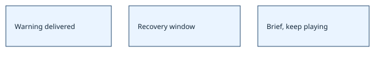

# Loop guards preserve runs

> Markdown twin of [loop-guard-supervisor-v1.html](../loop-guard-supervisor-v1.html), generated from the HTML by `just explainer-twins`. The HTML is the source; edit it, not this file.

`deterministic-loop-guard-v1 · loop-guard-supervisor-v1`

## Current behavior

The deterministic loop switch warns on repeated planning, observations, ineffective actions, cycles and refusals. After its recovery window, one factual nonterminal briefing remains visible until qualified recovery. It never selects an action or ends the run. OFF remains diagnostic: would_warn, would_stop and would_recover are historical diagnostic labels, never model messages. The supervisor switch adds current room, position, dialogue and recent attempts and rebriefs every recovery window. Without it the guard keeps its short bounded note. Menu refusal episodes keep the menu-specific controls and use the short nonterminal note.

Warning → existing recovery window → nonterminal briefing → model chooses.

## Evidence and scope

The recorded shop fixture from run2e93 turns262–287 validates warning, controls, bounded feedback and continued execution. Pinned-pi tests verify actual model delivery. The rule “no switch may kill runs” replaces terminal guard behavior; original records remain historical. Baseline reply-failure limits, explicit budgets and operator controls retain their distinct run policies. No tools or routes are added.
