Harness switch · guard · `low-hp-trainer-warning-v1` · needs nothing · off by default

# Low-HP trainer warning

> Markdown twin of [low-hp-trainer-warning-v1.html](../low-hp-trainer-warning-v1.html), generated from the HTML by `just explainer-twins`. The HTML is the source; edit it, not this file.

A one-time SUPERVISOR paragraph on a game-tool result when the lead Pokémon is below half HP and the Route 103 rival, not yet beaten, is on the map. It fires from the result's own game state, at the moment the model is choosing to walk over. Option B from the May whiteout options page; ships with `trainer-heal-guidance-v1`.

## Why: run 54a7, turn 363 to 371

Round 2 bundle run `2026-10-16T04-51-03_qwen36-gpu0_54a7`. Every field readout from turn 362 to 368 showed TORCHIC at 3/21 HP and the battle-triage line "below half". On turn 363 the model wrote "Torchic has 3/21 HP, which is below half. I need to find May." It talked to MAY at 5:27 AM, fainted on the first Tackle, woke up in BRENDANS HOUSE 2F with ₽1500 of its ₽3000 left, then dropped the rival goal. The Oldale POKéMON CENTER was about 27 tiles away.

## What run 54a7 would have read on turn 363

The navigate_to result that first showed MAY loaded at (10,3) ends with this paragraph (exact text from the test on the recorded state):

```
SUPERVISOR: Your TORCHIC has 3/21 HP (below half), and your rival MAY is on this map at (10,3). Talking to her starts a trainer battle you cannot run from. If your party faints, you black out: you lose half your money (₽1500 of ₽3000) and wake up back at the last POKéMON CENTER you entered, or at home. Heal before you talk to her: the nurse at a POKéMON CENTER heals your whole party, and so does MOM at home.
```

When the bag holds HP-restoring items, it adds them: `Your BAG has POTION ×2; using one on TORCHIC restores HP.` When money is unreadable it leaves the amounts out. 54a7's bag was empty.

## When it fires



*All five must hold on the same state. "Free field" means overworld, not in battle and field controls unlocked: after a won battle MAY's dialogue runs with controls locked before the game sets the defeat flag, so those states stay silent. 54a7's turn 362 state did not fire (MAY not yet loaded); turn 363 did.*

## Once, then re-armed by a lasting change


*One arm shared by observe, press and navigate_to. A wild battle on Route 103 does not re-arm it; healing or leaving the route does.*

## Where you see it

- The model: appended to that tool result, so it is in the recorded `tool_result` text too.
- Activity History: a SUPERVISOR row, "Low-HP trainer warning added to the navigate_to result · TORCHIC 3/21 HP · rival MAY at (10,3) · …", from the `low_hp_trainer_warning` event (tool, species, HP, rival, tile, map, money, bag items, text).
- The timeline: nothing. It is closed to new marks (operator decision 2026-10-16); a test checks the lanes are identical with and without the event.

## Game grounding (pret/pokeemerald)

| Fact | Source | Seen in 54a7 |
|---|---|---|
| Talking to the Route 103 rival runs a trainer battle; RUN is refused in trainer battles | `data/maps/Route103/scripts.inc` `trainerbattle_no_intro TRAINER_MAY_ROUTE_103_*` | T369 readout: `RUN REFUSED — "No! There's no running from a TRAINER battle!"` |
| A blackout halves money, heals the party and warps to the last heal location | `src/overworld.c` `DoWhiteOut`: `SetMoney(…, GetMoney(…) / 2)`, `SetWarpDestinationToLastHealLocation` | ₽3000 → ₽1500, TORCHIC 21/21, BRENDANS HOUSE 2F |
| Entering a POKéMON CENTER sets that heal location; before that it is home | `data/maps/OldaleTown_PokemonCenter_1F/scripts.inc` `setrespawn HEAL_LOCATION_OLDALE_TOWN` | No center entered before T371 |
| Rival battle won | `FLAG_DEFEATED_RIVAL_ROUTE103` (0x82), our `story.rival_battle_won` | `false` through T371 |

## Scope and status

- v1 covers the Route 103 rival only, using state PokeBench already reads. Ordinary trainers (Route 102, 104, Petalburg Woods, the gym) would need their trainer flags tied to their objects; not in this switch.
- Tests on run 54a7's recorded states; removing the wiring from `playGameTools` turns the factory test red. Not yet measured; joins the bundle arm of bundle-v-control by operator decision (2026-10-16).
