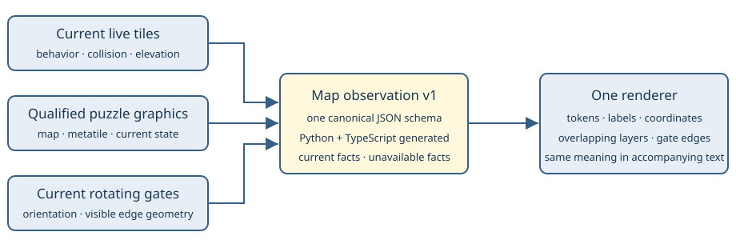

# One current map

> Markdown twin of [map-observability-v1.html](../map-observability-v1.html), generated from the HTML by `just explainer-twins`. The HTML is the source; edit it, not this file.

`map-observability-v1` gives map elements a shared meaning across gyms and special terrain. The map describes the captured game state. The model still chooses its actions.

**Activation:** enabled in control and bundle for fresh runs by the operator’s October 25 instruction. Active runs and frozen queued runs keep their existing versions. The switch’s explicit OFF state restores the previous observation format, including the selected legacy Mauville setting.

## The same floor symbol can hide different mechanics

A button, an arrow, a gate arm, and ordinary floor need different descriptions. Emerald stores some of these differences in live tile graphics; rotating gates have a separate puzzle owner. Reading only collision cannot describe them all.

**Player on a raised blue switch** @/S:up:B

Both the player and the underlying switch remain visible.

**Current flowing north** ./C:^

The kind and direction differ from a walking arrow or a sliding floor.

**Thin ice** ./I:t

Its current condition differs from ordinary ice and cracked ice.

**Teleporter with a warp marker** W/Wp:teleporter

The location marker and the special floor identity are both retained.

These are synthetic examples rendered by the production helper, not screenshots or observations from a gameplay trial. The combined sample below deliberately places several mechanics together to demonstrate the format.

```
Current map (observed elements v1); top-left (0,0), north is up:
                   0     1
   0        @/S:up:B ./C:^
   1 W/Wp:teleporter ./I:t
Element legend: S:up:B = blue switch (raised); C:^ = current north;
                Wp:teleporter = warp (teleporter); I:t = ice (thin)
```

The unified renderer takes precedence over the legacy Mauville-only renderer while enabled. Turn unified map observations OFF to use the selected legacy Mauville setting; turning both OFF restores anonymous Mauville floor/wall symbols.

Tokens have one central owner. Equal element facts produce the same token and label on every supported map. The readout also lists each current element’s coordinates, including elements underneath player, object, and warp markers.

## One schema, one presentation owner



The contract is `schemas/map-observation-v1.json`. It generates the Python `MapElement` type and the TypeScript validation schema. Mechanic providers return facts only. `map_observation.py` owns the token and label vocabulary.

| Field | Meaning |
|---|---|
| `version`, `map_id` | Format version and the current map’s group/number identity. |
| `origin`, `width`, `height` | The supplied view’s world-coordinate window. A local view cannot disclose elements outside that window. |
| `elements` | Typed facts at coordinates: kind, optional state, direction, color, footprint group, orientation, and edge endpoints. |
| `unavailable` | Explicit reasons a mechanic could not be established. Unreadable state is not replaced by a guessed orientation or default layout. |
| `layout` | Optional pointer-verified current layout identity, source-qualified variant, and valid darkness level. This describes state without changing the existing visibility policy. |

<details>
<summary>Example element payload</summary>

This is a source/synthetic fixture for a raised blue button, not a native trial receipt. The same element data produces `S:up:B` and “blue switch (raised).”

```
{
  "version": 1,
  "map_id": [24, 53],
  "origin": [30, 38],
  "width": 1,
  "height": 1,
  "elements": [{
    "kind": "switch", "x": 30, "y": 38,
    "state": "raised", "color": "blue"
  }],
  "unavailable": []
}
```

</details>

## Gate arms are edges, not extra walls

Fortree Gym and Trick House puzzle 6 use rotating gate sprites with their own collision code. The readout reports each current pivot, orientation, and arm edge. A gate arm lies between neighboring tiles, so the renderer draws `|` or `-` at the corresponding boundary rather than marking a whole tile as solid. A `*` between rows or columns marks the gate junction; a `+` inside a tile remains an edge wall.

Gate states are map-qualified and checked against the matching ROM configuration, temporary orientation bytes, and current sprite owner. An initializing or animating gate can be unavailable. The readout does not predict which push will rotate a gate, whether a rotation would succeed, or which sequence solves the room.

The source configuration has eight gates in Fortree and eleven in Trick House puzzle 6. These are reference counts for those two rooms, not evidence that a recorded model has reached them.

## Coverage by factual provider

| Provider | Current facts represented | Places and limits |
|---|---|---|
| Map-qualified puzzle tiles | Button color/raised/pressed state where visible; arrow color/direction; current barrier passage; door lock graphic; generator graphic. | Mauville; New Mauville; Mossdeep; Trick House 2, 3 and 7; Petalburg room doors; supported Abandoned Ship doors. Shared tile numbers are never treated as globally unique. |
| Rotating gate owner | Current pivot, orientation and arm edges, or an explicit unavailable reason. | Fortree Gym and Trick House 6. Source/ROM qualification is separate from native gameplay evidence. |
| Terrain behaviors | Ice/thin/cracked ice; slippery floor; forced walking versus sliding; directional currents; waterfalls; muddy/bumpy slopes; cracked floors; holes; rail axis/isolation; special warps and doors; water types; mats; encounter surfaces; Secret Base entrances and supported scenery. | These shared behaviors occur across Sootopolis, Shoal Cave, Sky Pillar, Mirage Tower, Granite Cave, Mt. Pyre, Seafloor Cavern, ocean routes, bike areas, and Secret Bases. The provider does not execute special movement. |
| Qualified bridge graphics | Fortree wooden bridge raised/lowered; Pacifidlog log axis and floating/partly submerged/submerged graphic. | Exact map, behavior and metatile matches. It does not infer that the player stands on top of a bridge solely from the bridge’s presence. |
| Current field boundary | Closed sandstorm boundary from the existing current field-gate state, in the shared grid, legend, and nearby labels. | Route 111. Open or unknown capability does not become a fabricated barrier; player and object markers remain visible. |
| Current layout context | Saved layout identity checked against the live pointer; current tide/clean-floor variant where qualified; darkness level when valid. | Shoal Cave and clean Sky Pillar variants. The original header layout ID can remain stale after a script swaps the live layout. |
| Generated dimensions | The source-qualified assembled Battle Pyramid floor size, with ordinary map-size validation retained elsewhere. | Only the exact Pyramid map/header/layout/dimension combination gets the 32×32 exception. Trainer Hill’s ordinary dimensions need no exception; its generated event behavior still requires native verification. |

Trick House puzzle 8 is described as slippery floor. It is distinct from a Secret Base spin mat. Scroll and puzzle-door interaction targets already existed; this format uses their existing identities rather than inventing a second interaction system.

## Evidence has separate levels

Game-source reference: clean `pret/pokeemerald 731ad5bfd6e6f265508d0efcca0ba42f9dcf5881`. Matching US ROM SHA-1: `f3ae088181bf583e55daf962a92bb46f4f1d07b7`. The ROM remains external and is never included with this page.

| Area | Established evidence | What it does not prove |
|---|---|---|
| Mauville | Three hash-validated saved native snapshots: states #193989, #194138 and #195466 from Qwen control run `2026-10-24T19-31-52_qwen36-gpu1_d41e`. They show raised→pressed switch and blocked→open→blocked gate states. | A new gameplay trial, or improved model puzzle-solving ability. |
| Current layout reader | The matching ROM’s 441 layout dimensions agree with the pinned source. Saved native frame 4772300 validates current layout 89, its live pointer, and darkness level 0. | Native coverage of a tide change, a clean-floor swap, or a generated Pyramid floor. |
| Fortree / Trick House 6 | Source configurations, matching ROM signatures, and synthetic decoder/geometry checks. | Native gate initialization, rotation and settling across recorded gameplay frames. No matching archived room observations were available in this investigation. |
| Other late-game areas | Source-qualified fixtures and current-state decoder checks. | Complete end-to-end native proof for each room, script phase, and optional event. |

Candidate tests and source fixtures are correctness evidence for those inputs. They are not a benchmark result. Final review, gate, landing, and served-build receipts belong to the matching worklog.

## Unsupported details remain visible as limits

This observation contract does not silently claim every Emerald visual effect is decoded. Separate owners are still needed for Birth Island’s visible triangle palette, Braille inscription display, Faraway Island’s hidden-actor visibility, Abandoned Ship’s transient sparkles, and other transient field effects. Native verification is also outstanding for generated facility events and script-supplied underwater destinations.

Missing native evidence and an unavailable live decoder are different: the evidence table records the former; the observation’s `unavailable` list records the latter when a supported owner cannot establish its state.

<details>
<summary>Scope and consistency checks</summary>

- One schema generates both language contracts; providers do not choose their own glyphs or labels.
- The same kind/state/color/direction produces the same presentation across maps. Overlapping occupants do not erase terrain.
- Local windows, map identity, ROM identity, and current snapshot ownership bound what can be stated.
- Ordinary collision/elevation values, navigation, tool target keys and activation remain separate from these annotations.
- When their existing switches are enabled, terrain entry consequences remain in the common legend and nearby descriptions, and grounded elevation barriers retain the elevation rule. Occupants and directional warp activation keep their existing qualifications. Turning those explanation switches OFF retains neutral element labels.
- No bike execution, boulder pushing automation, route selection, switch-effect prediction, or puzzle solving is added.
- Darkness is reported as context; this feature does not change the existing full-map visibility policy.
- New observations use the enabled contract in both arms. Older recordings do not acquire invented feature metadata.
- Explicit OFF retains the previous readout and serialized state behavior, including whichever legacy Mauville setting was selected.

</details>
