pokebench · audited main @ 8ad9568 · status re-checked @ 71a6da4 · pokeemerald 731ad5b · 2026-10-14

# Map observation audit

> Markdown twin of [map-observation-audit.html](../map-observation-audit.html), generated from the HTML by `just explainer-twins`. The HTML is the source; edit it, not this file.

Is the map we show the model telling the truth? The reader is right. The classifier and the planner are where the lies come from.

**230 / 230**live tiles decoded exactly as the game stores them

**\~250 → 5**tile behaviors folded into terrain glyphs

**746**moves the grid allows that the game refuses (elevation)

**30,549**walkable tiles navigate_to treated as walls; fixed by walkable-floor-v1

## ✓ Status since the audit

Five fixes have landed on main, each behind its own switch. Those cover every gap found on the first-gym route. Seven remain open, all later in the game.

Fixed Ledges drawn as walls`ledge-hops-v1`

Fixed Bedroom chair and other one-way tiles`one-way-tiles-v1`

Fixed Pokémon Center counters`counter-talk-v1`

Fixed navigate_to rejects sand, cave floor, bridges`walkable-floor-v1`

Fixed Planner height rule on stairs and bridges`elevation-transitions-v1`

Open Elevation shown to the model`no switch yet`

Open Currents, seaweed, waterfalls`no switch yet`

Open Ice, slides, bike-only tiles in the text`no switch yet`

Open Cave and sand encounter floors`no switch yet`

Open Invisible objects`no switch yet`

Open Map exits vs borders (?)`no switch yet`

Open Behavior list is raw hex`no switch yet`

## 1 Where the map comes from

*One RAM read feeds two consumers. The red box is where information is lost. navigate_to then re-reads the raw tiles with its own whitelist (dashed), so the model and its own tool can disagree about the same square.*

## 2 The collapse

*Each pill is a distinction the game makes when you try to move. Green dashed lines land on an honest glyph. Red lines land on a glyph that tells the model something false. Blue pills have been fixed since the audit and now get their own glyph. The amber pill (encounter floors) still needs a decision.*

## 3 How much of the game each lie covers

*Tile counts from scanning every layout in pokeemerald (map.bin plus tileset attribute tables) with the exact glyph rule from live_map.py:200-208. Log scale. Elevation and one-way rows count refused moves, found by replaying the game's collision check from every warp and map connection.*

## 4 Turn one: the bedroom chair

vs

*Player's bedroom, Littleroot. Tile (1,4) is a one-way tile (MB_IMPASSABLE_SOUTH_AND_NORTH, 0xC0) with no collision, so the model reads plain `.`. The game refuses every move across its north and south edges, in both directions. It can only be entered and left from the sides. **Fixed:** one-way-tiles-v1 draws it as `+` and lists its walled sides.*

## 5 Pokémon Centers: the nurse behind a wall

vs

*Oldale Pokémon Center. The model sees the nurse `N` behind a `#`. That `#` is a counter (0x80), and facing a counter and pressing A talks to whoever stands behind it (field_control_avatar.c:294-298). Nothing in the legend or the interaction list says so. The same holds in every Center and Mart: 474 counter tiles on 87 maps. **Fixed:** counter-talk-v1 draws counters as `=` and says to talk across them.*

## 6 Elevation: walls that are never drawn

vs

*Route 110 under the Cycling Road. Small numbers are tile elevations. The model reads one open field of dots and is never told its own elevation.*

*The same spot from the side. Walking under the deck keeps you at elevation 3, so stepping onto the elevation-4 deck tiles is refused (IsElevationMismatchAt). Across the game: 746 refused moves on 63 maps. **Still open:** the planner now knows this, but the model's text still shows no elevation.*

## 7 The planner disagrees with the grid

vs

*Route 104 beach. The model reads sand (MB_SAND, 0x21) as clear `.`. navigation.ts:13 only admits behaviors 0, 2, 3 and warp tiles, so every hatched tile is a wall to navigate_to and it answers "no supported local path". Same for all of Dewford, Granite Cave, Rusturf Tunnel and Route 116. **Fixed:** walkable-floor-v1 lets navigate_to walk these tiles.*

*Stairs and ramps. In the game, stepping onto an elevation-0 tile sets your elevation to 0, so the next step can go to any height. The planner keeps the old height, so it refuses the climb (navigation.ts:48-49). It also adopts 15 on bridge tiles, after which it refuses every normal tile; the game keeps your elevation there instead. **Fixed:** elevation-transitions-v1 makes the planner follow the game's rule.*

## 8 Findings and fixes

Line numbers are on main at 8ad9568. The ledge-fix thread owns ledge glyphs and hops, the whole-map thread owns the full-map readout, and the grass-cost thread owns grass costs. The audit itself changed no code; fixed cards are faded and name the switch that fixed them.

High

### Elevation is invisible to the model

Partly fixed

`env/pokebench_env/live_map.py:200-208; readout.py:280`

Tiles are classified from collision and behavior only; the player's elevation goes to JSON (readout.py:280) but never into the text. 746 legal-looking moves are refused by the game (Route 110 under the Cycling Road, Lilycove, Victory Road, Safari Zone, Route 119).

**Status.** elevation-transitions-v1 fixed the planner; the model text still has no elevation.

**Fix.** Print 'Player elevation N'. Draw tiles whose elevation is not 0, 15 or the player's as a distinct glyph (for example h, 'different height; reach it by stairs or a ramp').

Owner at audit time: unowned

Medium

### Water class is incomplete and lumps waterfalls

Open

`env/pokebench_env/live_map.py:206`

'\~' covers 0x10–0x15 only. Currents 0x50–0x53, no-surfacing 0x19, seaweed 0x22/0x2A and water doors 0x6C/0x6D/0x6F are drawn '.' (6,622 tiles). Waterfall 0x13 is drawn '\~' although Surf alone cannot climb it.

**Fix.** Use MetatileBehavior_IsSurfableWaterOrUnderwater's set for '\~'; give waterfalls and currents their own glyphs.

Owner at audit time: unowned

Medium

### Map edges collapse connections and hard borders

Open

`env/pokebench_env/live_map.py:173-180`

Every tile outside the map is '?'. The backup buffer already holds the connected map's tiles in the 7-tile padding; edges without a connection are walls (GetMapBorderIdAt == CONNECTION_INVALID). The model cannot tell a route exit from a cliff.

**Fix.** Render the padding cells from the buffer with a 'next map' marker, or mark each edge as exit / wall from the map's connection list.

Owner at audit time: whole-map thread overlaps (it drops ? on full maps); local grid unowned

Medium

### Encounter floors look like plain floor

Open

`env/pokebench_env/live_map.py:204`

Only 0x02 and 0x03 become g. Cave 0x08, indoor 0x0B, deep sand 0x06, ash grass 0x24 and footprints 0x25 also roll encounters (sTileBitAttributes TILE_FLAG_HAS_ENCOUNTERS).

**Fix.** Decide with the grass-cost thread whether these become g or a separate encounter glyph.

Owner at audit time: grass-cost thread should decide

Low

### Forced-movement and bike-only tiles drawn as clear

Partly fixed

`env/pokebench_env/live_map.py:200-208`

Ice, thin/cracked ice, slides, walk tiles, cracked floor and holes (852 tiles) move the player on their own; muddy/bumpy slopes and rails (99 tiles) need a specific bike.

**Status.** walkable-floor-v1 makes navigate_to refuse them; the map text still draws them as ..

**Fix.** Add glyphs or a per-tile note; exclude them from navigate_to.

Owner at audit time: unowned; later game only

Low

### Invisible objects are dropped but still block

Open

`env/pokebench_env/live_map.py:144; world_context.py:297; world.py:78`

The filter body\[1\] & 0x20 is ObjectEvent.invisible. DoesObjectCollideWithObjectAt ignores visibility, so invisible Kecleon (Routes 119/120, Fortree) and Mossdeep's hidden ninja boys are walls drawn as '.'. previousCoords also collide while an NPC is mid-step.

**Fix.** Keep invisible objects in the grid as a blocker glyph without a sprite name; also mark previousCoords.

Owner at audit time: unowned

Low

### Behavior list is bare hex

Open

`env/pokebench_env/live_map.py:116`

'Metatile behaviors present: 0x00, 0x21 …' gives the model codes it cannot decode.

**Fix.** Print names (MB_SAND) or drop the line.

Owner at audit time: unowned

High

### navigate_to refuses ordinary floor that the text calls clear

Fixed · walkable-floor-v1

`packages/agent/src/navigation.ts:13`

WALKING only admits behaviors 0, 2, 3 and warp tiles. Sand 0x21 (Route 104 beach, all of Dewford), cave floor 0x08 (Granite Cave, Rusturf Tunnel), mountain top 0x0C (Route 116), puddles, shallow water and bridges are treated as walls, so the planner answers 'no supported local path' while the grid shows dots.

**Fix.** Invert the rule: treat collision 0 plus elevation compatibility as walkable, and blacklist only behaviors with real side effects (surfable, ice, slides, holes, bike-only, one-way).

Owner at audit time: unowned; touches navigation.ts, which grass-cost, ledge-fix and whole-map also edit

High

### Planner elevation update is wrong for 0 and 15

Fixed · elevation-transitions-v1

`packages/agent/src/navigation.ts:48-49`

pokeemerald ObjectEventUpdateElevation keeps the old elevation on 15 (multi-level) tiles and sets 0 on transition tiles, after which any height is enterable. The planner instead adopts 15 (then refuses every non-15 tile) and keeps the old height across 0 (so it refuses 3→0→4 stairs, like the Route 104 pier).

**Fix.** Mirror the game: entering 15 keeps node.elevation; entering 0 sets it to 0; IsElevationMismatchAt ignores destination 0 and 15.

Owner at audit time: unowned; same file as above

Medium

### Counters drawn as walls

Fixed · counter-talk-v1

`env/pokebench_env/live_map.py:202; world.py METATILE_TARGETS`

MB_COUNTER 0x80 has collision, so it shows #. The game lets you talk across it (field_control_avatar.c:294-298). In every Pokémon Center the nurse sits behind a # with no hint that A works from the front.

**Fix.** Give counters their own glyph and legend ('counter: face it and press A to talk to whoever is behind'), and add 0x80 to METATILE_TARGETS.

Owner at audit time: unowned

Medium

### One-way walls drawn as clear

Fixed · one-way-tiles-v1

`env/pokebench_env/live_map.py:200-208`

MB_IMPASSABLE\_\* (0x30–0x37, 0xC0, 0xC1) are collision 0, so they render '.', but GetCollisionAtCoords blocks entry or exit on the marked sides. First seen on turn one: the chair in the player's bedroom (0xC0) blocks north and south.

**Fix.** Render with edge marks or list them ('(1,4): cannot enter/leave north or south').

Owner at audit time: unowned

## 9 Checked and correct

**Decode.** Metatile id, collision, elevation bits, the 512 primary/secondary split and behavior = attr & 0xFF all match fieldmap.h. Three live snapshots matched pokeemerald's map data on all 230 tiles.

**Warps.** Event offsets, the warp struct and the activation hints match field_control_avatar.c. Gap: each warp's own elevation is not shown.

**Objects.** ObjectEvent offsets are right. Only the exclusions are wrong (invisible objects still block).

**Grass.** 0x02 and 0x03 are the right tall and long grass behaviors.

## 10 Status

Read-only audit; status re-checked against main @ 71a6da4. Not done: no live probe on Route 110 or inside a Pokémon Center (static map data only there), and no review pass on the findings.
