# MART STOCK READOUT

> Markdown twin of [mart-stock-readout-v1.html](../mart-stock-readout-v1.html), generated from the HTML by `just explainer-twins`. The HTML is the source; edit it, not this file.

`mart-stock-readout-v1` · server readout switch · on in both arms of current (the operator 2026-11-01); registered default off · Rustboro gym strategy report, proposal 4 (2026-10-21)

None of the 11 runs that reached ROXANNE between Oct 19 and 21 had bought anything first, though they arrived holding ¥4,286–6,960. Run `2026-10-21T06-28-18_qwen36-gpu0_1331` did open the RUSTBORO CITY MART buy list (turns 680–690). The readout named only the first row, gave no price and no description, and lost track of the cursor as soon as it moved. The game itself shows one description at a time, for the highlighted row only.

While a normal shop's buy screen is up, this switch adds a block after the Interface lines: every row of the clerk's list with the price the list prints and the game's own item description, the CANCEL row, the highlighted row, and the player's money. Nothing ranks or recommends an item.

## What the game shows

MONEY 
¥3412

POKé BALL¥200

POTION¥300

SUPER POTION¥700

ANTIDOTE¥100

PARLYZ HEAL¥200

ESCAPE ROPE¥550

REPEL¥350

X SPEED¥350

Restores the HP of a POKéMON by 50 points.

*The RUSTBORO CITY MART buy screen at raw RAM 9913 of run 1331, laid out from the recorded state: eight of eleven rows fit, and only the highlighted row's description is on screen. The readout block below gives the model all eleven rows and every description at once.*

## Off and on, same moment (1331, SUPER POTION highlighted)

OFF · TODAY'S READOUT

Screen: shop_menu Dialog: none Unverified menu buffer: cursor 1 of 3; active menu owner unavailable Interface: shop_menu; input unavailable; Menu observation unavailable; STATE COVERAGE ERROR: invalid shop item list/index Menu state: selected index (zero based): 2 Bag: POKé BALL ×2; GREAT BALL ×1

ON · BLOCK ADDED

… Interface and Menu state lines as on the left … Buy list (the clerk's menu: each price as the list shows it and the game's own item description): 1 POKé BALL ¥200 — "A tool used for catching wild POKéMON." 2 POTION ¥300 — "Restores the HP of a POKéMON by 20 points." 3 SUPER POTION ¥700 — "Restores the HP of a POKéMON by 50 points." 4 ANTIDOTE ¥100 — "Heals a poisoned POKéMON." 5 PARLYZ HEAL ¥200 — "Heals a paralyzed POKéMON." 6 ESCAPE ROPE ¥550 — "Use to escape instantly from a cave or a dungeon." 7 REPEL ¥350 — "Repels weak wild POKéMON for 100 steps." 8 X SPEED ¥350 — "Raises the stat SPEED during one battle." 9 X ATTACK ¥500 — "Raises the stat ATTACK during one battle." 10 X DEFEND ¥550 — "Raises the stat DEFENSE during one battle." 11 CANCEL — "Quit shopping." Highlighted: 3 SUPER POTION Your money: ¥3412 Bag: POKé BALL ×2; GREAT BALL ×1

Exact text from the production reader on fixture `mart-stock-buy-list-row2` (raw RAM 9913). The Interface line's coverage error on the left is an existing bug that this switch does not touch; see "Not covered" below.

## When the block appears

*Green boxes show the block. Fixtures from run 1331: action menu (raw 9897), buy list rows 0 and 2 (9904, 9913), quantity box (9919), after the purchase (9930). The CANCEL row and the decoration shop are tested by patching one byte of the recorded RAM.*

## Where each field comes from

*pret/pokeemerald 731ad5bf `src/shop.c`: `BuyMenuSetListEntry` gives each row the item id; `BuyMenuPrintPriceInList` prints `GetItemPrice(item) >> IsPokeNewsActive(POKENEWS_SLATEPORT)` as "¥{STR_VAR_1}"; `BuyMenuPrintItemDescriptionAndShowItemIcon` prints `GetItemDescription(item)`, or `gText_QuitShopping` "Quit shopping." for CANCEL (`gText_Cancel2`). The description's line breaks become spaces.*

## The one price exception

The list halves every price only during the Slateport PokeNews sale, and only while the player is on SLATEPORT CITY talking to the Energy Guru (`src/tv.c` `ShouldApplyPokeNewsEffect`: map 0/1, `gSpecialVar_LastTalked` 25 at 0x020375F2, a Slateport news entry in state ACTIVE at SaveBlock1 +0x2B50). The reader applies the same rule, so the block always shows the price the list prints. Tests cover the sale, a different clerk, upcoming news and no news.

## Failures are visible

A bad item list pointer, an item count outside 1–100, an unknown item, a description outside the ROM or without a terminator, or a highlighted row whose id disagrees with the stock produces `HARNESS BUG (mart stock): …` in place of the block, never a guessed list. With the switch off nothing is read and the line never appears.

## Wiring

*Default off everywhere; on only in the bundle arm of bundle-cook-1h, bundle-v-control, whole-map-cook-1h and whole-map-pair-2h. The state JSON is unchanged either way: the list is text only.*

## Not covered

- The Interface line's shop errors (a wrong item id on row 0, "invalid shop item list/index" on rows 1+, "Shop has no unique verified input owner" after a purchase) come from the existing menu reader. Fixing them changes what the model sees, so it needs its own switch; it is a proposed follow-up.
- Decoration shops, the SELL screen and the bag's IN BAG count are not shown.

## Status

Tests: 38 pytest cases on five recorded states from run 1331 (exact block text, off byte parity, state JSON parity, failure lines, the sale rule), registry tests in the agent. Nine guards deleted one at a time each turned the tests red. Pending experiment `experiments/mart-stock-readout-v1.json`, not queued. No measured runs yet.
