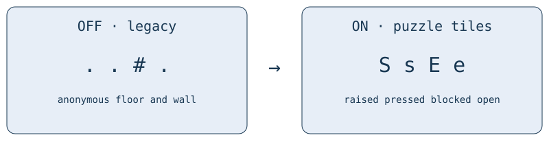

# Mauville puzzle tiles

> Markdown twin of [mauville-puzzle-readout-v1.html](../mauville-puzzle-readout-v1.html), generated from the HTML by `just explainer-twins`. The HTML is the source; edit it, not this file.

`mauville-puzzle-readout-v1` · correctness readout · enabled in control and bundle by Operator’s October 25 instruction.

## Which renderer is active?

This page describes the legacy Mauville-only format. When `map-observability-v1` is enabled, the [shared current-map renderer](map-observability-v1.md) takes precedence and provides the Mauville facts through the unified schema and tokens. Turning unified map observations OFF restores the selected legacy behavior: this Mauville switch ON gives the S/s and E/e format below; both switches OFF give the earlier anonymous floor/wall format.

## The moving walls are live. Now they have names.

Emerald changes its collision map when a floor switch is pressed. The harness already reads those changes. This fix distinguishes floor switches and electric doors from ordinary floor and permanent walls.



Illustrative symbol comparison. Scroll the diagram horizontally on a small screen. Navigation continues to use the same collision/elevation values; the displayed symbols do not create a route.

## What the model receives

| Symbol | Live observation |
|---|---|
| S / s | Raised / pressed floor switch |
| E / e | Blocked / open electric-door footprint |
| @ / N / W | Player, object and warp keep priority. Coordinate lists still identify the tile underneath. |

The readout includes “Floor switches now” and “Electric door tiles now” with coordinates, every observation. Existing switch interactions receive names such as `floor switch (pressed)`; their target keys stay the same.

```
navigate_to_target target {"kind":"interaction","interaction_kind":"coordinate_trigger","x":4,"y":12}
```

There is no recommended switch, predicted effect, route, or puzzle solution. Each readout describes its own captured state. No observation history is required.

## Native evidence

Recorded Qwen control run `2026-10-24T19-31-52_qwen36-gpu1_d41e`, US Emerald SHA-1 `f3ae088181bf583e55daf962a92bb46f4f1d07b7`.

| Recorded state | Switch tile (4,12) | Door tile (4,7) |
|---|---|---|
| #193989 · entry | 0x205 · raised | 0x228 · blocked |
| #194138 · after stepping on (4,12) | 0x206 · pressed | 0x238 · open |
| #195466 · later, switch (3,9) pressed | 0x205 · raised | 0x228 · blocked |

These are saved native observations, not a new gameplay trial. Source: clean pret/pokeemerald revision `731ad5bfd6e6f265508d0efcca0ba42f9dcf5881`, `metatile_labels.h`, `MauvilleCity_Gym/scripts.inc`, and `MauvilleGymPressSwitch` / `MauvilleGymSetDefaultBarriers` in `field_specials.c`.

## Scope and reproducibility

Only Mauville Gym’s matching live tiles are annotated. A local map shows only its local window; a configured full map shows its current map. Other maps, battle screens, disabled maps and absent geometry gain no puzzle readout. Horizontal door graphics above the walking footprint and fixed poles remain ordinary terrain.

With unified map observations OFF, this legacy switch’s explicit OFF restores the earlier map and interaction text. With unified map observations ON, their renderer continues to expose current Mauville elements regardless of this legacy setting. The current recipe uses `onInBoth`, so this fix is shared by both comparison arms. Older frozen recordings and running sessions keep their recorded harness. This change does not restart or hot-patch them.

Validation covers production readouts, explicit OFF, local/full maps, raw-memory replay, map identity and arm materialization. Independent review and landing receipts are recorded in the matching worklog. No measured improvement claim is made.
