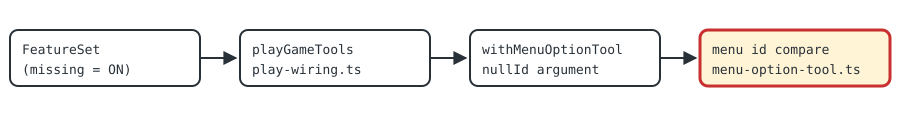

# START menu selection (menu-option-null-id-v1)

> Markdown twin of [menu-option-null-id-v1.html](../menu-option-null-id-v1.html), generated from the HTML by `just explainer-twins`. The HTML is the source; edit it, not this file.

A correctness fix, ON by default. `select_menu_option` could never pick anything on the START menu. The START menu has no menu id, the prompt tells the model to copy `null`, and the agent library turned that `null` into `0` before the tool ran. The tool then compared `0` with the menu's `null` and refused.

**32** START-menu calls refused in run 67d7 (Opus, Rayquaza boot)

**0** START-menu calls that worked in that run

**0** prompt or tool-list changes

## Where the null turned into 0


*The path of one START-menu call in run 67d7. The red box is where the value changed. The model did what the prompt said; the conversion happens inside the agent library before the tool sees the arguments, so the model only ever saw "the requested menu is not currently ready and verified."*

## Off and on, side by side

### Off (previous behavior)

```
START menu open, highlight on POKEMON
call: menu_id null, option "BAG"
after validation: menu_id 0
compare: null === 0 ? no
result: nothing pressed; the requested
menu is not currently ready and verified.
```

### On (default)

```
START menu open, highlight on POKEMON
call: menu_id null, option "BAG"
after validation: menu_id 0
compare: view has no id, asked 0 → match
result: pressed DOWN, A; confirmation
sent for BAG.
```

## The matching rule

| Menu's own id | menu_id the tool receives | Off | On |
|---|---|---|---|
| none (START menu) | null | match | match |
| none (START menu) | 0 (null after validation) | refused | match |
| none (START menu) | 5 | refused | refused |
| 86 (field multichoice) | 86 | match | match |
| 86 (field multichoice) | 0 | refused | refused |
| 0 (field multichoice) | 0 | match | match |

Only a menu with no id gets the extra match, and only for 0. Field multichoice menus always carry a real id, so they still need the exact one. Putting `Null` first in the schema would not fix it: the conversion would then turn a real 0 into null and break multichoice menu 0 instead.

## Recorded example

Run `2026-11-10T15-37-43_opus-rayquaza-boot_67d7`, state seq 184768 (turn 4013), Phoebe's room in the Pokémon League. The tests build this state in memory.

```
active_ui:
  phase: start_menu
  selected: POKEMON
  ready: true
  details:
    callback2: 0x08085E5D
    selected_index: 1
    options: [POKEDEX, POKEMON, BAG, POKENAV, PLAYER, SAVE, OPTIONS, EXIT]
    (no menu_id key)
```

## Wiring



*Presets that omit the switch get it ON. The legacy flag presets set it OFF, as they do for every new switch. Only the red box changes behavior.*

## Status

- Tests: `packages/agent/src/menu-option-null-id.test.ts`, all in memory, including one that runs pi-ai's own `validateToolArguments` and the production `playGameTools` path.
- Not measured with runs. This is a correctness fix; the first run that opens the START menu will show it.
