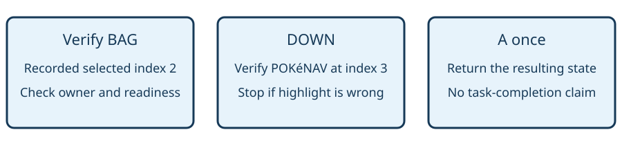

# Select a menu option

> Markdown twin of [menu-option-tool-v1.html](../menu-option-tool-v1.html), generated from the HTML by `just explainer-twins`. The HTML is the source; edit it, not this file.

menu-option-tool-v1

## The model chooses; the tool operates the cursor

**Default OFF. Bundle ON only.** This switch adds `select_menu_option` independently of instruction-goal-ledger-v1. OFF uses the previous tools and prompt. It selects only an option listed in a currently ready, verified vertical START or field multichoice menu. It never opens an unseen menu or chooses a subsequent option.

## Recorded BAG → POKéNAV example



Run `2026-10-24T08-12-35_qwen36-gpu1_0517`, state seq 39512, shows BAG highlighted. The recorded run also demonstrates that DOWN reaches POKéNAV. Tests use those observations; the scripted state after A is explicitly a fixture, not historical evidence that this run opened PokéNav.

```
{"phase":"field_multichoice","menu_id":86,"option":"POKéNAV"}
```

## What the tool checks

1. Read a fresh observation. Require a supported phase, input readiness, coherent options and cursor, and the requested menu ID.
2. Require exactly one visible option matching the requested label. Absent, duplicate and blank requested labels are rejected.
3. Before every press, check the same menu identity and planned cursor through the ordinary checked-input owner.
4. Move one row with UP or DOWN toward the requested option. Verify the expected adjacent index. No wrap shortcut is assumed.
5. When highlighted, press A exactly once and return. A sent confirmation is recorded separately from successful task completion.

The result lists supported visible choices and the tool arguments when the menu is ready. For a normal START menu, pass `menu_id:null`. Unsupported bag-item lists, grids, party layouts, animations and unreadable states remain with the ordinary press tool.

## Fail closed on a changed menu

Changed owner, changed options, lost readiness, a stale cursor or unexpected movement stops the call before confirmation. The tool returns a fresh observation. Pause and abort checks use the existing run-control boundary. It sends no memory writes, save loads or direct menu-selection mutation.

Inputs remain ordinary button_press/native_input records. The tool result records `menu_selection` with the requested option, actual buttons and `confirmation_sent`. The recorded text repeats this receipt so historical raw inspection retains it.

## Game source and status

Reference `pret/pokeemerald 731ad5bfd6e6f265508d0efcca0ba42f9dcf5881`: `src/start_menu.c:HandleStartMenuInput`; `src/script_menu.c:Task_HandleMultichoiceInput` and `CreateStartMenuForPokenavTutorial`; `data/maps/RustboroCity/scripts.inc:RustboroCity_EventScript_MatchCallTutorial`. Those owners accept vertical cursor input. The tutorial routes cancellation and every non-PokéNav choice back to its request.

Offline executor and production model-delivery tests use recorded state. No active run was modified. No gameplay improvement is claimed; gates, review, landing and served proof remain distinct worklog entries.
