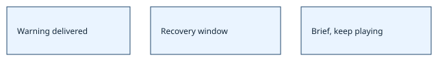

# Shop refusals preserve runs

> Markdown twin of [menu-refusal-recovery-v1.html](../menu-refusal-recovery-v1.html), generated from the HTML by `just explainer-twins`. The HTML is the source; edit it, not this file.

`menu-refusal-recovery-v1`

## Current behavior

Two no-button battle_action refusals in a verified ready shop menu warn with the selected option and the observed controls: B quits this menu. Six further calls without qualified interface recovery produce one nonterminal note, including when the generic supervisor is enabled. The note remains visible and does not send any buttons. An actual menu selection change or return to free field control retires it. Unknown observations do not establish recovery. OFF preserves previous shop-refusal detection behavior.

Warning → existing recovery window → nonterminal briefing → model chooses.

## Evidence and scope

The recorded shop fixture from run2e93 turns262–287 validates warning, controls, bounded feedback and continued execution. Pinned-pi tests verify actual model delivery. The rule “no switch may kill runs” replaces terminal guard behavior; original records remain historical. Baseline reply-failure limits, explicit budgets and operator controls retain their distinct run policies. No tools or routes are added.
