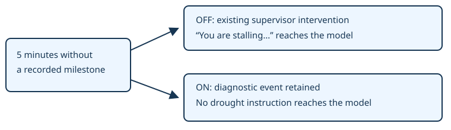

# Let the cutscene continue

> Markdown twin of [milestone-drought-suppression-v1.html](../milestone-drought-suppression-v1.html), generated from the HTML by `just explainer-twins`. The HTML is the source; edit it, not this file.

`milestone-drought-suppression-v1` · Default OFF · Bundle ON by operator request, October 22, 2026.

## A clock cannot prove a stall

In GLM run 557c, turn 313, the Devon researcher cutscene had just begun. The game showed “Hmmm… Not a one to be found…” and waited for A or B. At seq 24543 the supervisor said the game was not moving forward and demanded a new plan. GLM pressed B anyway; the script advanced into the Aqua battle.

Game source: pokeemerald 731ad5bf, PetalburgWoods_EventScript_DevonResearcherIntro. The researcher is looking for SHROOMISH. This change recognizes no particular character or cutscene: it removes milestone-drought interventions everywhere.

## Same timer, different delivery

The diagram shows the first timer threshold. Later thresholds remain diagnostic too. The clock retains the existing milestone and pause accounting.

## Independent of positive supervisor

This switch suppresses only milestone-drought interventions. It does not rewrite other supervisor messages or turn on positive-supervisor-v1. Map-cycle, interface-dwell, repeated-action and text-only supervisors retain their existing behavior. It does not blanket-suppress every guard during dialogue.

When positive-supervisor-v1 is also ON, its existing diagnostic wording takes precedence. OFF preserves the previous behavior under all the other switches.

## Evidence stays visible

The existing loop_guard event records kind milestone_drought, mode diagnostic, phase would_warn, and source sequence references. Activity History and the raw inspector retain it. No new timeline mark is added. The switch is declared in run metadata and is default OFF in omitted presets and the next-run draft.

## Validation boundary

Recorded cutscene replay through the production stall factory checks OFF delivery, ON suppression and diagnostic attribution. Additional checks preserve map-cycle and interface-dwell behavior, and the combination with positive supervisor. A pending experiment compares the bundle with this switch OFF against the same bundle with it ON.

This is a correctness change, not evidence of better gameplay. No measured run has been launched by this change. Current runs keep their frozen settings.
