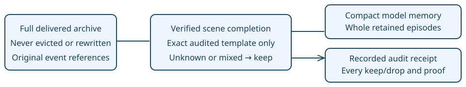

# Milestone instruction memory

> Markdown twin of [milestone-instruction-memory-v1.html](../milestone-instruction-memory-v1.html), generated from the HTML by `just explainer-twins`. The HTML is the source; edit it, not this file.

Keep the evidence. Stop repeating completed scenes. Switch: `milestone-instruction-memory-v1`. Default and control OFF; bundle treatment ON at the operator’s request. This page shows actual offline replay, not measured gameplay benefit.

## What the switch changes



The current chapter retains all its selected dialogue. Older episodes retire only when their complete text, map and attribution match an audited template and the relevant native completion is proven. No turn-age limit, fuzzy matching, extracted goal, route or chosen action. Repeated dialogue reactivates the original archive entry in the current chapter.

## What stays

Norman’s mixed conversation keeps the Roxanne instruction, later badges and eventual Norman battle together. Running controls, healing information, Pokédex information, Wally’s future destination and the uncertain desk instruction stay. Unrecognized variants stay, including all text before a reliable chapter/proof exists.

The first implementation is more conservative than the manual proposal: ea04 keeps two old nurse greetings because they explain a reusable service. It retains 27 episodes, not the proposed 25. The exact differences and every quote are below.

## What a milestone means

Only completed scenes advance chapters: clock set, rival introduction, Birch handoff, rival post-battle scene, Pokédex receipt, running shoes, Wally tutorial, Woods rescue, gym completion and its confirmed rewards. A town visit, gym arrival, unrelated trainer victory or evolution does not close a chapter. A lost battle cannot complete a gym instruction.

The implementation reuses PokeBench’s native milestone predicates on coherent, successfully delivered observation states. Failed or unmatched deliveries cannot retire evidence. Predicates and exact retirement text are grounded in pret/pokeemerald revision `731ad5bfd6e6f265508d0efcca0ba42f9dcf5881`. Unknown native state is not completion.

## Six frozen trace prefixes

Original source-prefix SHA-256 and byte count verified. Candidate and legacy archives are exactly equal. Every retained page keeps its text, order, attribution, map, map ID and state reference. Character counts include the model-facing memory header, compact payload and current delivered progress; they exclude the rest of the prompt.

| Run | Cutoff | Kept/all | Before | After | Reduction |
|---|---|---|---|---|---|
| ea04 | #22522 | 27/51 | 61,666 | 17,532 | 71.6% |
| d548 | #23110 | 6/14 | 32,360 | 10,004 | 69.1% |
| 1331 | #26032 | 5/13 | 32,254 | 9,640 | 70.1% |
| fd95 | #25304 | 6/14 | 32,811 | 10,194 | 68.9% |
| 8892 | #25455 | 6/14 | 31,783 | 9,971 | 68.6% |
| acfa | #10969 | 3/12 | 21,809 | 5,157 | 76.4% |

## Actual format and delivery

The memory has one explanatory line followed by compact JSON. Each episode has its first source result, dialogue events, original turn and whole page list. The `columns` array names each page value: `speaker, speaker_source, text, map, map_id, state_event`. Turns remain provenance; they never drive expiry. Current location/story is copied only from the delivered result.

A separate `ledger_context.retention` receipt records chapter/proof state and result references, every retained/retired result, reason and matching rule. The archived quotes are not injected in that receipt. Activity History and raw-event inspection preserve the receipt; no timeline marks were added.

With field-dialogue memory enabled, the duplicate conversation/room ledger is omitted. With story-only selection, the latest conversation still appears, but the old room-history list does not. The full original event log and in-memory archive remain intact in both cases.

## Verify offline

```
pnpm --filter @pokebench/agent build
node scripts/audit-milestone-memory.mjs ~/dev/pokebench/runs
```

This reads only the original recording prefixes and writes derived receipts under the worktree’s ignored runs directory. It does not call a model, start an emulator, approve an experiment or change a live run. New treatment is registered as pending; cohort design and operator launch remain separate.

## Inspect the retained and archived evidence

<details>
<summary>ea04: every keep and drop (51 episodes)</summary>

2026-10-21T13-33-54_qwen36-gpu0_ea04 · cutoff #22522. SHA-256 of the original 252,490,266-byte prefix:

```
460d50ff29de674f3c8447301d77b9ff6ec957539ccf5bc467d60314a302bbba
```

### Keep in model input

<details>
<summary>Result #1053 · unknown</summary>

Original dialogue events \[1051\]

MOM (name_prefix) · LITTLEROOT TOWN BRENDANS HOUSE 2F · state #1020

```
MOM: RBD, how do you like your
new room?
```

MOM (name_prefix) · LITTLEROOT TOWN BRENDANS HOUSE 2F · state #1027

```
Good! Everything's put away neatly!
```

MOM (name_prefix) · LITTLEROOT TOWN BRENDANS HOUSE 2F · state #1033

```
They finished moving everything in
downstairs, too.
```

MOM (name_prefix) · LITTLEROOT TOWN BRENDANS HOUSE 2F · state #1039

```
POKéMON movers are so convenient!
```

MOM (name_prefix) · LITTLEROOT TOWN BRENDANS HOUSE 2F · state #1045

```
Oh, you should make sure that
everything's all there on your desk.
```

</details>

<details>
<summary>Result #4372 · unknown</summary>

Original dialogue events \[4369\]

YOUNGSTER (faced_sprite) · ROUTE101 · state #4357

```
If POKéMON get tired, take them to
a POKéMON CENTER.
```

YOUNGSTER (faced_sprite) · ROUTE101 · state #4363

```
There's a POKéMON CENTER in OLDALE
TOWN right close by.
```

</details>

<details>
<summary>Result #5006 · unknown</summary>

Original dialogue events \[5003\]

None (None) · OLDALE TOWN POKEMON CENTER 1F · state #4990

```
Hello, and welcome to
the POKéMON CENTER.
```

None (None) · OLDALE TOWN POKEMON CENTER 1F · state #4996

```
We restore your tired POKéMON
to full health.
```

None (None) · OLDALE TOWN POKEMON CENTER 1F · state #5002

```
Would you like to rest your POKéMON?
```

</details>

<details>
<summary>Result #7825 · unknown</summary>

Original dialogue events \[7823\]

MOM (name_prefix) · LITTLEROOT TOWN BRENDANS HOUSE 1F · state #7805

```
MOM: How are you doing, RBD?
You look a little tired.
```

MOM (name_prefix) · LITTLEROOT TOWN BRENDANS HOUSE 1F · state #7811

```
I think you should rest a bit.
```

MOM (name_prefix) · LITTLEROOT TOWN BRENDANS HOUSE 1F · state #7817

```
MOM: Take care, honey!
```

</details>

<details>
<summary>Result #8083 · unknown</summary>

Original dialogue events \[8079\]

PROF. BIRCH (name_prefix) · LITTLEROOT TOWN PROFESSOR BIRCHS LAB · state #7972

```
PROF. BIRCH: Oh, hi, RBD!
```

PROF. BIRCH (name_prefix) · LITTLEROOT TOWN PROFESSOR BIRCHS LAB · state #7978

```
I heard you beat MAY on
your first try. That's excellent!
```

PROF. BIRCH (name_prefix) · LITTLEROOT TOWN PROFESSOR BIRCHS LAB · state #7984

```
MAY's been helping with my research
for a long time.
```

PROF. BIRCH (name_prefix) · LITTLEROOT TOWN PROFESSOR BIRCHS LAB · state #7990

```
MAY has an extensive history as
a TRAINER already.
```

PROF. BIRCH (name_prefix) · LITTLEROOT TOWN PROFESSOR BIRCHS LAB · state #8001

```
Here, RBD, I ordered this for my
research, but I think you should have
this POKéDEX.
```

PROF. BIRCH (name_prefix) · LITTLEROOT TOWN PROFESSOR BIRCHS LAB · state #8013

```
PROF. BIRCH: The POKéDEX is a high-tech
tool that automatically makes a record
of any POKéMON you meet or catch.
```

PROF. BIRCH (name_prefix) · LITTLEROOT TOWN PROFESSOR BIRCHS LAB · state #8019

```
My kid, MAY, goes everywhere
with it.
```

PROF. BIRCH (name_prefix) · LITTLEROOT TOWN PROFESSOR BIRCHS LAB · state #8035

```
Whenever my kid catches a rare POKéMON
and records its data in the POKéDEX,
why, MAY looks for me while I'm out
doing fieldwork, and shows me.
```

MAY (name_prefix) · LITTLEROOT TOWN PROFESSOR BIRCHS LAB · state #8041

```
MAY: Oh, wow, RBD!
You got a POKéDEX, too!
```

MAY (name_prefix) · LITTLEROOT TOWN PROFESSOR BIRCHS LAB · state #8047

```
That's great! Just like me!
I've got something for you, too!
```

None (None) · LITTLEROOT TOWN PROFESSOR BIRCHS LAB · state #8054

```
RBD put away the POKé BALLS
in the POKé BALLS POCKET.
```

MAY (name_prefix) · LITTLEROOT TOWN PROFESSOR BIRCHS LAB · state #8060

```
MAY: It's fun if you can get a lot of
POKéMON!
```

MAY (name_prefix) · LITTLEROOT TOWN PROFESSOR BIRCHS LAB · state #8066

```
I'm going to look all over the place
because I want different POKéMON.
```

MAY (name_prefix) · LITTLEROOT TOWN PROFESSOR BIRCHS LAB · state #8072

```
If I find any cute POKéMON, I'll catch
them with POKé BALLS!
```

</details>

<details>
<summary>Result #8401 · unknown</summary>

Original dialogue events \[8399\]

MOM (name_prefix) · LITTLEROOT TOWN · state #8319

```
MOM: RBD! RBD! Did you
introduce yourself to PROF. BIRCH?
```

MOM (name_prefix) · LITTLEROOT TOWN · state #8325

```
Oh! What an adorable POKéMON!
You got it from PROF. BIRCH. How nice!
```

MOM (name_prefix) · LITTLEROOT TOWN · state #8331

```
You're your father's child, all right.
You look good together with POKéMON!
```

MOM (name_prefix) · LITTLEROOT TOWN · state #8337

```
Here, honey! If you're going out on an
adventure, wear these RUNNING SHOES.
```

MOM (name_prefix) · LITTLEROOT TOWN · state #8343

```
They'll put a zip in your step!
```

None (None) · LITTLEROOT TOWN · state #8349

```
RBD switched shoes with the
RUNNING SHOES.
```

MOM (name_prefix) · LITTLEROOT TOWN · state #8350

```
MOM: RBD, those shoes came with
instructions.
```

MOM (name_prefix) · LITTLEROOT TOWN · state #8358

```
“Press the B Button while wearing these
RUNNING SHOES to run extra-fast!
```

MOM (name_prefix) · LITTLEROOT TOWN · state #8364

```
“Slip on these RUNNING SHOES and race
in the great outdoors!”
```

MOM (name_prefix) · LITTLEROOT TOWN · state #8370

```
… … … … … … … …
… … … … … … … …
```

MOM (name_prefix) · LITTLEROOT TOWN · state #8381

```
To think that you have your very own
POKéMON now…
Your father will be overjoyed.
```

MOM (name_prefix) · LITTLEROOT TOWN · state #8387

```
…But please be careful.
If anything happens, you can come home.
```

MOM (name_prefix) · LITTLEROOT TOWN · state #8393

```
Go on, go get them, honey!
```

</details>

<details>
<summary>Result #11212 · unknown</summary>

Original dialogue events \[11208\]

None (None) · PETALBURG CITY POKEMON CENTER 1F · state #11195

```
Hello, and welcome to
the POKéMON CENTER.
```

None (None) · PETALBURG CITY POKEMON CENTER 1F · state #11201

```
We restore your tired POKéMON
to full health.
```

None (None) · PETALBURG CITY POKEMON CENTER 1F · state #11207

```
Would you like to rest your POKéMON?
```

</details>

<details>
<summary>Result #11561 · unknown</summary>

Original dialogue events \[11559\]

DAD (name_prefix) · PETALBURG CITY GYM · state #11402

```
DAD: Hm?
```

DAD (name_prefix) · PETALBURG CITY GYM · state #11408

```
Well, if it isn't RBD!
So you're all finished moving in?
```

DAD (name_prefix) · PETALBURG CITY GYM · state #11414

```
I'm surprised that you managed to
get here by yourself.
```

DAD (name_prefix) · PETALBURG CITY GYM · state #11420

```
Oh, I see.
You're with your POKéMON.
```

DAD (name_prefix) · PETALBURG CITY GYM · state #11426

```
Hm… Then I guess you're going to
become a TRAINER like me, RBD.
```

DAD (name_prefix) · PETALBURG CITY GYM · state #11432

```
That's great news!
I'll be looking forward to it!
```

None (None) · PETALBURG CITY GYM · state #11438

```
Um… I…
I'd like to get a POKéMON, please…
```

DAD (name_prefix) · PETALBURG CITY GYM · state #11444

```
DAD: Hm? You're… Uh… Oh, right.
You're WALLY, right?
```

WALLY (name_prefix) · PETALBURG CITY GYM · state #11450

```
WALLY: I'm going to go stay with my
relatives in VERDANTURF TOWN.
```

WALLY (name_prefix) · PETALBURG CITY GYM · state #11456

```
I thought I would be lonely by myself,
so I wanted to take a POKéMON along.
```

WALLY (name_prefix) · PETALBURG CITY GYM · state #11462

```
But I've never caught a POKéMON before.
I don't know how…
```

DAD (name_prefix) · PETALBURG CITY GYM · state #11468

```
DAD: Hm. I see.
```

DAD (name_prefix) · PETALBURG CITY GYM · state #11474

```
DAD: RBD, you heard that,
right?
```

DAD (name_prefix) · PETALBURG CITY GYM · state #11480

```
Go with WALLY and make sure that he
safely catches a POKéMON.
```

DAD (name_prefix) · PETALBURG CITY GYM · state #11486

```
WALLY, here, I'll loan you my POKéMON.
```

DAD (name_prefix) · PETALBURG CITY GYM · state #11492

```
WALLY received a ZIGZAGOON!
```

WALLY (name_prefix) · PETALBURG CITY GYM · state #11498

```
WALLY: Oh, wow!
A POKéMON!
```

WALLY (name_prefix) · PETALBURG CITY GYM · state #11504

```
DAD: Hm. I'll give you a POKé BALL, too.
Go for it!
```

WALLY (name_prefix) · PETALBURG CITY GYM · state #11510

```
WALLY received a POKé BALL!
```

WALLY (name_prefix) · PETALBURG CITY GYM · state #11516

```
WALLY: Oh, wow!
Thank you!
```

WALLY (name_prefix) · PETALBURG CITY GYM · state #11522

```
RBD… Would you really come
with me?
```

WALLY (name_prefix) · ROUTE102 · state #11539

```
WALLY: RBD…
POKéMON hide in tall grass like this,
don't they?
```

WALLY (name_prefix) · ROUTE102 · state #11545

```
Please watch me and see if I can
catch one properly.
```

WALLY (name_prefix) · ROUTE102 · state #11551

```
…Whoa!
```

</details>

<details>
<summary>Result #11729 · unknown</summary>

Original dialogue events \[11727\]

WALLY (name_prefix) · ROUTE102 · state #11598

```
WALLY: I did it… It's my…
My POKéMON!
```

None (None) · ROUTE102 · state #11626

```
RBD, thank you!
Let's go back to the GYM!
```

DAD (name_prefix) · PETALBURG CITY GYM · state #11633

```
DAD: So, did it work out?
```

WALLY (name_prefix) · PETALBURG CITY GYM · state #11642

```
WALLY: Thank you, yes, it did.
Here's your POKéMON back.
```

WALLY (name_prefix) · PETALBURG CITY GYM · state #11648

```
RBD, thank you for coming along
with me.
```

WALLY (name_prefix) · PETALBURG CITY GYM · state #11654

```
You two are why I was able to catch
my POKéMON.
```

WALLY (name_prefix) · PETALBURG CITY GYM · state #11660

```
I promise I'll take really good
care of it.
```

WALLY (name_prefix) · PETALBURG CITY GYM · state #11666

```
Oh! My mom's waiting for me,
so I have to go!
```

WALLY (name_prefix) · PETALBURG CITY GYM · state #11672

```
Bye, RBD!
```

DAD (name_prefix) · PETALBURG CITY GYM · state #11678

```
DAD: Now…
```

DAD (name_prefix) · PETALBURG CITY GYM · state #11684

```
RBD, if you want to become a
strong TRAINER, here's my advice.
```

DAD (name_prefix) · PETALBURG CITY GYM · state #11690

```
Head for RUSTBORO CITY beyond this
town.
```

DAD (name_prefix) · PETALBURG CITY GYM · state #11696

```
There, you should challenge
the GYM LEADER, ROXANNE.
```

DAD (name_prefix) · PETALBURG CITY GYM · state #11702

```
After her, go on to other POKéMON
GYMS and defeat their LEADERS.
```

DAD (name_prefix) · PETALBURG CITY GYM · state #11708

```
Collect BADGES from them,
understood?
```

DAD (name_prefix) · PETALBURG CITY GYM · state #11714

```
Of course, I'm a GYM LEADER, too.
We'll battle one day, RBD.
```

DAD (name_prefix) · PETALBURG CITY GYM · state #11720

```
But that's only after you become
stronger.
```

</details>

<details>
<summary>Result #14254 · current_chapter</summary>

Original dialogue events \[14251\]

None (None) · PETALBURG WOODS · state #14185

```
Grrr… You've got some nerve
meddling with TEAM AQUA!
Come on and battle me again!
```

None (None) · PETALBURG WOODS · state #14191

```
I wish I could say that, but I'm out of
POKéMON…
```

None (None) · PETALBURG WOODS · state #14197

```
And, hey, we of TEAM AQUA are also
after something in RUSTBORO.
```

None (None) · PETALBURG WOODS · state #14203

```
I'll let you go today!
```

MAN_2 (faced_sprite) · PETALBURG WOODS · state #14209

```
Whew…
That was awfully close!
```

MAN_2 (faced_sprite) · PETALBURG WOODS · state #14215

```
Thanks to you, he didn't rob me of
these important papers.
```

MAN_2 (faced_sprite) · PETALBURG WOODS · state #14221

```
I know, I'll give you a GREAT BALL as
my thanks!
```

None (None) · PETALBURG WOODS · state #14228

```
RBD put away the GREAT BALL
in the POKé BALLS POCKET.
```

MAN_2 (faced_sprite) · PETALBURG WOODS · state #14239

```
Didn't that TEAM AQUA thug say
they were after something in
RUSTBORO, too?
```

MAN_2 (faced_sprite) · PETALBURG WOODS · state #14245

```
Uh-oh! It's a crisis!
I can't be wasting time!
```

</details>

<details>
<summary>Result #14537 · current_chapter</summary>

Original dialogue events \[14535\]

RICH_BOY (faced_sprite) · ROUTE104 · state #14516

```
Oh, sure, I'll accept your challenge.
I have a lot of money.
```

</details>

<details>
<summary>Result #15172 · current_chapter</summary>

Original dialogue events \[15167\]

Sign text "“Rejuvenate your tired partners!” | POKéMON CENTER" (faced_target) · RUSTBORO CITY · state #15161

```
“Rejuvenate your tired partners!”
POKéMON CENTER
```

</details>

<details>
<summary>Result #15270 · current_chapter</summary>

Original dialogue events \[15266\]

None (None) · RUSTBORO CITY POKEMON CENTER 1F · state #15253

```
Hello, and welcome to
the POKéMON CENTER.
```

None (None) · RUSTBORO CITY POKEMON CENTER 1F · state #15259

```
We restore your tired POKéMON
to full health.
```

None (None) · RUSTBORO CITY POKEMON CENTER 1F · state #15265

```
Would you like to rest your POKéMON?
```

</details>

<details>
<summary>Result #15306 · current_chapter</summary>

Original dialogue events \[15304\]

None (None) · RUSTBORO CITY POKEMON CENTER 1F · state #15286

```
Okay, I'll take your POKéMON
for a few seconds.
```

None (None) · RUSTBORO CITY POKEMON CENTER 1F · state #15287

```
Thank you for waiting.
```

None (None) · RUSTBORO CITY POKEMON CENTER 1F · state #15296

```
We've restored your POKéMON
to full health.
```

None (None) · RUSTBORO CITY POKEMON CENTER 1F · state #15297

```
We hope to see you again!
```

</details>

<details>
<summary>Result #15507 · current_chapter</summary>

Original dialogue events \[15505\]

YOUNGSTER (faced_sprite) · RUSTBORO CITY GYM · state #15486

```
Don't take us GYM TRAINERS lightly!
I'll show you why we're better!
```

</details>

<details>
<summary>Result #16309 · current_chapter</summary>

Original dialogue events \[16307\]

YOUNGSTER (faced_sprite) · RUSTBORO CITY GYM · state #16288

```
If you can't beat me, you won't stand
a chance against ROXANNE!
```

</details>

<details>
<summary>Result #16705 · current_chapter</summary>

Original dialogue events \[16703\]

HIKER (faced_sprite) · RUSTBORO CITY GYM · state #16678

```
We might be in the middle of town,
but so what?
```

HIKER (faced_sprite) · RUSTBORO CITY GYM · state #16684

```
My ROCK POKéMON need room to
rampage!
```

</details>

<details>
<summary>Result #17074 · current_chapter</summary>

Original dialogue events \[17072\]

ROXANNE (faced_sprite) · RUSTBORO CITY GYM · state #17036

```
Hello, I am ROXANNE, the RUSTBORO
POKéMON GYM LEADER.
```

ROXANNE (faced_sprite) · RUSTBORO CITY GYM · state #17047

```
I became a GYM LEADER so that I might
apply what I learned at the POKéMON
TRAINER'S SCHOOL in battle.
```

ROXANNE (faced_sprite) · RUSTBORO CITY GYM · state #17053

```
Would you kindly demonstrate how you
battle, and with which POKéMON?
```

</details>

<details>
<summary>Result #18777 · current_chapter</summary>

Original dialogue events \[18775\]

Sign text "DEVON CORPORATION | “For all your living needs, we make | it all.”" (faced_target) · RUSTBORO CITY · state #18763

```
DEVON CORPORATION
```

Sign text "DEVON CORPORATION | “For all your living needs, we make | it all.”" (faced_target) · RUSTBORO CITY · state #18769

```
“For all your living needs, we make
it all.”
```

</details>

<details>
<summary>Result #18867 · current_chapter</summary>

Original dialogue events \[18864\]

FAT_MAN (faced_sprite) · RUSTBORO CITY · state #18852

```
The DEVON CORPORATION…
We all just shorten it to DEVON.
```

FAT_MAN (faced_sprite) · RUSTBORO CITY · state #18858

```
That company makes all sorts of
convenient products.
```

</details>

<details>
<summary>Result #19296 · current_chapter</summary>

Original dialogue events \[19294\]

YOUNGSTER (faced_sprite) · ROUTE116 · state #19275

```
My POKéMON rule!
Check them out!
```

</details>

<details>
<summary>Result #19520 · current_chapter</summary>

Original dialogue events \[19518\]

YOUNGSTER (faced_sprite) · ROUTE116 · state #19512

```
Bandages are signs of toughness!
I've got another one!
```

</details>

<details>
<summary>Result #19899 · current_chapter</summary>

Original dialogue events \[19897\]

BUG_CATCHER (faced_sprite) · ROUTE116 · state #19878

```
My BUG POKéMON are tough!
Let's battle!
```

</details>

<details>
<summary>Result #21129 · current_chapter</summary>

Original dialogue events \[21127\]

BUG_CATCHER (faced_sprite) · ROUTE116 · state #21121

```
BUG POKéMON evolve quickly.
So they get strong quickly, too.
```

</details>

<details>
<summary>Result #21500 · current_chapter</summary>

Original dialogue events \[21498\]

None (None) · RUSTBORO CITY POKEMON CENTER 1F · state #21482

```
Thank you for waiting.
```

None (None) · RUSTBORO CITY POKEMON CENTER 1F · state #21490

```
We've restored your POKéMON
to full health.
```

None (None) · RUSTBORO CITY POKEMON CENTER 1F · state #21491

```
We hope to see you again!
```

</details>

<details>
<summary>Result #21869 · current_chapter</summary>

Original dialogue events \[21867\]

MAN_2 (faced_sprite) · RUSTBORO CITY GYM · state #21796

```
Yo, how's it going?
```

MAN_2 (faced_sprite) · RUSTBORO CITY GYM · state #21802

```
Listen, my friend!
Would you like to become the CHAMPION?
```

MAN_2 (faced_sprite) · RUSTBORO CITY GYM · state #21808

```
I'm no TRAINER, not me, but I can
sure give you winning advice.
```

MAN_2 (faced_sprite) · RUSTBORO CITY GYM · state #21814

```
That's settled, then! We'll aim for the
POKéMON CHAMPIONSHIP together!
```

MAN_2 (faced_sprite) · RUSTBORO CITY GYM · state #21820

```
It's your job as a TRAINER to collect
GYM BADGES, am I right?
```

MAN_2 (faced_sprite) · RUSTBORO CITY GYM · state #21826

```
But GYM LEADERS aren't pushovers!
```

MAN_2 (faced_sprite) · RUSTBORO CITY GYM · state #21832

```
And that's where I come in!
I'm here to provide expert advice!
```

MAN_2 (faced_sprite) · RUSTBORO CITY GYM · state #21838

```
ROXANNE, the GYM LEADER, is a user
of ROCK-type POKéMON.
```

MAN_2 (faced_sprite) · RUSTBORO CITY GYM · state #21849

```
The ROCK type is very durable, but
it can't stand WATER-type and
GRASS-type moves.
```

MAN_2 (faced_sprite) · RUSTBORO CITY GYM · state #21855

```
Come see me afterwards, if you beat
the GYM LEADER.
```

MAN_2 (faced_sprite) · RUSTBORO CITY GYM · state #21861

```
Well, go for it!
```

</details>

<details>
<summary>Result #21953 · current_chapter</summary>

Original dialogue events \[21951\]

Left Gym Statue (faced_target) · RUSTBORO CITY GYM · state #21945

```
RUSTBORO CITY POKéMON GYM
```

</details>

### Archive; omit from repeated model input

<details>
<summary>Result #888 · completed · home-clock</summary>

Original dialogue events \[886\]

MOM (name_prefix) · LITTLEROOT TOWN · state #812

```
MOM: RBD, we're here, honey!
```

MOM (name_prefix) · LITTLEROOT TOWN · state #818

```
It must be tiring riding with our things
in the moving truck.
```

MOM (name_prefix) · LITTLEROOT TOWN · state #824

```
Well, this is LITTLEROOT TOWN.
```

MOM (name_prefix) · LITTLEROOT TOWN · state #830

```
How do you like it?
This is our new home!
```

MOM (name_prefix) · LITTLEROOT TOWN · state #836

```
It has a quaint feel, but it seems to be
an easy place to live, don't you think?
```

MOM (name_prefix) · LITTLEROOT TOWN · state #842

```
And, you get your own room, RBD!
Let's go inside.
```

MOM (name_prefix) · LITTLEROOT TOWN BRENDANS HOUSE 1F · state #848

```
MOM: See, RBD?
Isn't it nice in here, too?
```

MOM (faced_sprite) · LITTLEROOT TOWN BRENDANS HOUSE 1F · state #862

```
The mover's POKéMON do all the work
of moving us in and cleaning up after.
This is so convenient!
```

MOM (faced_sprite) · LITTLEROOT TOWN BRENDANS HOUSE 1F · state #868

```
RBD, your room is upstairs.
Go check it out, dear!
```

MOM (faced_sprite) · LITTLEROOT TOWN BRENDANS HOUSE 1F · state #879

```
DAD bought you a new clock to mark
our move here.
Don't forget to set it!
```

</details>

<details>
<summary>Result #973 · completed · clock-request</summary>

Original dialogue events \[971\]

Wall clock (faced_target) · LITTLEROOT TOWN BRENDANS HOUSE 2F · state #957

```
The clock is stopped…
```

Wall clock (faced_target) · LITTLEROOT TOWN BRENDANS HOUSE 2F · state #963

```
Better set it and start it!
```

</details>

<details>
<summary>Result #1231 · completed · tv-birch-introduction</summary>

Original dialogue events \[1229\]

MOM (name_prefix) · LITTLEROOT TOWN BRENDANS HOUSE 1F · state #1180

```
MOM: Oh! RBD, RBD!
Quick! Come quickly!
```

MOM (name_prefix) · LITTLEROOT TOWN BRENDANS HOUSE 1F · state #1186

```
MOM: Look! It's PETALBURG GYM!
Maybe DAD will be on!
```

INTERVIEWER (name_prefix) · LITTLEROOT TOWN BRENDANS HOUSE 1F · state #1192

```
INTERVIEWER: …We brought you this
report from in front of PETALBURG GYM.
```

MOM (name_prefix) · LITTLEROOT TOWN BRENDANS HOUSE 1F · state #1198

```
MOM: Oh… It's over.
```

MOM (name_prefix) · LITTLEROOT TOWN BRENDANS HOUSE 1F · state #1204

```
I think DAD was on, but we missed him.
Too bad.
```

MOM (name_prefix) · LITTLEROOT TOWN BRENDANS HOUSE 1F · state #1210

```
Oh, yes.
One of DAD's friends lives in town.
```

MOM (name_prefix) · LITTLEROOT TOWN BRENDANS HOUSE 1F · state #1216

```
PROF. BIRCH is his name.
```

MOM (name_prefix) · LITTLEROOT TOWN BRENDANS HOUSE 1F · state #1222

```
He lives right next door, so you should
go over and introduce yourself.
```

</details>

<details>
<summary>Result #1400 · completed · rival-upstairs</summary>

Original dialogue events \[1398\]

WOMAN_4 (faced_sprite) · LITTLEROOT TOWN MAYS HOUSE 1F · state #1362

```
Oh, hello. And you are?
```

WOMAN_4 (faced_sprite) · LITTLEROOT TOWN MAYS HOUSE 1F · state #1368

```
… … … … … … … … …
… … … … … … … … …
```

WOMAN_4 (faced_sprite) · LITTLEROOT TOWN MAYS HOUSE 1F · state #1374

```
Oh, you're RBD, our new next-door
neighbor! Hi!
```

WOMAN_4 (faced_sprite) · LITTLEROOT TOWN MAYS HOUSE 1F · state #1380

```
We have a daughter about the same
age as you.
```

WOMAN_4 (faced_sprite) · LITTLEROOT TOWN MAYS HOUSE 1F · state #1386

```
Our daughter was excited about making
a new friend.
```

WOMAN_4 (faced_sprite) · LITTLEROOT TOWN MAYS HOUSE 1F · state #1392

```
Our daughter is upstairs, I think.
```

</details>

<details>
<summary>Result #1597 · completed · rival-introduction</summary>

Original dialogue events \[1594\]

RIVAL_MAY_NORMAL (faced_sprite) · LITTLEROOT TOWN MAYS HOUSE 1F · state #1517

```
Huh?
Who… Who are you?
```

RIVAL_MAY_NORMAL (faced_sprite) · LITTLEROOT TOWN MAYS HOUSE 1F · state #1523

```
… … … … … … … …
… … … … … … … …
```

RIVAL_MAY_NORMAL (faced_sprite) · LITTLEROOT TOWN MAYS HOUSE 1F · state #1529

```
Oh, you're RBD.
So your move was today.
```

RIVAL_MAY_NORMAL (faced_sprite) · LITTLEROOT TOWN MAYS HOUSE 1F · state #1535

```
Um… I'm MAY.
Glad to meet you!
```

RIVAL_MAY_NORMAL (faced_sprite) · LITTLEROOT TOWN MAYS HOUSE 1F · state #1546

```
I…
I have this dream of becoming friends
with POKéMON all over the world.
```

RIVAL_MAY_NORMAL (faced_sprite) · LITTLEROOT TOWN MAYS HOUSE 1F · state #1552

```
I… I heard about you, RBD, from
my dad, PROF. BIRCH.
```

RIVAL_MAY_NORMAL (faced_sprite) · LITTLEROOT TOWN MAYS HOUSE 1F · state #1558

```
I was hoping that you would be nice,
RBD, and that we could be friends.
```

RIVAL_MAY_NORMAL (faced_sprite) · LITTLEROOT TOWN MAYS HOUSE 1F · state #1564

```
Oh, this is silly, isn't it?
I… I've just met you, RBD.
```

RIVAL_MAY_NORMAL (faced_sprite) · LITTLEROOT TOWN MAYS HOUSE 1F · state #1570

```
Eheheh…
```

RIVAL_MAY_NORMAL (faced_sprite) · LITTLEROOT TOWN MAYS HOUSE 1F · state #1576

```
Oh, no! I forgot!
```

RIVAL_MAY_NORMAL (faced_sprite) · LITTLEROOT TOWN MAYS HOUSE 1F · state #1582

```
I was supposed to go help Dad catch
some wild POKéMON!
```

RIVAL_MAY_NORMAL (faced_sprite) · LITTLEROOT TOWN MAYS HOUSE 1F · state #1588

```
RBD, I'll catch you later!
```

</details>

<details>
<summary>Result #1785 · completed · birch-fieldwork</summary>

Original dialogue events \[1783\]

SCIENTIST_1 (faced_sprite) · LITTLEROOT TOWN PROFESSOR BIRCHS LAB · state #1738

```
Hunh? PROF. BIRCH?
```

SCIENTIST_1 (faced_sprite) · LITTLEROOT TOWN PROFESSOR BIRCHS LAB · state #1744

```
The PROF's away on fieldwork.
Ergo, he isn't here.
```

SCIENTIST_1 (faced_sprite) · LITTLEROOT TOWN PROFESSOR BIRCHS LAB · state #1750

```
Oh, let me explain what fieldwork is.
```

SCIENTIST_1 (faced_sprite) · LITTLEROOT TOWN PROFESSOR BIRCHS LAB · state #1761

```
It is to study things in the natural
environment, like fields and mountains,
instead of a laboratory.
```

SCIENTIST_1 (faced_sprite) · LITTLEROOT TOWN PROFESSOR BIRCHS LAB · state #1777

```
The PROF isn't one for doing desk work.
He's the type of person who would
rather go outside and experience
things than read about them here.
```

</details>

<details>
<summary>Result #2148 · completed · town-rescue-request</summary>

Original dialogue events \[2146\]

TWIN (faced_sprite) · LITTLEROOT TOWN · state #2121

```
Um, hi!
```

TWIN (faced_sprite) · LITTLEROOT TOWN · state #2127

```
There are scary POKéMON outside!
I can hear their cries!
```

TWIN (faced_sprite) · LITTLEROOT TOWN · state #2133

```
I want to go see what's going on,
but I don't have any POKéMON…
```

TWIN (faced_sprite) · LITTLEROOT TOWN · state #2139

```
Can you go see what's happening
for me?
```

</details>

<details>
<summary>Result #2198 · completed · birch-rescue-request</summary>

Original dialogue events \[2195\]

None (None) · ROUTE101 · state #2177

```
H-help me!
```

None (None) · ROUTE101 · state #2183

```
Hello! You over there!
Please! Help!
```

None (None) · ROUTE101 · state #2189

```
In my BAG!
There's a POKé BALL!
```

</details>

<details>
<summary>Result #2514 · completed · birch-handoff</summary>

Original dialogue events \[2512\]

PROF. BIRCH (name_prefix) · ROUTE101 · state #2422

```
PROF. BIRCH: Whew…
```

PROF. BIRCH (name_prefix) · ROUTE101 · state #2434

```
I was in the tall grass studying wild
POKéMON when I was jumped.
```

PROF. BIRCH (name_prefix) · ROUTE101 · state #2440

```
You saved me.
Thanks a lot!
```

PROF. BIRCH (name_prefix) · ROUTE101 · state #2446

```
Oh?
```

PROF. BIRCH (name_prefix) · ROUTE101 · state #2452

```
Hi, you're RBD!
```

PROF. BIRCH (name_prefix) · ROUTE101 · state #2458

```
This is not the place to chat, so come
by my POKéMON LAB later, okay?
```

PROF. BIRCH (name_prefix) · LITTLEROOT TOWN PROFESSOR BIRCHS LAB · state #2467

```
PROF. BIRCH: So, RBD.
```

PROF. BIRCH (name_prefix) · LITTLEROOT TOWN PROFESSOR BIRCHS LAB · state #2475

```
I've heard so much about you from
your father.
```

PROF. BIRCH (name_prefix) · LITTLEROOT TOWN PROFESSOR BIRCHS LAB · state #2481

```
I've heard that you don't have your
own POKéMON yet.
```

PROF. BIRCH (name_prefix) · LITTLEROOT TOWN PROFESSOR BIRCHS LAB · state #2487

```
But the way you battled earlier,
you pulled it off with aplomb!
```

PROF. BIRCH (name_prefix) · LITTLEROOT TOWN PROFESSOR BIRCHS LAB · state #2493

```
I guess you have your father's blood
in your veins after all!
```

PROF. BIRCH (name_prefix) · LITTLEROOT TOWN PROFESSOR BIRCHS LAB · state #2504

```
Oh, yes. As thanks for rescuing me,
I'd like you to have the POKéMON you
used earlier.
```

None (None) · LITTLEROOT TOWN PROFESSOR BIRCHS LAB · state #2510

```
RBD received the TORCHIC!
```

PROF. BIRCH (name_prefix) · LITTLEROOT TOWN PROFESSOR BIRCHS LAB · state #2511

```
PROF. BIRCH: While you're at it, why not
give a nickname to that TORCHIC?
```

</details>

<details>
<summary>Result #2557 · completed · birch-see-may</summary>

Original dialogue events \[2554\]

PROF. BIRCH (name_prefix) · LITTLEROOT TOWN PROFESSOR BIRCHS LAB · state #2541

```
PROF. BIRCH: If you work at POKéMON
and gain experience, I think you'll make
an extremely good TRAINER.
```

PROF. BIRCH (name_prefix) · LITTLEROOT TOWN PROFESSOR BIRCHS LAB · state #2547

```
My kid, MAY, is also studying
POKéMON while helping me out.
```

PROF. BIRCH (name_prefix) · LITTLEROOT TOWN PROFESSOR BIRCHS LAB · state #2553

```
RBD, don't you think it might be
a good idea to go see MAY?
```

</details>

<details>
<summary>Result #2588 · completed · birch-agree-see-may</summary>

Original dialogue events \[2586\]

PROF. BIRCH (name_prefix) · LITTLEROOT TOWN PROFESSOR BIRCHS LAB · state #2573

```
PROF. BIRCH: Great!
MAY should be happy, too.
```

PROF. BIRCH (name_prefix) · LITTLEROOT TOWN PROFESSOR BIRCHS LAB · state #2579

```
Get MAY to teach you what it
means to be a TRAINER.
```

</details>

<details>
<summary>Result #2834 · completed · home-sign</summary>

Original dialogue events \[2832\]

Sign text "RBD's HOUSE" (faced_target) · LITTLEROOT TOWN · state #2826

```
RBD's HOUSE
```

</details>

<details>
<summary>Result #5062 · completed · oldale-healed</summary>

Original dialogue events \[5060\]

None (None) · OLDALE TOWN POKEMON CENTER 1F · state #5042

```
Okay, I'll take your POKéMON
for a few seconds.
```

None (None) · OLDALE TOWN POKEMON CENTER 1F · state #5043

```
Thank you for waiting.
```

None (None) · OLDALE TOWN POKEMON CENTER 1F · state #5051

```
We've restored your POKéMON
to full health.
```

None (None) · OLDALE TOWN POKEMON CENTER 1F · state #5052

```
We hope to see you again!
```

</details>

<details>
<summary>Result #6964 · completed · rival-battle-intro</summary>

Original dialogue events \[6962\]

MAY (name_prefix) · ROUTE103 · state #6918

```
MAY: Let's see… The POKéMON found
on ROUTE 103 include…
```

MAY (name_prefix) · ROUTE103 · state #6924

```
Oh, hi, RBD!
```

MAY (name_prefix) · ROUTE103 · state #6930

```
…Oh, I see, my dad gave you
a POKéMON as a gift.
```

MAY (name_prefix) · ROUTE103 · state #6936

```
Since we're here, let's have a quick
battle!
```

MAY (name_prefix) · ROUTE103 · state #6942

```
I'll give you a taste of what being
a TRAINER is like.
```

</details>

<details>
<summary>Result #7189 · completed · rival-return-lab</summary>

Original dialogue events \[7185\]

MAY (name_prefix) · ROUTE103 · state #7157

```
MAY: I think I know why my dad has
an eye out for you now.
```

MAY (name_prefix) · ROUTE103 · state #7167

```
I mean, you just got that POKéMON,
but it already likes you.
```

MAY (name_prefix) · ROUTE103 · state #7173

```
You might be able to befriend any
kind of POKéMON easily.
```

MAY (name_prefix) · ROUTE103 · state #7179

```
Well, it's time to head back to
the LAB.
```

</details>

<details>
<summary>Result #7604 · completed · rival-hurry-home</summary>

Original dialogue events \[7601\]

MAY (name_prefix) · OLDALE TOWN · state #7595

```
MAY: RBD!
Over here!
Let's hurry home!
```

</details>

<details>
<summary>Result #10152 · completed · calvin-intro</summary>

Original dialogue events \[10150\]

YOUNGSTER (faced_sprite) · ROUTE102 · state #10131

```
If you have POKéMON with you, then
you're an official POKéMON TRAINER!
You can't say no to my challenge!
```

</details>

<details>
<summary>Result #10413 · completed · rick-intro</summary>

Original dialogue events \[10411\]

BUG_CATCHER (faced_sprite) · ROUTE102 · state #10387

```
Hahah! Our eyes met!
I'll take you on with my BUG POKéMON!
```

</details>

<details>
<summary>Result #10685 · completed · allen-intro</summary>

Original dialogue events \[10683\]

YOUNGSTER (faced_sprite) · ROUTE102 · state #10664

```
Did you just become a TRAINER?
We're both beginners!
```

</details>

<details>
<summary>Result #11248 · completed · petalburg-healed</summary>

Original dialogue events \[11246\]

None (None) · PETALBURG CITY POKEMON CENTER 1F · state #11228

```
Okay, I'll take your POKéMON
for a few seconds.
```

None (None) · PETALBURG CITY POKEMON CENTER 1F · state #11229

```
Thank you for waiting.
```

None (None) · PETALBURG CITY POKEMON CENTER 1F · state #11238

```
We've restored your POKéMON
to full health.
```

None (None) · PETALBURG CITY POKEMON CENTER 1F · state #11239

```
We hope to see you again!
```

</details>

<details>
<summary>Result #11971 · completed · scott-introduction</summary>

Original dialogue events \[11969\]

SCOTT (faced_sprite) · PETALBURG CITY · state #11922

```
Excuse me!
```

SCOTT (faced_sprite) · PETALBURG CITY · state #11933

```
Let me guess, from the way you're
dressed, are you a POKéMON TRAINER?
```

SCOTT (faced_sprite) · PETALBURG CITY · state #11939

```
… … … … … …
```

SCOTT (faced_sprite) · PETALBURG CITY · state #11945

```
Well, maybe not.
Your clothes aren't all that dirty.
```

SCOTT (faced_sprite) · PETALBURG CITY · state #11951

```
You're either a rookie TRAINER,
or maybe you're just an ordinary kid.
```

SCOTT (faced_sprite) · PETALBURG CITY · state #11957

```
I'm roaming the land in search of
talented TRAINERS.
```

SCOTT (faced_sprite) · PETALBURG CITY · state #11963

```
I'm sorry to have taken your time.
```

</details>

<details>
<summary>Result #13147 · completed · cindy-intro</summary>

Original dialogue events \[13145\]

WOMAN_2 (faced_sprite) · ROUTE104 · state #13126

```
We must have been fated to meet.
May I ask you for a battle?
```

</details>

<details>
<summary>Result #13566 · completed · lyle-intro</summary>

Original dialogue events \[13564\]

BUG_CATCHER (faced_sprite) · PETALBURG WOODS · state #13539

```
I caught a whole bunch of POKéMON!
```

BUG_CATCHER (faced_sprite) · PETALBURG WOODS · state #13545

```
Go, go, go!
My BUG POKéMON team!
```

</details>

<details>
<summary>Result #14063 · completed · woods-rescue-request</summary>

Original dialogue events \[14061\]

None (None) · PETALBURG WOODS · state #13971

```
Hmmm…
Not a one to be found…
```

MAN_2 (faced_sprite) · PETALBURG WOODS · state #13977

```
Hello, have you seen any POKéMON
called SHROOMISH around here?
```

MAN_2 (faced_sprite) · PETALBURG WOODS · state #13983

```
I really love that POKéMON.
```

MAN_2 (faced_sprite) · PETALBURG WOODS · state #13994

```
I was going to ambush you, but you
had to dawdle in PETALBURG WOODS
forever, didn't you?
```

MAN_2 (faced_sprite) · PETALBURG WOODS · state #14000

```
I got sick of waiting, so here I am!
```

MAN_2 (faced_sprite) · PETALBURG WOODS · state #14006

```
You! DEVON RESEARCHER!
```

MAN_2 (faced_sprite) · PETALBURG WOODS · state #14012

```
Hand over those papers!
```

MAN_2 (faced_sprite) · PETALBURG WOODS · state #14018

```
Aiyeeeh!
```

MAN_2 (faced_sprite) · PETALBURG WOODS · state #14024

```
You're a POKéMON TRAINER, aren't you?
You've got to help me, please!
```

AQUA_MEMBER_M (faced_sprite) · PETALBURG WOODS · state #14030

```
Hunh? What do you think you're doing?
What, you're going to protect him?
```

AQUA_MEMBER_M (faced_sprite) · PETALBURG WOODS · state #14036

```
No one who crosses TEAM AQUA
gets any mercy, not even a kid!
```

AQUA_MEMBER_M (faced_sprite) · PETALBURG WOODS · state #14042

```
Come on and battle me!
```

</details>

</details>

<details>
<summary>d548: every keep and drop (14 episodes)</summary>

2026-10-21T13-33-36_qwen36-gpu1_d548 · cutoff #23110. SHA-256 of the original 246,743,742-byte prefix:

```
87469a232541a11386cb71bbfdc8b61cf41ee4cf48b9a22ddad8c842dde258a3
```

### Keep in model input

<details>
<summary>Result #1057 · unknown</summary>

Original dialogue events \[1055\]

MOM (name_prefix) · LITTLEROOT TOWN BRENDANS HOUSE 2F · state #1025

```
MOM: AHS, how do you like your
new room?
```

MOM (name_prefix) · LITTLEROOT TOWN BRENDANS HOUSE 2F · state #1031

```
Good! Everything's put away neatly!
```

MOM (name_prefix) · LITTLEROOT TOWN BRENDANS HOUSE 2F · state #1037

```
They finished moving everything in
downstairs, too.
```

MOM (name_prefix) · LITTLEROOT TOWN BRENDANS HOUSE 2F · state #1043

```
POKéMON movers are so convenient!
```

MOM (name_prefix) · LITTLEROOT TOWN BRENDANS HOUSE 2F · state #1049

```
Oh, you should make sure that
everything's all there on your desk.
```

</details>

<details>
<summary>Result #4795 · unknown</summary>

Original dialogue events \[4791\]

PROF. BIRCH (name_prefix) · LITTLEROOT TOWN PROFESSOR BIRCHS LAB · state #4684

```
PROF. BIRCH: Oh, hi, AHS!
```

PROF. BIRCH (name_prefix) · LITTLEROOT TOWN PROFESSOR BIRCHS LAB · state #4690

```
I heard you beat MAY on
your first try. That's excellent!
```

PROF. BIRCH (name_prefix) · LITTLEROOT TOWN PROFESSOR BIRCHS LAB · state #4696

```
MAY's been helping with my research
for a long time.
```

PROF. BIRCH (name_prefix) · LITTLEROOT TOWN PROFESSOR BIRCHS LAB · state #4702

```
MAY has an extensive history as
a TRAINER already.
```

PROF. BIRCH (name_prefix) · LITTLEROOT TOWN PROFESSOR BIRCHS LAB · state #4713

```
Here, AHS, I ordered this for my
research, but I think you should have
this POKéDEX.
```

PROF. BIRCH (name_prefix) · LITTLEROOT TOWN PROFESSOR BIRCHS LAB · state #4725

```
PROF. BIRCH: The POKéDEX is a high-tech
tool that automatically makes a record
of any POKéMON you meet or catch.
```

PROF. BIRCH (name_prefix) · LITTLEROOT TOWN PROFESSOR BIRCHS LAB · state #4731

```
My kid, MAY, goes everywhere
with it.
```

PROF. BIRCH (name_prefix) · LITTLEROOT TOWN PROFESSOR BIRCHS LAB · state #4747

```
Whenever my kid catches a rare POKéMON
and records its data in the POKéDEX,
why, MAY looks for me while I'm out
doing fieldwork, and shows me.
```

MAY (name_prefix) · LITTLEROOT TOWN PROFESSOR BIRCHS LAB · state #4753

```
MAY: Oh, wow, AHS!
You got a POKéDEX, too!
```

MAY (name_prefix) · LITTLEROOT TOWN PROFESSOR BIRCHS LAB · state #4759

```
That's great! Just like me!
I've got something for you, too!
```

None (None) · LITTLEROOT TOWN PROFESSOR BIRCHS LAB · state #4766

```
AHS put away the POKé BALLS
in the POKé BALLS POCKET.
```

MAY (name_prefix) · LITTLEROOT TOWN PROFESSOR BIRCHS LAB · state #4772

```
MAY: It's fun if you can get a lot of
POKéMON!
```

MAY (name_prefix) · LITTLEROOT TOWN PROFESSOR BIRCHS LAB · state #4778

```
I'm going to look all over the place
because I want different POKéMON.
```

MAY (name_prefix) · LITTLEROOT TOWN PROFESSOR BIRCHS LAB · state #4784

```
If I find any cute POKéMON, I'll catch
them with POKé BALLS!
```

</details>

<details>
<summary>Result #5114 · unknown</summary>

Original dialogue events \[5112\]

MOM (name_prefix) · LITTLEROOT TOWN · state #5033

```
MOM: AHS! AHS! Did you
introduce yourself to PROF. BIRCH?
```

MOM (name_prefix) · LITTLEROOT TOWN · state #5039

```
Oh! What an adorable POKéMON!
You got it from PROF. BIRCH. How nice!
```

MOM (name_prefix) · LITTLEROOT TOWN · state #5045

```
You're your father's child, all right.
You look good together with POKéMON!
```

MOM (name_prefix) · LITTLEROOT TOWN · state #5051

```
Here, honey! If you're going out on an
adventure, wear these RUNNING SHOES.
```

MOM (name_prefix) · LITTLEROOT TOWN · state #5057

```
They'll put a zip in your step!
```

MOM (name_prefix) · LITTLEROOT TOWN · state #5063

```
MOM: AHS, those shoes came with
instructions.
```

MOM (name_prefix) · LITTLEROOT TOWN · state #5071

```
“Press the B Button while wearing these
RUNNING SHOES to run extra-fast!
```

MOM (name_prefix) · LITTLEROOT TOWN · state #5077

```
“Slip on these RUNNING SHOES and race
in the great outdoors!”
```

MOM (name_prefix) · LITTLEROOT TOWN · state #5083

```
… … … … … … … …
… … … … … … … …
```

MOM (name_prefix) · LITTLEROOT TOWN · state #5094

```
To think that you have your very own
POKéMON now…
Your father will be overjoyed.
```

MOM (name_prefix) · LITTLEROOT TOWN · state #5100

```
…But please be careful.
If anything happens, you can come home.
```

MOM (name_prefix) · LITTLEROOT TOWN · state #5106

```
Go on, go get them, honey!
```

</details>

<details>
<summary>Result #8154 · unknown</summary>

Original dialogue events \[8152\]

DAD (name_prefix) · PETALBURG CITY GYM · state #7996

```
DAD: Hm?
```

DAD (name_prefix) · PETALBURG CITY GYM · state #8002

```
Well, if it isn't AHS!
So you're all finished moving in?
```

DAD (name_prefix) · PETALBURG CITY GYM · state #8008

```
I'm surprised that you managed to
get here by yourself.
```

DAD (name_prefix) · PETALBURG CITY GYM · state #8014

```
Oh, I see.
You're with your POKéMON.
```

DAD (name_prefix) · PETALBURG CITY GYM · state #8020

```
Hm… Then I guess you're going to
become a TRAINER like me, AHS.
```

DAD (name_prefix) · PETALBURG CITY GYM · state #8026

```
That's great news!
I'll be looking forward to it!
```

None (None) · PETALBURG CITY GYM · state #8032

```
Um… I…
I'd like to get a POKéMON, please…
```

DAD (name_prefix) · PETALBURG CITY GYM · state #8038

```
DAD: Hm? You're… Uh… Oh, right.
You're WALLY, right?
```

WALLY (name_prefix) · PETALBURG CITY GYM · state #8044

```
WALLY: I'm going to go stay with my
relatives in VERDANTURF TOWN.
```

WALLY (name_prefix) · PETALBURG CITY GYM · state #8050

```
I thought I would be lonely by myself,
so I wanted to take a POKéMON along.
```

WALLY (name_prefix) · PETALBURG CITY GYM · state #8056

```
But I've never caught a POKéMON before.
I don't know how…
```

DAD (name_prefix) · PETALBURG CITY GYM · state #8062

```
DAD: Hm. I see.
```

DAD (name_prefix) · PETALBURG CITY GYM · state #8068

```
DAD: AHS, you heard that,
right?
```

DAD (name_prefix) · PETALBURG CITY GYM · state #8074

```
Go with WALLY and make sure that he
safely catches a POKéMON.
```

DAD (name_prefix) · PETALBURG CITY GYM · state #8080

```
WALLY, here, I'll loan you my POKéMON.
```

DAD (name_prefix) · PETALBURG CITY GYM · state #8086

```
WALLY received a ZIGZAGOON!
```

WALLY (name_prefix) · PETALBURG CITY GYM · state #8092

```
WALLY: Oh, wow!
A POKéMON!
```

WALLY (name_prefix) · PETALBURG CITY GYM · state #8098

```
DAD: Hm. I'll give you a POKé BALL, too.
Go for it!
```

WALLY (name_prefix) · PETALBURG CITY GYM · state #8104

```
WALLY received a POKé BALL!
```

WALLY (name_prefix) · PETALBURG CITY GYM · state #8110

```
WALLY: Oh, wow!
Thank you!
```

WALLY (name_prefix) · PETALBURG CITY GYM · state #8116

```
AHS… Would you really come
with me?
```

WALLY (name_prefix) · ROUTE102 · state #8132

```
WALLY: AHS…
POKéMON hide in tall grass like this,
don't they?
```

WALLY (name_prefix) · ROUTE102 · state #8138

```
Please watch me and see if I can
catch one properly.
```

WALLY (name_prefix) · ROUTE102 · state #8144

```
…Whoa!
```

</details>

<details>
<summary>Result #8335 · unknown</summary>

Original dialogue events \[8333\]

WALLY (name_prefix) · ROUTE102 · state #8220

```
WALLY: I did it… It's my…
My POKéMON!
```

None (None) · ROUTE102 · state #8232

```
AHS, thank you!
Let's go back to the GYM!
```

DAD (name_prefix) · PETALBURG CITY GYM · state #8239

```
DAD: So, did it work out?
```

WALLY (name_prefix) · PETALBURG CITY GYM · state #8248

```
WALLY: Thank you, yes, it did.
Here's your POKéMON back.
```

WALLY (name_prefix) · PETALBURG CITY GYM · state #8254

```
AHS, thank you for coming along
with me.
```

WALLY (name_prefix) · PETALBURG CITY GYM · state #8260

```
You two are why I was able to catch
my POKéMON.
```

WALLY (name_prefix) · PETALBURG CITY GYM · state #8266

```
I promise I'll take really good
care of it.
```

WALLY (name_prefix) · PETALBURG CITY GYM · state #8272

```
Oh! My mom's waiting for me,
so I have to go!
```

WALLY (name_prefix) · PETALBURG CITY GYM · state #8278

```
Bye, AHS!
```

DAD (name_prefix) · PETALBURG CITY GYM · state #8284

```
DAD: Now…
```

DAD (name_prefix) · PETALBURG CITY GYM · state #8290

```
AHS, if you want to become a
strong TRAINER, here's my advice.
```

DAD (name_prefix) · PETALBURG CITY GYM · state #8296

```
Head for RUSTBORO CITY beyond this
town.
```

DAD (name_prefix) · PETALBURG CITY GYM · state #8302

```
There, you should challenge
the GYM LEADER, ROXANNE.
```

DAD (name_prefix) · PETALBURG CITY GYM · state #8308

```
After her, go on to other POKéMON
GYMS and defeat their LEADERS.
```

DAD (name_prefix) · PETALBURG CITY GYM · state #8314

```
Collect BADGES from them,
understood?
```

DAD (name_prefix) · PETALBURG CITY GYM · state #8320

```
Of course, I'm a GYM LEADER, too.
We'll battle one day, AHS.
```

DAD (name_prefix) · PETALBURG CITY GYM · state #8326

```
But that's only after you become
stronger.
```

</details>

<details>
<summary>Result #8381 · unknown</summary>

Original dialogue events \[8379\]

DAD (name_prefix) · PETALBURG CITY GYM · state #8355

```
DAD: Hm? Aren't you going to the
POKéMON GYM in RUSTBORO CITY?
```

DAD (name_prefix) · PETALBURG CITY GYM · state #8361

```
There's no challenge for me to
battle a greenhorn TRAINER.
```

DAD (name_prefix) · PETALBURG CITY GYM · state #8367

```
AHS, I want you to challenge me
when you become a lot stronger.
```

DAD (name_prefix) · PETALBURG CITY GYM · state #8373

```
I'll battle you, AHS, when you
can show me four GYM BADGES, okay?
```

</details>

### Archive; omit from repeated model input

<details>
<summary>Result #874 · completed · home-clock</summary>

Original dialogue events \[871\]

MOM (name_prefix) · LITTLEROOT TOWN · state #797

```
MOM: AHS, we're here, honey!
```

MOM (name_prefix) · LITTLEROOT TOWN · state #803

```
It must be tiring riding with our things
in the moving truck.
```

MOM (name_prefix) · LITTLEROOT TOWN · state #809

```
Well, this is LITTLEROOT TOWN.
```

MOM (name_prefix) · LITTLEROOT TOWN · state #815

```
How do you like it?
This is our new home!
```

MOM (name_prefix) · LITTLEROOT TOWN · state #821

```
It has a quaint feel, but it seems to be
an easy place to live, don't you think?
```

MOM (name_prefix) · LITTLEROOT TOWN · state #827

```
And, you get your own room, AHS!
Let's go inside.
```

MOM (name_prefix) · LITTLEROOT TOWN BRENDANS HOUSE 1F · state #833

```
MOM: See, AHS?
Isn't it nice in here, too?
```

MOM (faced_sprite) · LITTLEROOT TOWN BRENDANS HOUSE 1F · state #847

```
The mover's POKéMON do all the work
of moving us in and cleaning up after.
This is so convenient!
```

MOM (faced_sprite) · LITTLEROOT TOWN BRENDANS HOUSE 1F · state #853

```
AHS, your room is upstairs.
Go check it out, dear!
```

MOM (faced_sprite) · LITTLEROOT TOWN BRENDANS HOUSE 1F · state #864

```
DAD bought you a new clock to mark
our move here.
Don't forget to set it!
```

</details>

<details>
<summary>Result #1147 · completed · tv-birch-introduction</summary>

Original dialogue events \[1144\]

MOM (name_prefix) · LITTLEROOT TOWN BRENDANS HOUSE 1F · state #1096

```
MOM: Oh! AHS, AHS!
Quick! Come quickly!
```

MOM (name_prefix) · LITTLEROOT TOWN BRENDANS HOUSE 1F · state #1102

```
MOM: Look! It's PETALBURG GYM!
Maybe DAD will be on!
```

INTERVIEWER (name_prefix) · LITTLEROOT TOWN BRENDANS HOUSE 1F · state #1108

```
INTERVIEWER: …We brought you this
report from in front of PETALBURG GYM.
```

MOM (name_prefix) · LITTLEROOT TOWN BRENDANS HOUSE 1F · state #1114

```
MOM: Oh… It's over.
```

MOM (name_prefix) · LITTLEROOT TOWN BRENDANS HOUSE 1F · state #1120

```
I think DAD was on, but we missed him.
Too bad.
```

MOM (name_prefix) · LITTLEROOT TOWN BRENDANS HOUSE 1F · state #1126

```
Oh, yes.
One of DAD's friends lives in town.
```

MOM (name_prefix) · LITTLEROOT TOWN BRENDANS HOUSE 1F · state #1132

```
PROF. BIRCH is his name.
```

MOM (name_prefix) · LITTLEROOT TOWN BRENDANS HOUSE 1F · state #1138

```
He lives right next door, so you should
go over and introduce yourself.
```

</details>

<details>
<summary>Result #2759 · completed · birch-handoff</summary>

Original dialogue events \[2757\]

PROF. BIRCH (name_prefix) · ROUTE101 · state #2667

```
PROF. BIRCH: Whew…
```

PROF. BIRCH (name_prefix) · ROUTE101 · state #2679

```
I was in the tall grass studying wild
POKéMON when I was jumped.
```

PROF. BIRCH (name_prefix) · ROUTE101 · state #2685

```
You saved me.
Thanks a lot!
```

PROF. BIRCH (name_prefix) · ROUTE101 · state #2691

```
Oh?
```

PROF. BIRCH (name_prefix) · ROUTE101 · state #2697

```
Hi, you're AHS!
```

PROF. BIRCH (name_prefix) · ROUTE101 · state #2703

```
This is not the place to chat, so come
by my POKéMON LAB later, okay?
```

PROF. BIRCH (name_prefix) · LITTLEROOT TOWN PROFESSOR BIRCHS LAB · state #2712

```
PROF. BIRCH: So, AHS.
```

PROF. BIRCH (name_prefix) · LITTLEROOT TOWN PROFESSOR BIRCHS LAB · state #2720

```
I've heard so much about you from
your father.
```

PROF. BIRCH (name_prefix) · LITTLEROOT TOWN PROFESSOR BIRCHS LAB · state #2726

```
I've heard that you don't have your
own POKéMON yet.
```

PROF. BIRCH (name_prefix) · LITTLEROOT TOWN PROFESSOR BIRCHS LAB · state #2732

```
But the way you battled earlier,
you pulled it off with aplomb!
```

PROF. BIRCH (name_prefix) · LITTLEROOT TOWN PROFESSOR BIRCHS LAB · state #2738

```
I guess you have your father's blood
in your veins after all!
```

PROF. BIRCH (name_prefix) · LITTLEROOT TOWN PROFESSOR BIRCHS LAB · state #2749

```
Oh, yes. As thanks for rescuing me,
I'd like you to have the POKéMON you
used earlier.
```

None (None) · LITTLEROOT TOWN PROFESSOR BIRCHS LAB · state #2755

```
AHS received the TORCHIC!
```

PROF. BIRCH (name_prefix) · LITTLEROOT TOWN PROFESSOR BIRCHS LAB · state #2756

```
PROF. BIRCH: While you're at it, why not
give a nickname to that TORCHIC?
```

</details>

<details>
<summary>Result #2802 · completed · birch-see-may</summary>

Original dialogue events \[2799\]

PROF. BIRCH (name_prefix) · LITTLEROOT TOWN PROFESSOR BIRCHS LAB · state #2786

```
PROF. BIRCH: If you work at POKéMON
and gain experience, I think you'll make
an extremely good TRAINER.
```

PROF. BIRCH (name_prefix) · LITTLEROOT TOWN PROFESSOR BIRCHS LAB · state #2792

```
My kid, MAY, is also studying
POKéMON while helping me out.
```

PROF. BIRCH (name_prefix) · LITTLEROOT TOWN PROFESSOR BIRCHS LAB · state #2798

```
AHS, don't you think it might be
a good idea to go see MAY?
```

</details>

<details>
<summary>Result #2833 · completed · birch-agree-see-may</summary>

Original dialogue events \[2831\]

PROF. BIRCH (name_prefix) · LITTLEROOT TOWN PROFESSOR BIRCHS LAB · state #2818

```
PROF. BIRCH: Great!
MAY should be happy, too.
```

PROF. BIRCH (name_prefix) · LITTLEROOT TOWN PROFESSOR BIRCHS LAB · state #2824

```
Get MAY to teach you what it
means to be a TRAINER.
```

</details>

<details>
<summary>Result #3960 · completed · rival-battle-intro</summary>

Original dialogue events \[3958\]

MAY (name_prefix) · ROUTE103 · state #3914

```
MAY: Let's see… The POKéMON found
on ROUTE 103 include…
```

MAY (name_prefix) · ROUTE103 · state #3920

```
Oh, hi, AHS!
```

MAY (name_prefix) · ROUTE103 · state #3926

```
…Oh, I see, my dad gave you
a POKéMON as a gift.
```

MAY (name_prefix) · ROUTE103 · state #3932

```
Since we're here, let's have a quick
battle!
```

MAY (name_prefix) · ROUTE103 · state #3938

```
I'll give you a taste of what being
a TRAINER is like.
```

</details>

<details>
<summary>Result #4192 · completed · rival-return-lab</summary>

Original dialogue events \[4188\]

MAY (name_prefix) · ROUTE103 · state #4160

```
MAY: I think I know why my dad has
an eye out for you now.
```

MAY (name_prefix) · ROUTE103 · state #4170

```
I mean, you just got that POKéMON,
but it already likes you.
```

MAY (name_prefix) · ROUTE103 · state #4176

```
You might be able to befriend any
kind of POKéMON easily.
```

MAY (name_prefix) · ROUTE103 · state #4182

```
Well, it's time to head back to
the LAB.
```

</details>

<details>
<summary>Result #4492 · completed · rival-hurry-home</summary>

Original dialogue events \[4489\]

MAY (name_prefix) · OLDALE TOWN · state #4483

```
MAY: AHS!
Over here!
Let's hurry home!
```

</details>

</details>

<details>
<summary>1331: every keep and drop (13 episodes)</summary>

2026-10-21T06-28-18_qwen36-gpu0_1331 · cutoff #26032. SHA-256 of the original 252,767,512-byte prefix:

```
3b2a00049ac0b695a136e8e4124c1a992fef4906aeaaf01c98f330e508c54f51
```

### Keep in model input

<details>
<summary>Result #1220 · unknown</summary>

Original dialogue events \[1218\]

MOM (name_prefix) · LITTLEROOT TOWN BRENDANS HOUSE 2F · state #1187

```
MOM: ARD, how do you like your
new room?
```

MOM (name_prefix) · LITTLEROOT TOWN BRENDANS HOUSE 2F · state #1194

```
Good! Everything's put away neatly!
```

MOM (name_prefix) · LITTLEROOT TOWN BRENDANS HOUSE 2F · state #1200

```
They finished moving everything in
downstairs, too.
```

MOM (name_prefix) · LITTLEROOT TOWN BRENDANS HOUSE 2F · state #1206

```
POKéMON movers are so convenient!
```

MOM (name_prefix) · LITTLEROOT TOWN BRENDANS HOUSE 2F · state #1212

```
Oh, you should make sure that
everything's all there on your desk.
```

</details>

<details>
<summary>Result #13635 · unknown</summary>

Original dialogue events \[13631\]

PROF. BIRCH (name_prefix) · LITTLEROOT TOWN PROFESSOR BIRCHS LAB · state #13524

```
PROF. BIRCH: Oh, hi, ARD!
```

PROF. BIRCH (name_prefix) · LITTLEROOT TOWN PROFESSOR BIRCHS LAB · state #13530

```
I heard you beat MAY on
your first try. That's excellent!
```

PROF. BIRCH (name_prefix) · LITTLEROOT TOWN PROFESSOR BIRCHS LAB · state #13536

```
MAY's been helping with my research
for a long time.
```

PROF. BIRCH (name_prefix) · LITTLEROOT TOWN PROFESSOR BIRCHS LAB · state #13542

```
MAY has an extensive history as
a TRAINER already.
```

PROF. BIRCH (name_prefix) · LITTLEROOT TOWN PROFESSOR BIRCHS LAB · state #13553

```
Here, ARD, I ordered this for my
research, but I think you should have
this POKéDEX.
```

PROF. BIRCH (name_prefix) · LITTLEROOT TOWN PROFESSOR BIRCHS LAB · state #13565

```
PROF. BIRCH: The POKéDEX is a high-tech
tool that automatically makes a record
of any POKéMON you meet or catch.
```

PROF. BIRCH (name_prefix) · LITTLEROOT TOWN PROFESSOR BIRCHS LAB · state #13571

```
My kid, MAY, goes everywhere
with it.
```

PROF. BIRCH (name_prefix) · LITTLEROOT TOWN PROFESSOR BIRCHS LAB · state #13587

```
Whenever my kid catches a rare POKéMON
and records its data in the POKéDEX,
why, MAY looks for me while I'm out
doing fieldwork, and shows me.
```

MAY (name_prefix) · LITTLEROOT TOWN PROFESSOR BIRCHS LAB · state #13593

```
MAY: Oh, wow, ARD!
You got a POKéDEX, too!
```

MAY (name_prefix) · LITTLEROOT TOWN PROFESSOR BIRCHS LAB · state #13599

```
That's great! Just like me!
I've got something for you, too!
```

None (None) · LITTLEROOT TOWN PROFESSOR BIRCHS LAB · state #13606

```
ARD put away the POKé BALLS
in the POKé BALLS POCKET.
```

MAY (name_prefix) · LITTLEROOT TOWN PROFESSOR BIRCHS LAB · state #13612

```
MAY: It's fun if you can get a lot of
POKéMON!
```

MAY (name_prefix) · LITTLEROOT TOWN PROFESSOR BIRCHS LAB · state #13618

```
I'm going to look all over the place
because I want different POKéMON.
```

MAY (name_prefix) · LITTLEROOT TOWN PROFESSOR BIRCHS LAB · state #13624

```
If I find any cute POKéMON, I'll catch
them with POKé BALLS!
```

</details>

<details>
<summary>Result #13932 · unknown</summary>

Original dialogue events \[13930\]

MOM (name_prefix) · LITTLEROOT TOWN · state #13845

```
MOM: Wait, ARD!
```

MOM (name_prefix) · LITTLEROOT TOWN · state #13851

```
MOM: ARD! ARD! Did you
introduce yourself to PROF. BIRCH?
```

MOM (name_prefix) · LITTLEROOT TOWN · state #13857

```
Oh! What an adorable POKéMON!
You got it from PROF. BIRCH. How nice!
```

MOM (name_prefix) · LITTLEROOT TOWN · state #13863

```
You're your father's child, all right.
You look good together with POKéMON!
```

MOM (name_prefix) · LITTLEROOT TOWN · state #13869

```
Here, honey! If you're going out on an
adventure, wear these RUNNING SHOES.
```

MOM (name_prefix) · LITTLEROOT TOWN · state #13875

```
They'll put a zip in your step!
```

None (None) · LITTLEROOT TOWN · state #13881

```
ARD switched shoes with the
RUNNING SHOES.
```

MOM (name_prefix) · LITTLEROOT TOWN · state #13882

```
MOM: ARD, those shoes came with
instructions.
```

MOM (name_prefix) · LITTLEROOT TOWN · state #13889

```
“Press the B Button while wearing these
RUNNING SHOES to run extra-fast!
```

MOM (name_prefix) · LITTLEROOT TOWN · state #13895

```
“Slip on these RUNNING SHOES and race
in the great outdoors!”
```

MOM (name_prefix) · LITTLEROOT TOWN · state #13901

```
… … … … … … … …
… … … … … … … …
```

MOM (name_prefix) · LITTLEROOT TOWN · state #13912

```
To think that you have your very own
POKéMON now…
Your father will be overjoyed.
```

MOM (name_prefix) · LITTLEROOT TOWN · state #13918

```
…But please be careful.
If anything happens, you can come home.
```

MOM (name_prefix) · LITTLEROOT TOWN · state #13924

```
Go on, go get them, honey!
```

</details>

<details>
<summary>Result #18006 · unknown</summary>

Original dialogue events \[18004\]

DAD (name_prefix) · PETALBURG CITY GYM · state #17848

```
DAD: Hm?
```

DAD (name_prefix) · PETALBURG CITY GYM · state #17854

```
Well, if it isn't ARD!
So you're all finished moving in?
```

DAD (name_prefix) · PETALBURG CITY GYM · state #17860

```
I'm surprised that you managed to
get here by yourself.
```

DAD (name_prefix) · PETALBURG CITY GYM · state #17866

```
Oh, I see.
You're with your POKéMON.
```

DAD (name_prefix) · PETALBURG CITY GYM · state #17872

```
Hm… Then I guess you're going to
become a TRAINER like me, ARD.
```

DAD (name_prefix) · PETALBURG CITY GYM · state #17878

```
That's great news!
I'll be looking forward to it!
```

None (None) · PETALBURG CITY GYM · state #17884

```
Um… I…
I'd like to get a POKéMON, please…
```

DAD (name_prefix) · PETALBURG CITY GYM · state #17890

```
DAD: Hm? You're… Uh… Oh, right.
You're WALLY, right?
```

WALLY (name_prefix) · PETALBURG CITY GYM · state #17896

```
WALLY: I'm going to go stay with my
relatives in VERDANTURF TOWN.
```

WALLY (name_prefix) · PETALBURG CITY GYM · state #17902

```
I thought I would be lonely by myself,
so I wanted to take a POKéMON along.
```

WALLY (name_prefix) · PETALBURG CITY GYM · state #17908

```
But I've never caught a POKéMON before.
I don't know how…
```

DAD (name_prefix) · PETALBURG CITY GYM · state #17914

```
DAD: Hm. I see.
```

DAD (name_prefix) · PETALBURG CITY GYM · state #17920

```
DAD: ARD, you heard that,
right?
```

DAD (name_prefix) · PETALBURG CITY GYM · state #17926

```
Go with WALLY and make sure that he
safely catches a POKéMON.
```

DAD (name_prefix) · PETALBURG CITY GYM · state #17932

```
WALLY, here, I'll loan you my POKéMON.
```

DAD (name_prefix) · PETALBURG CITY GYM · state #17938

```
WALLY received a ZIGZAGOON!
```

WALLY (name_prefix) · PETALBURG CITY GYM · state #17944

```
WALLY: Oh, wow!
A POKéMON!
```

WALLY (name_prefix) · PETALBURG CITY GYM · state #17950

```
DAD: Hm. I'll give you a POKé BALL, too.
Go for it!
```

WALLY (name_prefix) · PETALBURG CITY GYM · state #17956

```
WALLY received a POKé BALL!
```

WALLY (name_prefix) · PETALBURG CITY GYM · state #17962

```
WALLY: Oh, wow!
Thank you!
```

WALLY (name_prefix) · PETALBURG CITY GYM · state #17968

```
ARD… Would you really come
with me?
```

WALLY (name_prefix) · ROUTE102 · state #17984

```
WALLY: ARD…
POKéMON hide in tall grass like this,
don't they?
```

WALLY (name_prefix) · ROUTE102 · state #17990

```
Please watch me and see if I can
catch one properly.
```

WALLY (name_prefix) · ROUTE102 · state #17996

```
…Whoa!
```

</details>

<details>
<summary>Result #18178 · unknown</summary>

Original dialogue events \[18176\]

WALLY (name_prefix) · ROUTE102 · state #18047

```
WALLY: I did it… It's my…
My POKéMON!
```

None (None) · ROUTE102 · state #18075

```
ARD, thank you!
Let's go back to the GYM!
```

DAD (name_prefix) · PETALBURG CITY GYM · state #18082

```
DAD: So, did it work out?
```

WALLY (name_prefix) · PETALBURG CITY GYM · state #18091

```
WALLY: Thank you, yes, it did.
Here's your POKéMON back.
```

WALLY (name_prefix) · PETALBURG CITY GYM · state #18097

```
ARD, thank you for coming along
with me.
```

WALLY (name_prefix) · PETALBURG CITY GYM · state #18103

```
You two are why I was able to catch
my POKéMON.
```

WALLY (name_prefix) · PETALBURG CITY GYM · state #18109

```
I promise I'll take really good
care of it.
```

WALLY (name_prefix) · PETALBURG CITY GYM · state #18115

```
Oh! My mom's waiting for me,
so I have to go!
```

WALLY (name_prefix) · PETALBURG CITY GYM · state #18121

```
Bye, ARD!
```

DAD (name_prefix) · PETALBURG CITY GYM · state #18127

```
DAD: Now…
```

DAD (name_prefix) · PETALBURG CITY GYM · state #18133

```
ARD, if you want to become a
strong TRAINER, here's my advice.
```

DAD (name_prefix) · PETALBURG CITY GYM · state #18139

```
Head for RUSTBORO CITY beyond this
town.
```

DAD (name_prefix) · PETALBURG CITY GYM · state #18145

```
There, you should challenge
the GYM LEADER, ROXANNE.
```

DAD (name_prefix) · PETALBURG CITY GYM · state #18151

```
After her, go on to other POKéMON
GYMS and defeat their LEADERS.
```

DAD (name_prefix) · PETALBURG CITY GYM · state #18157

```
Collect BADGES from them,
understood?
```

DAD (name_prefix) · PETALBURG CITY GYM · state #18163

```
Of course, I'm a GYM LEADER, too.
We'll battle one day, ARD.
```

DAD (name_prefix) · PETALBURG CITY GYM · state #18169

```
But that's only after you become
stronger.
```

</details>

### Archive; omit from repeated model input

<details>
<summary>Result #1003 · completed · home-clock</summary>

Original dialogue events \[1001\]

MOM (name_prefix) · LITTLEROOT TOWN · state #927

```
MOM: ARD, we're here, honey!
```

MOM (name_prefix) · LITTLEROOT TOWN · state #933

```
It must be tiring riding with our things
in the moving truck.
```

MOM (name_prefix) · LITTLEROOT TOWN · state #939

```
Well, this is LITTLEROOT TOWN.
```

MOM (name_prefix) · LITTLEROOT TOWN · state #945

```
How do you like it?
This is our new home!
```

MOM (name_prefix) · LITTLEROOT TOWN · state #951

```
It has a quaint feel, but it seems to be
an easy place to live, don't you think?
```

MOM (name_prefix) · LITTLEROOT TOWN · state #957

```
And, you get your own room, ARD!
Let's go inside.
```

MOM (name_prefix) · LITTLEROOT TOWN BRENDANS HOUSE 1F · state #963

```
MOM: See, ARD?
Isn't it nice in here, too?
```

MOM (faced_sprite) · LITTLEROOT TOWN BRENDANS HOUSE 1F · state #977

```
The mover's POKéMON do all the work
of moving us in and cleaning up after.
This is so convenient!
```

MOM (faced_sprite) · LITTLEROOT TOWN BRENDANS HOUSE 1F · state #983

```
ARD, your room is upstairs.
Go check it out, dear!
```

MOM (faced_sprite) · LITTLEROOT TOWN BRENDANS HOUSE 1F · state #994

```
DAD bought you a new clock to mark
our move here.
Don't forget to set it!
```

</details>

<details>
<summary>Result #1303 · completed · tv-birch-introduction</summary>

Original dialogue events \[1300\]

MOM (name_prefix) · LITTLEROOT TOWN BRENDANS HOUSE 1F · state #1252

```
MOM: Oh! ARD, ARD!
Quick! Come quickly!
```

MOM (name_prefix) · LITTLEROOT TOWN BRENDANS HOUSE 1F · state #1258

```
MOM: Look! It's PETALBURG GYM!
Maybe DAD will be on!
```

INTERVIEWER (name_prefix) · LITTLEROOT TOWN BRENDANS HOUSE 1F · state #1264

```
INTERVIEWER: …We brought you this
report from in front of PETALBURG GYM.
```

MOM (name_prefix) · LITTLEROOT TOWN BRENDANS HOUSE 1F · state #1270

```
MOM: Oh… It's over.
```

MOM (name_prefix) · LITTLEROOT TOWN BRENDANS HOUSE 1F · state #1276

```
I think DAD was on, but we missed him.
Too bad.
```

MOM (name_prefix) · LITTLEROOT TOWN BRENDANS HOUSE 1F · state #1282

```
Oh, yes.
One of DAD's friends lives in town.
```

MOM (name_prefix) · LITTLEROOT TOWN BRENDANS HOUSE 1F · state #1288

```
PROF. BIRCH is his name.
```

MOM (name_prefix) · LITTLEROOT TOWN BRENDANS HOUSE 1F · state #1294

```
He lives right next door, so you should
go over and introduce yourself.
```

</details>

<details>
<summary>Result #2377 · completed · birch-handoff</summary>

Original dialogue events \[2375\]

PROF. BIRCH (name_prefix) · ROUTE101 · state #2286

```
PROF. BIRCH: Whew…
```

PROF. BIRCH (name_prefix) · ROUTE101 · state #2298

```
I was in the tall grass studying wild
POKéMON when I was jumped.
```

PROF. BIRCH (name_prefix) · ROUTE101 · state #2304

```
You saved me.
Thanks a lot!
```

PROF. BIRCH (name_prefix) · ROUTE101 · state #2310

```
Oh?
```

PROF. BIRCH (name_prefix) · ROUTE101 · state #2316

```
Hi, you're ARD!
```

PROF. BIRCH (name_prefix) · ROUTE101 · state #2322

```
This is not the place to chat, so come
by my POKéMON LAB later, okay?
```

PROF. BIRCH (name_prefix) · LITTLEROOT TOWN PROFESSOR BIRCHS LAB · state #2330

```
PROF. BIRCH: So, ARD.
```

PROF. BIRCH (name_prefix) · LITTLEROOT TOWN PROFESSOR BIRCHS LAB · state #2338

```
I've heard so much about you from
your father.
```

PROF. BIRCH (name_prefix) · LITTLEROOT TOWN PROFESSOR BIRCHS LAB · state #2344

```
I've heard that you don't have your
own POKéMON yet.
```

PROF. BIRCH (name_prefix) · LITTLEROOT TOWN PROFESSOR BIRCHS LAB · state #2350

```
But the way you battled earlier,
you pulled it off with aplomb!
```

PROF. BIRCH (name_prefix) · LITTLEROOT TOWN PROFESSOR BIRCHS LAB · state #2356

```
I guess you have your father's blood
in your veins after all!
```

PROF. BIRCH (name_prefix) · LITTLEROOT TOWN PROFESSOR BIRCHS LAB · state #2367

```
Oh, yes. As thanks for rescuing me,
I'd like you to have the POKéMON you
used earlier.
```

None (None) · LITTLEROOT TOWN PROFESSOR BIRCHS LAB · state #2373

```
ARD received the TORCHIC!
```

PROF. BIRCH (name_prefix) · LITTLEROOT TOWN PROFESSOR BIRCHS LAB · state #2374

```
PROF. BIRCH: While you're at it, why not
give a nickname to that TORCHIC?
```

</details>

<details>
<summary>Result #2412 · completed · birch-see-may</summary>

Original dialogue events \[2410\]

PROF. BIRCH (name_prefix) · LITTLEROOT TOWN PROFESSOR BIRCHS LAB · state #2397

```
PROF. BIRCH: If you work at POKéMON
and gain experience, I think you'll make
an extremely good TRAINER.
```

PROF. BIRCH (name_prefix) · LITTLEROOT TOWN PROFESSOR BIRCHS LAB · state #2403

```
My kid, MAY, is also studying
POKéMON while helping me out.
```

PROF. BIRCH (name_prefix) · LITTLEROOT TOWN PROFESSOR BIRCHS LAB · state #2409

```
ARD, don't you think it might be
a good idea to go see MAY?
```

</details>

<details>
<summary>Result #2442 · completed · birch-agree-see-may</summary>

Original dialogue events \[2440\]

PROF. BIRCH (name_prefix) · LITTLEROOT TOWN PROFESSOR BIRCHS LAB · state #2427

```
PROF. BIRCH: Great!
MAY should be happy, too.
```

PROF. BIRCH (name_prefix) · LITTLEROOT TOWN PROFESSOR BIRCHS LAB · state #2433

```
Get MAY to teach you what it
means to be a TRAINER.
```

</details>

<details>
<summary>Result #12801 · completed · rival-battle-intro</summary>

Original dialogue events \[12799\]

MAY (name_prefix) · ROUTE103 · state #12755

```
MAY: Let's see… The POKéMON found
on ROUTE 103 include…
```

MAY (name_prefix) · ROUTE103 · state #12761

```
Oh, hi, ARD!
```

MAY (name_prefix) · ROUTE103 · state #12767

```
…Oh, I see, my dad gave you
a POKéMON as a gift.
```

MAY (name_prefix) · ROUTE103 · state #12773

```
Since we're here, let's have a quick
battle!
```

MAY (name_prefix) · ROUTE103 · state #12779

```
I'll give you a taste of what being
a TRAINER is like.
```

</details>

<details>
<summary>Result #13036 · completed · rival-return-lab</summary>

Original dialogue events \[13033\]

MAY (name_prefix) · ROUTE103 · state #13005

```
MAY: I think I know why my dad has
an eye out for you now.
```

MAY (name_prefix) · ROUTE103 · state #13015

```
I mean, you just got that POKéMON,
but it already likes you.
```

MAY (name_prefix) · ROUTE103 · state #13021

```
You might be able to befriend any
kind of POKéMON easily.
```

MAY (name_prefix) · ROUTE103 · state #13027

```
Well, it's time to head back to
the LAB.
```

</details>

<details>
<summary>Result #13278 · completed · rival-hurry-home</summary>

Original dialogue events \[13275\]

MAY (name_prefix) · OLDALE TOWN · state #13269

```
MAY: ARD!
Over here!
Let's hurry home!
```

</details>

</details>

<details>
<summary>fd95: every keep and drop (14 episodes)</summary>

2026-10-21T04-27-11_qwen36-gpu1_fd95 · cutoff #25304. SHA-256 of the original 272,417,860-byte prefix:

```
aaeea023cc94c57d3b41866e0bd00f4e401064a425b081e92781a17b113cd9c2
```

### Keep in model input

<details>
<summary>Result #1188 · unknown</summary>

Original dialogue events \[1186\]

MOM (name_prefix) · LITTLEROOT TOWN BRENDANS HOUSE 2F · state #1154

```
MOM: AA, how do you like your
new room?
```

MOM (name_prefix) · LITTLEROOT TOWN BRENDANS HOUSE 2F · state #1162

```
Good! Everything's put away neatly!
```

MOM (name_prefix) · LITTLEROOT TOWN BRENDANS HOUSE 2F · state #1168

```
They finished moving everything in
downstairs, too.
```

MOM (name_prefix) · LITTLEROOT TOWN BRENDANS HOUSE 2F · state #1174

```
POKéMON movers are so convenient!
```

MOM (name_prefix) · LITTLEROOT TOWN BRENDANS HOUSE 2F · state #1180

```
Oh, you should make sure that
everything's all there on your desk.
```

</details>

<details>
<summary>Result #3695 · unknown</summary>

Original dialogue events \[3693\]

PROF. BIRCH (name_prefix) · LITTLEROOT TOWN PROFESSOR BIRCHS LAB · state #3675

```
PROF. BIRCH: MAY?
Gone home, I think.
```

PROF. BIRCH (name_prefix) · LITTLEROOT TOWN PROFESSOR BIRCHS LAB · state #3681

```
Or maybe that kid's scrabbling around
in tall grass again somewhere…
```

PROF. BIRCH (name_prefix) · LITTLEROOT TOWN PROFESSOR BIRCHS LAB · state #3687

```
If you or your POKéMON get tired,
you should get some rest at home.
```

</details>

<details>
<summary>Result #8108 · unknown</summary>

Original dialogue events \[8104\]

PROF. BIRCH (name_prefix) · LITTLEROOT TOWN PROFESSOR BIRCHS LAB · state #7997

```
PROF. BIRCH: Oh, hi, AA!
```

PROF. BIRCH (name_prefix) · LITTLEROOT TOWN PROFESSOR BIRCHS LAB · state #8003

```
I heard you beat MAY on
your first try. That's excellent!
```

PROF. BIRCH (name_prefix) · LITTLEROOT TOWN PROFESSOR BIRCHS LAB · state #8009

```
MAY's been helping with my research
for a long time.
```

PROF. BIRCH (name_prefix) · LITTLEROOT TOWN PROFESSOR BIRCHS LAB · state #8015

```
MAY has an extensive history as
a TRAINER already.
```

PROF. BIRCH (name_prefix) · LITTLEROOT TOWN PROFESSOR BIRCHS LAB · state #8026

```
Here, AA, I ordered this for my
research, but I think you should have
this POKéDEX.
```

PROF. BIRCH (name_prefix) · LITTLEROOT TOWN PROFESSOR BIRCHS LAB · state #8038

```
PROF. BIRCH: The POKéDEX is a high-tech
tool that automatically makes a record
of any POKéMON you meet or catch.
```

PROF. BIRCH (name_prefix) · LITTLEROOT TOWN PROFESSOR BIRCHS LAB · state #8044

```
My kid, MAY, goes everywhere
with it.
```

PROF. BIRCH (name_prefix) · LITTLEROOT TOWN PROFESSOR BIRCHS LAB · state #8060

```
Whenever my kid catches a rare POKéMON
and records its data in the POKéDEX,
why, MAY looks for me while I'm out
doing fieldwork, and shows me.
```

MAY (name_prefix) · LITTLEROOT TOWN PROFESSOR BIRCHS LAB · state #8066

```
MAY: Oh, wow, AA!
You got a POKéDEX, too!
```

MAY (name_prefix) · LITTLEROOT TOWN PROFESSOR BIRCHS LAB · state #8072

```
That's great! Just like me!
I've got something for you, too!
```

None (None) · LITTLEROOT TOWN PROFESSOR BIRCHS LAB · state #8079

```
AA put away the POKé BALLS
in the POKé BALLS POCKET.
```

MAY (name_prefix) · LITTLEROOT TOWN PROFESSOR BIRCHS LAB · state #8085

```
MAY: It's fun if you can get a lot of
POKéMON!
```

MAY (name_prefix) · LITTLEROOT TOWN PROFESSOR BIRCHS LAB · state #8091

```
I'm going to look all over the place
because I want different POKéMON.
```

MAY (name_prefix) · LITTLEROOT TOWN PROFESSOR BIRCHS LAB · state #8097

```
If I find any cute POKéMON, I'll catch
them with POKé BALLS!
```

</details>

<details>
<summary>Result #8594 · unknown</summary>

Original dialogue events \[8592\]

MOM (name_prefix) · LITTLEROOT TOWN · state #8507

```
MOM: Wait, AA!
```

MOM (name_prefix) · LITTLEROOT TOWN · state #8513

```
MOM: AA! AA! Did you
introduce yourself to PROF. BIRCH?
```

MOM (name_prefix) · LITTLEROOT TOWN · state #8519

```
Oh! What an adorable POKéMON!
You got it from PROF. BIRCH. How nice!
```

MOM (name_prefix) · LITTLEROOT TOWN · state #8525

```
You're your father's child, all right.
You look good together with POKéMON!
```

MOM (name_prefix) · LITTLEROOT TOWN · state #8531

```
Here, honey! If you're going out on an
adventure, wear these RUNNING SHOES.
```

MOM (name_prefix) · LITTLEROOT TOWN · state #8537

```
They'll put a zip in your step!
```

None (None) · LITTLEROOT TOWN · state #8543

```
AA switched shoes with the
RUNNING SHOES.
```

MOM (name_prefix) · LITTLEROOT TOWN · state #8544

```
MOM: AA, those shoes came with
instructions.
```

MOM (name_prefix) · LITTLEROOT TOWN · state #8551

```
“Press the B Button while wearing these
RUNNING SHOES to run extra-fast!
```

MOM (name_prefix) · LITTLEROOT TOWN · state #8557

```
“Slip on these RUNNING SHOES and race
in the great outdoors!”
```

MOM (name_prefix) · LITTLEROOT TOWN · state #8563

```
… … … … … … … …
… … … … … … … …
```

MOM (name_prefix) · LITTLEROOT TOWN · state #8574

```
To think that you have your very own
POKéMON now…
Your father will be overjoyed.
```

MOM (name_prefix) · LITTLEROOT TOWN · state #8580

```
…But please be careful.
If anything happens, you can come home.
```

MOM (name_prefix) · LITTLEROOT TOWN · state #8586

```
Go on, go get them, honey!
```

</details>

<details>
<summary>Result #13015 · unknown</summary>

Original dialogue events \[13013\]

DAD (name_prefix) · PETALBURG CITY GYM · state #12857

```
DAD: Hm?
```

DAD (name_prefix) · PETALBURG CITY GYM · state #12863

```
Well, if it isn't AA!
So you're all finished moving in?
```

DAD (name_prefix) · PETALBURG CITY GYM · state #12869

```
I'm surprised that you managed to
get here by yourself.
```

DAD (name_prefix) · PETALBURG CITY GYM · state #12875

```
Oh, I see.
You're with your POKéMON.
```

DAD (name_prefix) · PETALBURG CITY GYM · state #12881

```
Hm… Then I guess you're going to
become a TRAINER like me, AA.
```

DAD (name_prefix) · PETALBURG CITY GYM · state #12887

```
That's great news!
I'll be looking forward to it!
```

None (None) · PETALBURG CITY GYM · state #12893

```
Um… I…
I'd like to get a POKéMON, please…
```

DAD (name_prefix) · PETALBURG CITY GYM · state #12899

```
DAD: Hm? You're… Uh… Oh, right.
You're WALLY, right?
```

WALLY (name_prefix) · PETALBURG CITY GYM · state #12905

```
WALLY: I'm going to go stay with my
relatives in VERDANTURF TOWN.
```

WALLY (name_prefix) · PETALBURG CITY GYM · state #12911

```
I thought I would be lonely by myself,
so I wanted to take a POKéMON along.
```

WALLY (name_prefix) · PETALBURG CITY GYM · state #12917

```
But I've never caught a POKéMON before.
I don't know how…
```

DAD (name_prefix) · PETALBURG CITY GYM · state #12923

```
DAD: Hm. I see.
```

DAD (name_prefix) · PETALBURG CITY GYM · state #12929

```
DAD: AA, you heard that,
right?
```

DAD (name_prefix) · PETALBURG CITY GYM · state #12935

```
Go with WALLY and make sure that he
safely catches a POKéMON.
```

DAD (name_prefix) · PETALBURG CITY GYM · state #12941

```
WALLY, here, I'll loan you my POKéMON.
```

DAD (name_prefix) · PETALBURG CITY GYM · state #12947

```
WALLY received a ZIGZAGOON!
```

WALLY (name_prefix) · PETALBURG CITY GYM · state #12953

```
WALLY: Oh, wow!
A POKéMON!
```

WALLY (name_prefix) · PETALBURG CITY GYM · state #12959

```
DAD: Hm. I'll give you a POKé BALL, too.
Go for it!
```

WALLY (name_prefix) · PETALBURG CITY GYM · state #12965

```
WALLY received a POKé BALL!
```

WALLY (name_prefix) · PETALBURG CITY GYM · state #12971

```
WALLY: Oh, wow!
Thank you!
```

WALLY (name_prefix) · PETALBURG CITY GYM · state #12977

```
AA… Would you really come
with me?
```

WALLY (name_prefix) · ROUTE102 · state #12993

```
WALLY: AA…
POKéMON hide in tall grass like this,
don't they?
```

WALLY (name_prefix) · ROUTE102 · state #12999

```
Please watch me and see if I can
catch one properly.
```

WALLY (name_prefix) · ROUTE102 · state #13005

```
…Whoa!
```

</details>

<details>
<summary>Result #13204 · unknown</summary>

Original dialogue events \[13202\]

WALLY (name_prefix) · ROUTE102 · state #13089

```
WALLY: I did it… It's my…
My POKéMON!
```

None (None) · ROUTE102 · state #13101

```
AA, thank you!
Let's go back to the GYM!
```

DAD (name_prefix) · PETALBURG CITY GYM · state #13108

```
DAD: So, did it work out?
```

WALLY (name_prefix) · PETALBURG CITY GYM · state #13117

```
WALLY: Thank you, yes, it did.
Here's your POKéMON back.
```

WALLY (name_prefix) · PETALBURG CITY GYM · state #13123

```
AA, thank you for coming along
with me.
```

WALLY (name_prefix) · PETALBURG CITY GYM · state #13129

```
You two are why I was able to catch
my POKéMON.
```

WALLY (name_prefix) · PETALBURG CITY GYM · state #13135

```
I promise I'll take really good
care of it.
```

WALLY (name_prefix) · PETALBURG CITY GYM · state #13141

```
Oh! My mom's waiting for me,
so I have to go!
```

WALLY (name_prefix) · PETALBURG CITY GYM · state #13147

```
Bye, AA!
```

DAD (name_prefix) · PETALBURG CITY GYM · state #13153

```
DAD: Now…
```

DAD (name_prefix) · PETALBURG CITY GYM · state #13159

```
AA, if you want to become a
strong TRAINER, here's my advice.
```

DAD (name_prefix) · PETALBURG CITY GYM · state #13165

```
Head for RUSTBORO CITY beyond this
town.
```

DAD (name_prefix) · PETALBURG CITY GYM · state #13171

```
There, you should challenge
the GYM LEADER, ROXANNE.
```

DAD (name_prefix) · PETALBURG CITY GYM · state #13177

```
After her, go on to other POKéMON
GYMS and defeat their LEADERS.
```

DAD (name_prefix) · PETALBURG CITY GYM · state #13183

```
Collect BADGES from them,
understood?
```

DAD (name_prefix) · PETALBURG CITY GYM · state #13189

```
Of course, I'm a GYM LEADER, too.
We'll battle one day, AA.
```

DAD (name_prefix) · PETALBURG CITY GYM · state #13195

```
But that's only after you become
stronger.
```

</details>

### Archive; omit from repeated model input

<details>
<summary>Result #819 · completed · home-clock</summary>

Original dialogue events \[817\]

MOM (name_prefix) · LITTLEROOT TOWN · state #743

```
MOM: AA, we're here, honey!
```

MOM (name_prefix) · LITTLEROOT TOWN · state #749

```
It must be tiring riding with our things
in the moving truck.
```

MOM (name_prefix) · LITTLEROOT TOWN · state #755

```
Well, this is LITTLEROOT TOWN.
```

MOM (name_prefix) · LITTLEROOT TOWN · state #761

```
How do you like it?
This is our new home!
```

MOM (name_prefix) · LITTLEROOT TOWN · state #767

```
It has a quaint feel, but it seems to be
an easy place to live, don't you think?
```

MOM (name_prefix) · LITTLEROOT TOWN · state #773

```
And, you get your own room, AA!
Let's go inside.
```

MOM (name_prefix) · LITTLEROOT TOWN BRENDANS HOUSE 1F · state #779

```
MOM: See, AA?
Isn't it nice in here, too?
```

MOM (faced_sprite) · LITTLEROOT TOWN BRENDANS HOUSE 1F · state #793

```
The mover's POKéMON do all the work
of moving us in and cleaning up after.
This is so convenient!
```

MOM (faced_sprite) · LITTLEROOT TOWN BRENDANS HOUSE 1F · state #799

```
AA, your room is upstairs.
Go check it out, dear!
```

MOM (faced_sprite) · LITTLEROOT TOWN BRENDANS HOUSE 1F · state #810

```
DAD bought you a new clock to mark
our move here.
Don't forget to set it!
```

</details>

<details>
<summary>Result #1273 · completed · tv-birch-introduction</summary>

Original dialogue events \[1271\]

MOM (name_prefix) · LITTLEROOT TOWN BRENDANS HOUSE 1F · state #1222

```
MOM: Oh! AA, AA!
Quick! Come quickly!
```

MOM (name_prefix) · LITTLEROOT TOWN BRENDANS HOUSE 1F · state #1228

```
MOM: Look! It's PETALBURG GYM!
Maybe DAD will be on!
```

INTERVIEWER (name_prefix) · LITTLEROOT TOWN BRENDANS HOUSE 1F · state #1234

```
INTERVIEWER: …We brought you this
report from in front of PETALBURG GYM.
```

MOM (name_prefix) · LITTLEROOT TOWN BRENDANS HOUSE 1F · state #1240

```
MOM: Oh… It's over.
```

MOM (name_prefix) · LITTLEROOT TOWN BRENDANS HOUSE 1F · state #1246

```
I think DAD was on, but we missed him.
Too bad.
```

MOM (name_prefix) · LITTLEROOT TOWN BRENDANS HOUSE 1F · state #1252

```
Oh, yes.
One of DAD's friends lives in town.
```

MOM (name_prefix) · LITTLEROOT TOWN BRENDANS HOUSE 1F · state #1258

```
PROF. BIRCH is his name.
```

MOM (name_prefix) · LITTLEROOT TOWN BRENDANS HOUSE 1F · state #1264

```
He lives right next door, so you should
go over and introduce yourself.
```

</details>

<details>
<summary>Result #2989 · completed · birch-handoff</summary>

Original dialogue events \[2987\]

PROF. BIRCH (name_prefix) · ROUTE101 · state #2898

```
PROF. BIRCH: Whew…
```

PROF. BIRCH (name_prefix) · ROUTE101 · state #2909

```
I was in the tall grass studying wild
POKéMON when I was jumped.
```

PROF. BIRCH (name_prefix) · ROUTE101 · state #2915

```
You saved me.
Thanks a lot!
```

PROF. BIRCH (name_prefix) · ROUTE101 · state #2921

```
Oh?
```

PROF. BIRCH (name_prefix) · ROUTE101 · state #2927

```
Hi, you're AA!
```

PROF. BIRCH (name_prefix) · ROUTE101 · state #2933

```
This is not the place to chat, so come
by my POKéMON LAB later, okay?
```

PROF. BIRCH (name_prefix) · LITTLEROOT TOWN PROFESSOR BIRCHS LAB · state #2942

```
PROF. BIRCH: So, AA.
```

PROF. BIRCH (name_prefix) · LITTLEROOT TOWN PROFESSOR BIRCHS LAB · state #2950

```
I've heard so much about you from
your father.
```

PROF. BIRCH (name_prefix) · LITTLEROOT TOWN PROFESSOR BIRCHS LAB · state #2956

```
I've heard that you don't have your
own POKéMON yet.
```

PROF. BIRCH (name_prefix) · LITTLEROOT TOWN PROFESSOR BIRCHS LAB · state #2962

```
But the way you battled earlier,
you pulled it off with aplomb!
```

PROF. BIRCH (name_prefix) · LITTLEROOT TOWN PROFESSOR BIRCHS LAB · state #2968

```
I guess you have your father's blood
in your veins after all!
```

PROF. BIRCH (name_prefix) · LITTLEROOT TOWN PROFESSOR BIRCHS LAB · state #2979

```
Oh, yes. As thanks for rescuing me,
I'd like you to have the POKéMON you
used earlier.
```

None (None) · LITTLEROOT TOWN PROFESSOR BIRCHS LAB · state #2985

```
AA received the TORCHIC!
```

PROF. BIRCH (name_prefix) · LITTLEROOT TOWN PROFESSOR BIRCHS LAB · state #2986

```
PROF. BIRCH: While you're at it, why not
give a nickname to that TORCHIC?
```

</details>

<details>
<summary>Result #3031 · completed · birch-see-may</summary>

Original dialogue events \[3028\]

PROF. BIRCH (name_prefix) · LITTLEROOT TOWN PROFESSOR BIRCHS LAB · state #3015

```
PROF. BIRCH: If you work at POKéMON
and gain experience, I think you'll make
an extremely good TRAINER.
```

PROF. BIRCH (name_prefix) · LITTLEROOT TOWN PROFESSOR BIRCHS LAB · state #3021

```
My kid, MAY, is also studying
POKéMON while helping me out.
```

PROF. BIRCH (name_prefix) · LITTLEROOT TOWN PROFESSOR BIRCHS LAB · state #3027

```
AA, don't you think it might be
a good idea to go see MAY?
```

</details>

<details>
<summary>Result #3061 · completed · birch-agree-see-may</summary>

Original dialogue events \[3059\]

PROF. BIRCH (name_prefix) · LITTLEROOT TOWN PROFESSOR BIRCHS LAB · state #3046

```
PROF. BIRCH: Great!
MAY should be happy, too.
```

PROF. BIRCH (name_prefix) · LITTLEROOT TOWN PROFESSOR BIRCHS LAB · state #3052

```
Get MAY to teach you what it
means to be a TRAINER.
```

</details>

<details>
<summary>Result #7435 · completed · rival-battle-intro</summary>

Original dialogue events \[7433\]

MAY (name_prefix) · ROUTE103 · state #7389

```
MAY: Let's see… The POKéMON found
on ROUTE 103 include…
```

MAY (name_prefix) · ROUTE103 · state #7395

```
Oh, hi, AA!
```

MAY (name_prefix) · ROUTE103 · state #7401

```
…Oh, I see, my dad gave you
a POKéMON as a gift.
```

MAY (name_prefix) · ROUTE103 · state #7407

```
Since we're here, let's have a quick
battle!
```

MAY (name_prefix) · ROUTE103 · state #7413

```
I'll give you a taste of what being
a TRAINER is like.
```

</details>

<details>
<summary>Result #7638 · completed · rival-return-lab</summary>

Original dialogue events \[7635\]

MAY (name_prefix) · ROUTE103 · state #7607

```
MAY: I think I know why my dad has
an eye out for you now.
```

MAY (name_prefix) · ROUTE103 · state #7617

```
I mean, you just got that POKéMON,
but it already likes you.
```

MAY (name_prefix) · ROUTE103 · state #7623

```
You might be able to befriend any
kind of POKéMON easily.
```

MAY (name_prefix) · ROUTE103 · state #7629

```
Well, it's time to head back to
the LAB.
```

</details>

<details>
<summary>Result #7791 · completed · rival-hurry-home</summary>

Original dialogue events \[7788\]

MAY (name_prefix) · OLDALE TOWN · state #7782

```
MAY: AA!
Over here!
Let's hurry home!
```

</details>

</details>

<details>
<summary>8892: every keep and drop (14 episodes)</summary>

2026-10-21T08-28-28_qwen36-gpu1_8892 · cutoff #25455. SHA-256 of the original 226,352,432-byte prefix:

```
455018e4ff742f0f3d8afc8f871f055f5526b6a47db006e45db8ece5ce0e28bf
```

### Keep in model input

<details>
<summary>Result #1322 · unknown</summary>

Original dialogue events \[1320\]

MOM (name_prefix) · LITTLEROOT TOWN BRENDANS HOUSE 2F · state #1290

```
MOM: RIVAL, how do you like your
new room?
```

MOM (name_prefix) · LITTLEROOT TOWN BRENDANS HOUSE 2F · state #1296

```
Good! Everything's put away neatly!
```

MOM (name_prefix) · LITTLEROOT TOWN BRENDANS HOUSE 2F · state #1302

```
They finished moving everything in
downstairs, too.
```

MOM (name_prefix) · LITTLEROOT TOWN BRENDANS HOUSE 2F · state #1308

```
POKéMON movers are so convenient!
```

MOM (name_prefix) · LITTLEROOT TOWN BRENDANS HOUSE 2F · state #1314

```
Oh, you should make sure that
everything's all there on your desk.
```

</details>

<details>
<summary>Result #10173 · unknown</summary>

Original dialogue events \[10171\]

MOM (name_prefix) · LITTLEROOT TOWN BRENDANS HOUSE 1F · state #10153

```
MOM: How are you doing, RIVAL?
You look a little tired.
```

MOM (name_prefix) · LITTLEROOT TOWN BRENDANS HOUSE 1F · state #10159

```
I think you should rest a bit.
```

MOM (name_prefix) · LITTLEROOT TOWN BRENDANS HOUSE 1F · state #10165

```
MOM: Take care, honey!
```

</details>

<details>
<summary>Result #10418 · unknown</summary>

Original dialogue events \[10414\]

PROF. BIRCH (name_prefix) · LITTLEROOT TOWN PROFESSOR BIRCHS LAB · state #10307

```
PROF. BIRCH: Oh, hi, RIVAL!
```

PROF. BIRCH (name_prefix) · LITTLEROOT TOWN PROFESSOR BIRCHS LAB · state #10313

```
I heard you beat MAY on
your first try. That's excellent!
```

PROF. BIRCH (name_prefix) · LITTLEROOT TOWN PROFESSOR BIRCHS LAB · state #10319

```
MAY's been helping with my research
for a long time.
```

PROF. BIRCH (name_prefix) · LITTLEROOT TOWN PROFESSOR BIRCHS LAB · state #10325

```
MAY has an extensive history as
a TRAINER already.
```

PROF. BIRCH (name_prefix) · LITTLEROOT TOWN PROFESSOR BIRCHS LAB · state #10336

```
Here, RIVAL, I ordered this for my
research, but I think you should have
this POKéDEX.
```

PROF. BIRCH (name_prefix) · LITTLEROOT TOWN PROFESSOR BIRCHS LAB · state #10348

```
PROF. BIRCH: The POKéDEX is a high-tech
tool that automatically makes a record
of any POKéMON you meet or catch.
```

PROF. BIRCH (name_prefix) · LITTLEROOT TOWN PROFESSOR BIRCHS LAB · state #10354

```
My kid, MAY, goes everywhere
with it.
```

PROF. BIRCH (name_prefix) · LITTLEROOT TOWN PROFESSOR BIRCHS LAB · state #10370

```
Whenever my kid catches a rare POKéMON
and records its data in the POKéDEX,
why, MAY looks for me while I'm out
doing fieldwork, and shows me.
```

MAY (name_prefix) · LITTLEROOT TOWN PROFESSOR BIRCHS LAB · state #10376

```
MAY: Oh, wow, RIVAL!
You got a POKéDEX, too!
```

MAY (name_prefix) · LITTLEROOT TOWN PROFESSOR BIRCHS LAB · state #10382

```
That's great! Just like me!
I've got something for you, too!
```

None (None) · LITTLEROOT TOWN PROFESSOR BIRCHS LAB · state #10389

```
RIVAL put away the POKé BALLS
in the POKé BALLS POCKET.
```

MAY (name_prefix) · LITTLEROOT TOWN PROFESSOR BIRCHS LAB · state #10395

```
MAY: It's fun if you can get a lot of
POKéMON!
```

MAY (name_prefix) · LITTLEROOT TOWN PROFESSOR BIRCHS LAB · state #10401

```
I'm going to look all over the place
because I want different POKéMON.
```

MAY (name_prefix) · LITTLEROOT TOWN PROFESSOR BIRCHS LAB · state #10407

```
If I find any cute POKéMON, I'll catch
them with POKé BALLS!
```

</details>

<details>
<summary>Result #10916 · unknown</summary>

Original dialogue events \[10914\]

MOM (name_prefix) · LITTLEROOT TOWN · state #10828

```
MOM: Wait, RIVAL!
```

MOM (name_prefix) · LITTLEROOT TOWN · state #10834

```
MOM: RIVAL! RIVAL! Did you
introduce yourself to PROF. BIRCH?
```

MOM (name_prefix) · LITTLEROOT TOWN · state #10840

```
Oh! What an adorable POKéMON!
You got it from PROF. BIRCH. How nice!
```

MOM (name_prefix) · LITTLEROOT TOWN · state #10846

```
You're your father's child, all right.
You look good together with POKéMON!
```

MOM (name_prefix) · LITTLEROOT TOWN · state #10852

```
Here, honey! If you're going out on an
adventure, wear these RUNNING SHOES.
```

MOM (name_prefix) · LITTLEROOT TOWN · state #10858

```
They'll put a zip in your step!
```

None (None) · LITTLEROOT TOWN · state #10864

```
RIVAL switched shoes with the
RUNNING SHOES.
```

MOM (name_prefix) · LITTLEROOT TOWN · state #10865

```
MOM: RIVAL, those shoes came with
instructions.
```

MOM (name_prefix) · LITTLEROOT TOWN · state #10873

```
“Press the B Button while wearing these
RUNNING SHOES to run extra-fast!
```

MOM (name_prefix) · LITTLEROOT TOWN · state #10879

```
“Slip on these RUNNING SHOES and race
in the great outdoors!”
```

MOM (name_prefix) · LITTLEROOT TOWN · state #10885

```
… … … … … … … …
… … … … … … … …
```

MOM (name_prefix) · LITTLEROOT TOWN · state #10896

```
To think that you have your very own
POKéMON now…
Your father will be overjoyed.
```

MOM (name_prefix) · LITTLEROOT TOWN · state #10902

```
…But please be careful.
If anything happens, you can come home.
```

MOM (name_prefix) · LITTLEROOT TOWN · state #10908

```
Go on, go get them, honey!
```

</details>

<details>
<summary>Result #13593 · unknown</summary>

Original dialogue events \[13591\]

DAD (name_prefix) · PETALBURG CITY GYM · state #13435

```
DAD: Hm?
```

DAD (name_prefix) · PETALBURG CITY GYM · state #13441

```
Well, if it isn't RIVAL!
So you're all finished moving in?
```

DAD (name_prefix) · PETALBURG CITY GYM · state #13447

```
I'm surprised that you managed to
get here by yourself.
```

DAD (name_prefix) · PETALBURG CITY GYM · state #13453

```
Oh, I see.
You're with your POKéMON.
```

DAD (name_prefix) · PETALBURG CITY GYM · state #13459

```
Hm… Then I guess you're going to
become a TRAINER like me, RIVAL.
```

DAD (name_prefix) · PETALBURG CITY GYM · state #13465

```
That's great news!
I'll be looking forward to it!
```

None (None) · PETALBURG CITY GYM · state #13471

```
Um… I…
I'd like to get a POKéMON, please…
```

DAD (name_prefix) · PETALBURG CITY GYM · state #13477

```
DAD: Hm? You're… Uh… Oh, right.
You're WALLY, right?
```

WALLY (name_prefix) · PETALBURG CITY GYM · state #13483

```
WALLY: I'm going to go stay with my
relatives in VERDANTURF TOWN.
```

WALLY (name_prefix) · PETALBURG CITY GYM · state #13489

```
I thought I would be lonely by myself,
so I wanted to take a POKéMON along.
```

WALLY (name_prefix) · PETALBURG CITY GYM · state #13495

```
But I've never caught a POKéMON before.
I don't know how…
```

DAD (name_prefix) · PETALBURG CITY GYM · state #13501

```
DAD: Hm. I see.
```

DAD (name_prefix) · PETALBURG CITY GYM · state #13507

```
DAD: RIVAL, you heard that,
right?
```

DAD (name_prefix) · PETALBURG CITY GYM · state #13513

```
Go with WALLY and make sure that he
safely catches a POKéMON.
```

DAD (name_prefix) · PETALBURG CITY GYM · state #13519

```
WALLY, here, I'll loan you my POKéMON.
```

DAD (name_prefix) · PETALBURG CITY GYM · state #13525

```
WALLY received a ZIGZAGOON!
```

WALLY (name_prefix) · PETALBURG CITY GYM · state #13531

```
WALLY: Oh, wow!
A POKéMON!
```

WALLY (name_prefix) · PETALBURG CITY GYM · state #13537

```
DAD: Hm. I'll give you a POKé BALL, too.
Go for it!
```

WALLY (name_prefix) · PETALBURG CITY GYM · state #13543

```
WALLY received a POKé BALL!
```

WALLY (name_prefix) · PETALBURG CITY GYM · state #13549

```
WALLY: Oh, wow!
Thank you!
```

WALLY (name_prefix) · PETALBURG CITY GYM · state #13555

```
RIVAL… Would you really come
with me?
```

WALLY (name_prefix) · ROUTE102 · state #13571

```
WALLY: RIVAL…
POKéMON hide in tall grass like this,
don't they?
```

WALLY (name_prefix) · ROUTE102 · state #13577

```
Please watch me and see if I can
catch one properly.
```

WALLY (name_prefix) · ROUTE102 · state #13583

```
…Whoa!
```

</details>

<details>
<summary>Result #13774 · current_chapter</summary>

Original dialogue events \[13772\]

WALLY (name_prefix) · ROUTE102 · state #13659

```
WALLY: I did it… It's my…
My POKéMON!
```

None (None) · ROUTE102 · state #13671

```
RIVAL, thank you!
Let's go back to the GYM!
```

DAD (name_prefix) · PETALBURG CITY GYM · state #13678

```
DAD: So, did it work out?
```

WALLY (name_prefix) · PETALBURG CITY GYM · state #13687

```
WALLY: Thank you, yes, it did.
Here's your POKéMON back.
```

WALLY (name_prefix) · PETALBURG CITY GYM · state #13693

```
RIVAL, thank you for coming along
with me.
```

WALLY (name_prefix) · PETALBURG CITY GYM · state #13699

```
You two are why I was able to catch
my POKéMON.
```

WALLY (name_prefix) · PETALBURG CITY GYM · state #13705

```
I promise I'll take really good
care of it.
```

WALLY (name_prefix) · PETALBURG CITY GYM · state #13711

```
Oh! My mom's waiting for me,
so I have to go!
```

WALLY (name_prefix) · PETALBURG CITY GYM · state #13717

```
Bye, RIVAL!
```

DAD (name_prefix) · PETALBURG CITY GYM · state #13723

```
DAD: Now…
```

DAD (name_prefix) · PETALBURG CITY GYM · state #13729

```
RIVAL, if you want to become a
strong TRAINER, here's my advice.
```

DAD (name_prefix) · PETALBURG CITY GYM · state #13735

```
Head for RUSTBORO CITY beyond this
town.
```

DAD (name_prefix) · PETALBURG CITY GYM · state #13741

```
There, you should challenge
the GYM LEADER, ROXANNE.
```

DAD (name_prefix) · PETALBURG CITY GYM · state #13747

```
After her, go on to other POKéMON
GYMS and defeat their LEADERS.
```

DAD (name_prefix) · PETALBURG CITY GYM · state #13753

```
Collect BADGES from them,
understood?
```

DAD (name_prefix) · PETALBURG CITY GYM · state #13759

```
Of course, I'm a GYM LEADER, too.
We'll battle one day, RIVAL.
```

DAD (name_prefix) · PETALBURG CITY GYM · state #13765

```
But that's only after you become
stronger.
```

</details>

### Archive; omit from repeated model input

<details>
<summary>Result #1150 · completed · home-clock</summary>

Original dialogue events \[1148\]

MOM (name_prefix) · LITTLEROOT TOWN · state #1074

```
MOM: RIVAL, we're here, honey!
```

MOM (name_prefix) · LITTLEROOT TOWN · state #1080

```
It must be tiring riding with our things
in the moving truck.
```

MOM (name_prefix) · LITTLEROOT TOWN · state #1086

```
Well, this is LITTLEROOT TOWN.
```

MOM (name_prefix) · LITTLEROOT TOWN · state #1092

```
How do you like it?
This is our new home!
```

MOM (name_prefix) · LITTLEROOT TOWN · state #1098

```
It has a quaint feel, but it seems to be
an easy place to live, don't you think?
```

MOM (name_prefix) · LITTLEROOT TOWN · state #1104

```
And, you get your own room, RIVAL!
Let's go inside.
```

MOM (name_prefix) · LITTLEROOT TOWN BRENDANS HOUSE 1F · state #1110

```
MOM: See, RIVAL?
Isn't it nice in here, too?
```

MOM (faced_sprite) · LITTLEROOT TOWN BRENDANS HOUSE 1F · state #1124

```
The mover's POKéMON do all the work
of moving us in and cleaning up after.
This is so convenient!
```

MOM (faced_sprite) · LITTLEROOT TOWN BRENDANS HOUSE 1F · state #1130

```
RIVAL, your room is upstairs.
Go check it out, dear!
```

MOM (faced_sprite) · LITTLEROOT TOWN BRENDANS HOUSE 1F · state #1141

```
DAD bought you a new clock to mark
our move here.
Don't forget to set it!
```

</details>

<details>
<summary>Result #1458 · completed · tv-birch-introduction</summary>

Original dialogue events \[1456\]

MOM (name_prefix) · LITTLEROOT TOWN BRENDANS HOUSE 1F · state #1407

```
MOM: Oh! RIVAL, RIVAL!
Quick! Come quickly!
```

MOM (name_prefix) · LITTLEROOT TOWN BRENDANS HOUSE 1F · state #1413

```
MOM: Look! It's PETALBURG GYM!
Maybe DAD will be on!
```

INTERVIEWER (name_prefix) · LITTLEROOT TOWN BRENDANS HOUSE 1F · state #1419

```
INTERVIEWER: …We brought you this
report from in front of PETALBURG GYM.
```

MOM (name_prefix) · LITTLEROOT TOWN BRENDANS HOUSE 1F · state #1425

```
MOM: Oh… It's over.
```

MOM (name_prefix) · LITTLEROOT TOWN BRENDANS HOUSE 1F · state #1431

```
I think DAD was on, but we missed him.
Too bad.
```

MOM (name_prefix) · LITTLEROOT TOWN BRENDANS HOUSE 1F · state #1437

```
Oh, yes.
One of DAD's friends lives in town.
```

MOM (name_prefix) · LITTLEROOT TOWN BRENDANS HOUSE 1F · state #1443

```
PROF. BIRCH is his name.
```

MOM (name_prefix) · LITTLEROOT TOWN BRENDANS HOUSE 1F · state #1449

```
He lives right next door, so you should
go over and introduce yourself.
```

</details>

<details>
<summary>Result #2539 · completed · birch-handoff</summary>

Original dialogue events \[2537\]

PROF. BIRCH (name_prefix) · ROUTE101 · state #2448

```
PROF. BIRCH: Whew…
```

PROF. BIRCH (name_prefix) · ROUTE101 · state #2460

```
I was in the tall grass studying wild
POKéMON when I was jumped.
```

PROF. BIRCH (name_prefix) · ROUTE101 · state #2466

```
You saved me.
Thanks a lot!
```

PROF. BIRCH (name_prefix) · ROUTE101 · state #2472

```
Oh?
```

PROF. BIRCH (name_prefix) · ROUTE101 · state #2478

```
Hi, you're RIVAL!
```

PROF. BIRCH (name_prefix) · ROUTE101 · state #2484

```
This is not the place to chat, so come
by my POKéMON LAB later, okay?
```

PROF. BIRCH (name_prefix) · LITTLEROOT TOWN PROFESSOR BIRCHS LAB · state #2492

```
PROF. BIRCH: So, RIVAL.
```

PROF. BIRCH (name_prefix) · LITTLEROOT TOWN PROFESSOR BIRCHS LAB · state #2500

```
I've heard so much about you from
your father.
```

PROF. BIRCH (name_prefix) · LITTLEROOT TOWN PROFESSOR BIRCHS LAB · state #2506

```
I've heard that you don't have your
own POKéMON yet.
```

PROF. BIRCH (name_prefix) · LITTLEROOT TOWN PROFESSOR BIRCHS LAB · state #2512

```
But the way you battled earlier,
you pulled it off with aplomb!
```

PROF. BIRCH (name_prefix) · LITTLEROOT TOWN PROFESSOR BIRCHS LAB · state #2518

```
I guess you have your father's blood
in your veins after all!
```

PROF. BIRCH (name_prefix) · LITTLEROOT TOWN PROFESSOR BIRCHS LAB · state #2529

```
Oh, yes. As thanks for rescuing me,
I'd like you to have the POKéMON you
used earlier.
```

None (None) · LITTLEROOT TOWN PROFESSOR BIRCHS LAB · state #2535

```
RIVAL received the TORCHIC!
```

PROF. BIRCH (name_prefix) · LITTLEROOT TOWN PROFESSOR BIRCHS LAB · state #2536

```
PROF. BIRCH: While you're at it, why not
give a nickname to that TORCHIC?
```

</details>

<details>
<summary>Result #2582 · completed · birch-see-may</summary>

Original dialogue events \[2579\]

PROF. BIRCH (name_prefix) · LITTLEROOT TOWN PROFESSOR BIRCHS LAB · state #2566

```
PROF. BIRCH: If you work at POKéMON
and gain experience, I think you'll make
an extremely good TRAINER.
```

PROF. BIRCH (name_prefix) · LITTLEROOT TOWN PROFESSOR BIRCHS LAB · state #2572

```
My kid, MAY, is also studying
POKéMON while helping me out.
```

PROF. BIRCH (name_prefix) · LITTLEROOT TOWN PROFESSOR BIRCHS LAB · state #2578

```
RIVAL, don't you think it might be
a good idea to go see MAY?
```

</details>

<details>
<summary>Result #2674 · completed · birch-agree-see-may</summary>

Original dialogue events \[2672\]

PROF. BIRCH (name_prefix) · LITTLEROOT TOWN PROFESSOR BIRCHS LAB · state #2658

```
PROF. BIRCH: Great!
MAY should be happy, too.
```

PROF. BIRCH (name_prefix) · LITTLEROOT TOWN PROFESSOR BIRCHS LAB · state #2664

```
Get MAY to teach you what it
means to be a TRAINER.
```

</details>

<details>
<summary>Result #8322 · completed · rival-battle-intro</summary>

Original dialogue events \[8320\]

MAY (name_prefix) · ROUTE103 · state #8276

```
MAY: Let's see… The POKéMON found
on ROUTE 103 include…
```

MAY (name_prefix) · ROUTE103 · state #8282

```
Oh, hi, RIVAL!
```

MAY (name_prefix) · ROUTE103 · state #8288

```
…Oh, I see, my dad gave you
a POKéMON as a gift.
```

MAY (name_prefix) · ROUTE103 · state #8294

```
Since we're here, let's have a quick
battle!
```

MAY (name_prefix) · ROUTE103 · state #8300

```
I'll give you a taste of what being
a TRAINER is like.
```

</details>

<details>
<summary>Result #9637 · completed · rival-return-lab</summary>

Original dialogue events \[9632\]

MAY (name_prefix) · ROUTE103 · state #9604

```
MAY: I think I know why my dad has
an eye out for you now.
```

MAY (name_prefix) · ROUTE103 · state #9614

```
I mean, you just got that POKéMON,
but it already likes you.
```

MAY (name_prefix) · ROUTE103 · state #9620

```
You might be able to befriend any
kind of POKéMON easily.
```

MAY (name_prefix) · ROUTE103 · state #9626

```
Well, it's time to head back to
the LAB.
```

</details>

<details>
<summary>Result #9943 · completed · rival-hurry-home</summary>

Original dialogue events \[9940\]

MAY (name_prefix) · OLDALE TOWN · state #9934

```
MAY: RIVAL!
Over here!
Let's hurry home!
```

</details>

</details>

<details>
<summary>acfa: every keep and drop (12 episodes)</summary>

2026-10-21T07-17-35_glm53-mac_acfa · cutoff #10969. SHA-256 of the original 67,945,789-byte prefix:

```
18d15cec68145f1e2557e0a192b6fc85aa639ae592976905078a988bcccc7772
```

### Keep in model input

<details>
<summary>Result #1343 · unknown</summary>

Original dialogue events \[1341\]

MOM (name_prefix) · LITTLEROOT TOWN BRENDANS HOUSE 2F · state #1310

```
MOM: ASH, how do you like your
new room?
```

MOM (name_prefix) · LITTLEROOT TOWN BRENDANS HOUSE 2F · state #1317

```
Good! Everything's put away neatly!
```

MOM (name_prefix) · LITTLEROOT TOWN BRENDANS HOUSE 2F · state #1323

```
They finished moving everything in
downstairs, too.
```

MOM (name_prefix) · LITTLEROOT TOWN BRENDANS HOUSE 2F · state #1329

```
POKéMON movers are so convenient!
```

MOM (name_prefix) · LITTLEROOT TOWN BRENDANS HOUSE 2F · state #1335

```
Oh, you should make sure that
everything's all there on your desk.
```

</details>

<details>
<summary>Result #7674 · unknown</summary>

Original dialogue events \[7670\]

PROF. BIRCH (name_prefix) · LITTLEROOT TOWN PROFESSOR BIRCHS LAB · state #7563

```
PROF. BIRCH: Oh, hi, ASH!
```

PROF. BIRCH (name_prefix) · LITTLEROOT TOWN PROFESSOR BIRCHS LAB · state #7569

```
I heard you beat MAY on
your first try. That's excellent!
```

PROF. BIRCH (name_prefix) · LITTLEROOT TOWN PROFESSOR BIRCHS LAB · state #7575

```
MAY's been helping with my research
for a long time.
```

PROF. BIRCH (name_prefix) · LITTLEROOT TOWN PROFESSOR BIRCHS LAB · state #7581

```
MAY has an extensive history as
a TRAINER already.
```

PROF. BIRCH (name_prefix) · LITTLEROOT TOWN PROFESSOR BIRCHS LAB · state #7592

```
Here, ASH, I ordered this for my
research, but I think you should have
this POKéDEX.
```

PROF. BIRCH (name_prefix) · LITTLEROOT TOWN PROFESSOR BIRCHS LAB · state #7604

```
PROF. BIRCH: The POKéDEX is a high-tech
tool that automatically makes a record
of any POKéMON you meet or catch.
```

PROF. BIRCH (name_prefix) · LITTLEROOT TOWN PROFESSOR BIRCHS LAB · state #7610

```
My kid, MAY, goes everywhere
with it.
```

PROF. BIRCH (name_prefix) · LITTLEROOT TOWN PROFESSOR BIRCHS LAB · state #7626

```
Whenever my kid catches a rare POKéMON
and records its data in the POKéDEX,
why, MAY looks for me while I'm out
doing fieldwork, and shows me.
```

MAY (name_prefix) · LITTLEROOT TOWN PROFESSOR BIRCHS LAB · state #7632

```
MAY: Oh, wow, ASH!
You got a POKéDEX, too!
```

MAY (name_prefix) · LITTLEROOT TOWN PROFESSOR BIRCHS LAB · state #7638

```
That's great! Just like me!
I've got something for you, too!
```

None (None) · LITTLEROOT TOWN PROFESSOR BIRCHS LAB · state #7645

```
ASH put away the POKé BALLS
in the POKé BALLS POCKET.
```

MAY (name_prefix) · LITTLEROOT TOWN PROFESSOR BIRCHS LAB · state #7651

```
MAY: It's fun if you can get a lot of
POKéMON!
```

MAY (name_prefix) · LITTLEROOT TOWN PROFESSOR BIRCHS LAB · state #7657

```
I'm going to look all over the place
because I want different POKéMON.
```

MAY (name_prefix) · LITTLEROOT TOWN PROFESSOR BIRCHS LAB · state #7663

```
If I find any cute POKéMON, I'll catch
them with POKé BALLS!
```

</details>

<details>
<summary>Result #8447 · current_chapter</summary>

Original dialogue events \[8445\]

MOM (name_prefix) · LITTLEROOT TOWN · state #8360

```
MOM: Wait, ASH!
```

MOM (name_prefix) · LITTLEROOT TOWN · state #8366

```
MOM: ASH! ASH! Did you
introduce yourself to PROF. BIRCH?
```

MOM (name_prefix) · LITTLEROOT TOWN · state #8372

```
Oh! What an adorable POKéMON!
You got it from PROF. BIRCH. How nice!
```

MOM (name_prefix) · LITTLEROOT TOWN · state #8378

```
You're your father's child, all right.
You look good together with POKéMON!
```

MOM (name_prefix) · LITTLEROOT TOWN · state #8384

```
Here, honey! If you're going out on an
adventure, wear these RUNNING SHOES.
```

MOM (name_prefix) · LITTLEROOT TOWN · state #8390

```
They'll put a zip in your step!
```

None (None) · LITTLEROOT TOWN · state #8396

```
ASH switched shoes with the
RUNNING SHOES.
```

MOM (name_prefix) · LITTLEROOT TOWN · state #8397

```
MOM: ASH, those shoes came with
instructions.
```

MOM (name_prefix) · LITTLEROOT TOWN · state #8404

```
“Press the B Button while wearing these
RUNNING SHOES to run extra-fast!
```

MOM (name_prefix) · LITTLEROOT TOWN · state #8410

```
“Slip on these RUNNING SHOES and race
in the great outdoors!”
```

MOM (name_prefix) · LITTLEROOT TOWN · state #8416

```
… … … … … … … …
… … … … … … … …
```

MOM (name_prefix) · LITTLEROOT TOWN · state #8427

```
To think that you have your very own
POKéMON now…
Your father will be overjoyed.
```

MOM (name_prefix) · LITTLEROOT TOWN · state #8433

```
…But please be careful.
If anything happens, you can come home.
```

MOM (name_prefix) · LITTLEROOT TOWN · state #8439

```
Go on, go get them, honey!
```

</details>

### Archive; omit from repeated model input

<details>
<summary>Result #1140 · completed · home-clock</summary>

Original dialogue events \[1137\]

MOM (name_prefix) · LITTLEROOT TOWN · state #1063

```
MOM: ASH, we're here, honey!
```

MOM (name_prefix) · LITTLEROOT TOWN · state #1069

```
It must be tiring riding with our things
in the moving truck.
```

MOM (name_prefix) · LITTLEROOT TOWN · state #1075

```
Well, this is LITTLEROOT TOWN.
```

MOM (name_prefix) · LITTLEROOT TOWN · state #1081

```
How do you like it?
This is our new home!
```

MOM (name_prefix) · LITTLEROOT TOWN · state #1087

```
It has a quaint feel, but it seems to be
an easy place to live, don't you think?
```

MOM (name_prefix) · LITTLEROOT TOWN · state #1093

```
And, you get your own room, ASH!
Let's go inside.
```

MOM (name_prefix) · LITTLEROOT TOWN BRENDANS HOUSE 1F · state #1099

```
MOM: See, ASH?
Isn't it nice in here, too?
```

MOM (faced_sprite) · LITTLEROOT TOWN BRENDANS HOUSE 1F · state #1113

```
The mover's POKéMON do all the work
of moving us in and cleaning up after.
This is so convenient!
```

MOM (faced_sprite) · LITTLEROOT TOWN BRENDANS HOUSE 1F · state #1119

```
ASH, your room is upstairs.
Go check it out, dear!
```

MOM (faced_sprite) · LITTLEROOT TOWN BRENDANS HOUSE 1F · state #1130

```
DAD bought you a new clock to mark
our move here.
Don't forget to set it!
```

</details>

<details>
<summary>Result #1538 · completed · tv-birch-introduction</summary>

Original dialogue events \[1536\]

MOM (name_prefix) · LITTLEROOT TOWN BRENDANS HOUSE 1F · state #1487

```
MOM: Oh! ASH, ASH!
Quick! Come quickly!
```

MOM (name_prefix) · LITTLEROOT TOWN BRENDANS HOUSE 1F · state #1493

```
MOM: Look! It's PETALBURG GYM!
Maybe DAD will be on!
```

INTERVIEWER (name_prefix) · LITTLEROOT TOWN BRENDANS HOUSE 1F · state #1499

```
INTERVIEWER: …We brought you this
report from in front of PETALBURG GYM.
```

MOM (name_prefix) · LITTLEROOT TOWN BRENDANS HOUSE 1F · state #1505

```
MOM: Oh… It's over.
```

MOM (name_prefix) · LITTLEROOT TOWN BRENDANS HOUSE 1F · state #1511

```
I think DAD was on, but we missed him.
Too bad.
```

MOM (name_prefix) · LITTLEROOT TOWN BRENDANS HOUSE 1F · state #1517

```
Oh, yes.
One of DAD's friends lives in town.
```

MOM (name_prefix) · LITTLEROOT TOWN BRENDANS HOUSE 1F · state #1523

```
PROF. BIRCH is his name.
```

MOM (name_prefix) · LITTLEROOT TOWN BRENDANS HOUSE 1F · state #1529

```
He lives right next door, so you should
go over and introduce yourself.
```

</details>

<details>
<summary>Result #2699 · completed · birch-handoff</summary>

Original dialogue events \[2697\]

PROF. BIRCH (name_prefix) · ROUTE101 · state #2607

```
PROF. BIRCH: Whew…
```

PROF. BIRCH (name_prefix) · ROUTE101 · state #2619

```
I was in the tall grass studying wild
POKéMON when I was jumped.
```

PROF. BIRCH (name_prefix) · ROUTE101 · state #2625

```
You saved me.
Thanks a lot!
```

PROF. BIRCH (name_prefix) · ROUTE101 · state #2631

```
Oh?
```

PROF. BIRCH (name_prefix) · ROUTE101 · state #2637

```
Hi, you're ASH!
```

PROF. BIRCH (name_prefix) · ROUTE101 · state #2643

```
This is not the place to chat, so come
by my POKéMON LAB later, okay?
```

PROF. BIRCH (name_prefix) · LITTLEROOT TOWN PROFESSOR BIRCHS LAB · state #2652

```
PROF. BIRCH: So, ASH.
```

PROF. BIRCH (name_prefix) · LITTLEROOT TOWN PROFESSOR BIRCHS LAB · state #2660

```
I've heard so much about you from
your father.
```

PROF. BIRCH (name_prefix) · LITTLEROOT TOWN PROFESSOR BIRCHS LAB · state #2666

```
I've heard that you don't have your
own POKéMON yet.
```

PROF. BIRCH (name_prefix) · LITTLEROOT TOWN PROFESSOR BIRCHS LAB · state #2672

```
But the way you battled earlier,
you pulled it off with aplomb!
```

PROF. BIRCH (name_prefix) · LITTLEROOT TOWN PROFESSOR BIRCHS LAB · state #2678

```
I guess you have your father's blood
in your veins after all!
```

PROF. BIRCH (name_prefix) · LITTLEROOT TOWN PROFESSOR BIRCHS LAB · state #2689

```
Oh, yes. As thanks for rescuing me,
I'd like you to have the POKéMON you
used earlier.
```

None (None) · LITTLEROOT TOWN PROFESSOR BIRCHS LAB · state #2695

```
ASH received the TORCHIC!
```

PROF. BIRCH (name_prefix) · LITTLEROOT TOWN PROFESSOR BIRCHS LAB · state #2696

```
PROF. BIRCH: While you're at it, why not
give a nickname to that TORCHIC?
```

</details>

<details>
<summary>Result #2755 · completed · birch-see-may</summary>

Original dialogue events \[2752\]

PROF. BIRCH (name_prefix) · LITTLEROOT TOWN PROFESSOR BIRCHS LAB · state #2739

```
PROF. BIRCH: If you work at POKéMON
and gain experience, I think you'll make
an extremely good TRAINER.
```

PROF. BIRCH (name_prefix) · LITTLEROOT TOWN PROFESSOR BIRCHS LAB · state #2745

```
My kid, MAY, is also studying
POKéMON while helping me out.
```

PROF. BIRCH (name_prefix) · LITTLEROOT TOWN PROFESSOR BIRCHS LAB · state #2751

```
ASH, don't you think it might be
a good idea to go see MAY?
```

</details>

<details>
<summary>Result #2908 · completed · birch-agree-see-may</summary>

Original dialogue events \[2906\]

PROF. BIRCH (name_prefix) · LITTLEROOT TOWN PROFESSOR BIRCHS LAB · state #2893

```
PROF. BIRCH: Great!
MAY should be happy, too.
```

PROF. BIRCH (name_prefix) · LITTLEROOT TOWN PROFESSOR BIRCHS LAB · state #2899

```
Get MAY to teach you what it
means to be a TRAINER.
```

</details>

<details>
<summary>Result #6560 · completed · rival-battle-intro</summary>

Original dialogue events \[6558\]

MAY (name_prefix) · ROUTE103 · state #6514

```
MAY: Let's see… The POKéMON found
on ROUTE 103 include…
```

MAY (name_prefix) · ROUTE103 · state #6520

```
Oh, hi, ASH!
```

MAY (name_prefix) · ROUTE103 · state #6526

```
…Oh, I see, my dad gave you
a POKéMON as a gift.
```

MAY (name_prefix) · ROUTE103 · state #6532

```
Since we're here, let's have a quick
battle!
```

MAY (name_prefix) · ROUTE103 · state #6538

```
I'll give you a taste of what being
a TRAINER is like.
```

</details>

<details>
<summary>Result #6841 · completed · rival-return-lab</summary>

Original dialogue events \[6837\]

MAY (name_prefix) · ROUTE103 · state #6809

```
MAY: I think I know why my dad has
an eye out for you now.
```

MAY (name_prefix) · ROUTE103 · state #6819

```
I mean, you just got that POKéMON,
but it already likes you.
```

MAY (name_prefix) · ROUTE103 · state #6825

```
You might be able to befriend any
kind of POKéMON easily.
```

MAY (name_prefix) · ROUTE103 · state #6831

```
Well, it's time to head back to
the LAB.
```

</details>

<details>
<summary>Result #7308 · completed · rival-hurry-home</summary>

Original dialogue events \[7305\]

MAY (name_prefix) · OLDALE TOWN · state #7299

```
MAY: ASH!
Over here!
Let's hurry home!
```

</details>

<details>
<summary>Result #7808 · completed · may-background</summary>

Original dialogue events \[7806\]

MAY (name_prefix) · LITTLEROOT TOWN PROFESSOR BIRCHS LAB · state #7800

```
MAY: I wonder where I should go look
for POKéMON next?
```

</details>

</details>

## Status

Candidate implementation and offline replay verified. Repository gates, independent review and local landing are tracked in `docs/worklogs/active/2026-10-21_milestone-instruction-memory.md`. No gameplay benefit is claimed from a size reduction.
