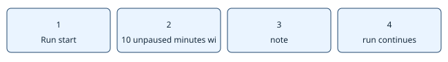

# A milestone drought produces a notice

> Markdown twin of [milestone-stall-stop-v1.html](../milestone-stall-stop-v1.html), generated from the HTML by `just explainer-twins`. The HTML is the source; edit it, not this file.

`milestone-stall-stop-v1` · existing defaults retained

## What happens

The historical switch ID is retained. After 10 unpaused minutes with no newly observed milestone counted by this clock, it requests one factual note. A milestone drought does not establish that the game stopped changing. This switch never aborts or selects an action.

Run start → 10 unpaused minutes without a new milestone → note → run continues

## Evidence and limits

OFF attaches no timer or notice. ON records a diagnostic if another briefing is active or loop mode is diagnostic. A newly observed milestone outside the measurement-only set re-arms the notice; measurement-only milestones may have been recorded during the interval. Present-at-start milestones do not reset it. Explicit run budgets, operator controls and operational failures retain their policies.

Doors and warps are coordinates in the observed map state; foot reachability comes from exit_reach. Game reference 731ad5bfd6e6f265508d0efcca0ba42f9dcf5881, src/field_control_avatar.c: TryDoorWarp and GetWarpEventAtPosition. No new route knowledge, tools or timeline marks.

## Verification status

Item1 correctness repair. Recorded-fixture and pinned-pi tests establish delivery, not gameplay benefit. Cloud review, landing and served-build proof are recorded separately in the worklog. Current measured runs retain their original source.
