# Move-learn comparison

> Markdown twin of [move-learn-comparison-v1.html](../move-learn-comparison-v1.html), generated from the HTML by `just explainer-twins`. The HTML is the source; edit it, not this file.

`move-learn-comparison-v1` · server readout switch · bundle-only, default off · approved by Operator 2026-10-21

In run `2026-10-20T20-26-22_qwen36-gpu1_97a0` the model never weighed DOUBLE KICK during 100+ turns on COMBUSKEN's prompts: nothing in the readout described it beyond its name. At the two learn-a-move boxes, in the evolution scene or in battle, and on the summary screen's forget-a-move list, this switch adds a block: the learner with its types, each move it knows and the new move, each with type, kind, power, accuracy and PP from the game's move table, and the game's own description (the text the summary screen shows). Nothing ranks or recommends a move.

## The block as delivered (97a0, "Delete a move to make room for DOUBLE KICK?")

Moves (the game's move data and the summary screen's descriptions): COMBUSKEN (FIRE/FIGHTING) knows: 1 PECK FLYING physical pow 35 acc 100 PP 35/35 — "Attacks the foe with a jabbing beak, etc." 2 GROWL NORMAL status acc 100 PP 40/40 — "Growls cutely to reduce the foe's ATTACK." 3 FOCUS ENERGY NORMAL status never misses PP 30/30 — "Focuses power to raise the critical-hit ratio." 4 EMBER FIRE special pow 40 acc 100 PP 21/25 — "A weak fire attack that may inflict a burn." New move: DOUBLE KICK FIGHTING physical pow 30 acc 100 PP 30/30 — "A double-kicking attack that strikes the foe twice."

Exact text from the production reader on fixture `move-learn-evo-delete-box`; the same block on `evo-stop-box`. In battle and on the forget-a-move list (fixtures `battle-delete-box`, `battle-stop-box`, `summary-forget`, turns 755-770):

Moves (the game's move data and the summary screen's descriptions): TORCHIC (FIRE) knows: 1 SCRATCH NORMAL physical pow 40 acc 100 PP 35/35 — "Scratches the foe with sharp claws." 2 GROWL NORMAL status acc 100 PP 40/40 — "Growls cutely to reduce the foe's ATTACK." 3 FOCUS ENERGY NORMAL status never misses PP 30/30 — "Focuses power to raise the critical-hit ratio." 4 EMBER FIRE special pow 40 acc 100 PP 23/25 — "A weak fire attack that may inflict a burn." New move: PECK FLYING physical pow 35 acc 100 PP 35/35 — "Attacks the foe with a jabbing beak, etc."

## Where each field comes from

*US ROM f3ae0881, static reads. The description's line breaks are joined with a space. The new move is `new_move_id` on the evolution box and on the forget-a-move list, and `gMoveToLearn` (0x020244E2) in battle.*

## Where the block shows

| Screen | Block |
|---|---|
| Evolution or trade scene, ready "Delete a move…?" or "Stop learning…?" box | yes |
| Battle, ready learn_move or stop_learning_move prompt | yes |
| Summary screen forget-a-move list (summary_move_forget) | yes |
| While the scene prints (MVSTATE 2 or 3), any other screen | no |

An unreadable value (a description pointer outside the ROM, no terminator, an invalid move id, move type or species type, a learner slot outside the party) gives a visible `HARNESS BUG (move learning): …` line, never a guess.

## What the model receives (97a0, "Delete a move…?" box)

Off

Interface: evolution_move_confirmation; input ready; selected YES; UP/DOWN selects YES or NO; A chooses; B answers NO Menu state: … new move id: 24; new move: DOUBLE KICK; options: YES | NO To answer NO, press DOWN, then A. Pressing A now answers YES. B also answers NO. Bag: …

On (question switch on too, as in the bundle)

Interface: evolution_move_confirmation; input ready; selected YES; UP/DOWN selects YES or NO; A chooses; B answers NO Menu state: … new move id: 24; new move: DOUBLE KICK; options: YES | NO To answer NO, press DOWN, then A. Pressing A now answers YES. B also answers NO. The game asks: "Delete a move to make room for DOUBLE KICK?" YES: the game lists COMBUSKEN's moves so you pick one to forget for DOUBLE KICK. NO or B: the game asks "Stop learning DOUBLE KICK?" Moves (the game's move data and the summary screen's descriptions): COMBUSKEN (FIRE/FIGHTING) knows: 1 PECK FLYING physical pow 35 acc 100 PP 35/35 — "Attacks the foe with a jabbing beak, etc." 2 GROWL NORMAL status acc 100 PP 40/40 — "Growls cutely to reduce the foe's ATTACK." 3 FOCUS ENERGY NORMAL status never misses PP 30/30 — "Focuses power to raise the critical-hit ratio." 4 EMBER FIRE special pow 40 acc 100 PP 21/25 — "A weak fire attack that may inflict a burn." New move: DOUBLE KICK FIGHTING physical pow 30 acc 100 PP 30/30 — "A double-kicking attack that strikes the foe twice." Bag: …

Production render of fixture `move-learn-evo-delete-box`. With the question switch on, the question line comes first and the moves block follows it (test `test_both_switches_on_put_the_question_before_the_moves`).

## Where the block comes from

*Server readout, after the Interface line, in observe, press and navigate_to results.*

## Status

Tests: `env/tests/env/test_move_learn.py` (exact blocks for the evolution, battle and summary states, no block while printing, OFF byte parity per archive, state JSON unchanged, every bad-data path reported). Gates passing. Not yet reviewed or landed. Pending experiment `experiments/move-learn-comparison-v1.json`. On in the bundle arm of bundle-v-control, bundle-cook-1h and whole-map-cook-1h; off in control. No measured runs.
