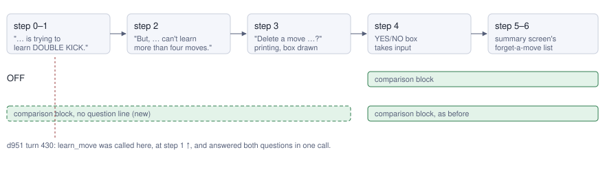
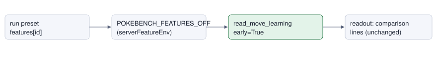

# Move-learn early comparison

> Markdown twin of [move-learn-early-comparison-v1.html](../move-learn-early-comparison-v1.html), generated from the HTML by `just explainer-twins`. The HTML is the source; edit it, not this file.

`move-learn-early-comparison-v1` · observation · game server · needs `move-learn-comparison-v1` · default OFF

When a POKéMON tries to learn a fifth move, the move comparison (its four moves and the new move, with type, power, accuracy, PP and the game's own description) now shows from the first page of the move-learning text, not only once the YES/NO box is open.

## What went wrong

Bundle run `2026-10-22T00-22-02_qwen36-gpu0_d951`, turn 430 (1:31 AM New York time), right after TORCHIC evolved into COMBUSKEN in RUSTBORO CITY GYM:

- The game showed the page "COMBUSKEN is trying to learn DOUBLE KICK." (evolution scene, move-learning step 1, event seq 16473).
- `move-learn-comparison-v1` lists the moves only at the YES/NO box and the summary screen's forget-a-move list, so the readout named DOUBLE KICK only inside the raw Menu state line. No type, power or description.
- `learn_move` accepts that page. The model called it with `forget: "none"` ("Since I don't need another move right now"), and the tool pressed A, A, B, A through both questions. COMBUSKEN did not learn DOUBLE KICK.
- In run `2026-10-21T13-33-54_qwen36-gpu0_ea04`, the same model saw the block at the box ("FIGHTING physical pow 30 … strikes the foe twice"), reasoned that Fighting moves are super effective against Rock, and learned it.

In battle, battle text auto-advance usually carries the model past these pages to the box, so PECK's choice in d951 (turn 421) had the block. The evolution scene has no auto-advance.

## When the block shows



*Evolution and trade scenes (pret `src/evolution_scene.c` MVSTATE_INTRO_MSG_1 to MVSTATE_PRINT_YES_NO are steps 0–3, the same numbers in both scenes). After "Stop learning …?" the scene goes back through step 3, so the block shows there too. Steps 7 and later (forgetting, learned, did not learn) show nothing new.*

In battle the block shows on the two pages `sText_TryToLearnMove1/2`, "&lt;POKéMON&gt; is trying to learn &lt;move&gt;." and "But, &lt;POKéMON&gt; can't learn more than four moves.", only when the page names the POKéMON in `gBattleStruct->expGetterMonId` (and, on the first page, the move in `gMoveToLearn`). Any other battle page reads no extra memory; a page naming another POKéMON reads only the learner's slot, and a first page naming another move reads only that move's name. Only a battle screen's pages are read this way: the evolution scene prints in the same message window, and its pages are read from the scene instead.

## What the model sees at the recorded page

The readout of d951's raw RAM at event seq 16473 (fixture `move-learn-early-evo-page1.json.gz`), after the Interface and Menu state lines. OFF, as recorded:

```
Interface: evolution_move_learning; input ready; A or B advances the waiting move-learning text; inspect the next choice
Menu state: … new move id: 24; new move: DOUBLE KICK
Bag: POKé BALL ×5; GREAT BALL ×1
```

ON, the same state:

```
Interface: evolution_move_learning; input ready; A or B advances the waiting move-learning text; inspect the next choice
Menu state: … new move id: 24; new move: DOUBLE KICK
Moves (the game's move data and the summary screen's descriptions):
  COMBUSKEN (FIRE/FIGHTING) knows:
  1 SCRATCH NORMAL physical pow 40 acc 100 PP 35/35 — "Scratches the foe with sharp claws."
  2 GROWL NORMAL status acc 100 PP 40/40 — "Growls cutely to reduce the foe's ATTACK."
  3 FOCUS ENERGY NORMAL status never misses PP 30/30 — "Focuses power to raise the critical-hit ratio."
  4 EMBER FIRE special pow 40 acc 100 PP 17/25 — "A weak fire attack that may inflict a burn."
  New move: DOUBLE KICK FIGHTING physical pow 30 acc 100 PP 30/30 — "A double-kicking attack that strikes the foe twice."
Bag: POKé BALL ×5; GREAT BALL ×1
```

Every value comes from the game: the party's moves and PP, `gBattleMoves` for type, kind, power and accuracy, and `gMoveDescriptionPointers` for the summary screen's text. It adds no type matchups, no gym information and no advice.

## Wiring



*Only the reader changes (green). `rerender.read_state` turns it on when this switch and `move-learn-comparison-v1` are both on. The readout prints the block and, because a page has no question, no "The game asks" line. State JSON is unchanged.*

## Status

- Tests from d951's raw RAM: the evolution page and TORCHIC's two PECK pages in battle; OFF parity with today's readout.
- Registered as a pending experiment, not queued or approved. No measured runs yet and no claim that it helps.
