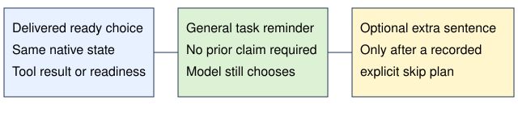

# Move-learning goal reminder

> Markdown twin of [move-learn-goal-reminder-v1.html](../move-learn-goal-reminder-v1.html), generated from the HTML by `just explainer-twins`. The HTML is the source; edit it, not this file.

Updated October 23: every verified move-learning choice gets a reminder when the switch is ON. Earlier reasoning is optional evidence, never a delivery requirement.

## Every choice, with truthful context

The first choice and later choices are eligible without any earlier mistake. The same native ownership checks reject stale observations, errors, unready or diagnostic UI, and completed learning or decline pages.

The existing conservative phrase detector recognizes “I don't need new moves,” “I do not need new moves,” “I will skip learning new moves,” and “I will keep the current moveset.” Other wording still receives the general reminder. Recognition only controls the optional earlier-reasoning sentence.

## Exact messages

General reminder

Task reminder: your instruction is to play the game and make as much story progress as you can. There is no instruction to skip learning new moves or to keep the current moveset. Evaluate this offered move using the displayed comparison and the current party, then choose whether to learn it or decline it. The choice is yours.

After a recognized recorded skip plan

Task reminder: your instruction is to play the game and make as much story progress as you can. There is no instruction to skip learning new moves or to keep the current moveset. Your earlier reasoning about skipping new moves was your own plan, not a rule. Evaluate this offered move using the displayed comparison and the current party, then choose whether to learn it or decline it. The choice is yours.

The second version retains the original tested wording. The general version removes only the unsupported earlier-reasoning sentence. Neither selects a move or presses a button.

## Delivery and recording

The reminder follows the outgoing context, preserving canonical history and all earlier messages. Both successful tool results and battle-readiness snapshots bind delivery to the current native state. Existing ledger_context records the exact message and state/delivery sequence references; a recognized earlier plan adds its assistant reference. Identical existing reminder text suppresses duplication. No timeline marks or tools are added.

## Configuration

| OFF | ON |
|---|---|
| Previous context exactly, no subscription | Every delivered ready learning choice receives a reminder |

Omitted presets remain OFF. Both gym-rustboro-torchic and gym-rustboro-torchic-healed now explicitly enable the reminder in both arms. Their other feature settings, save hashes, caps and plans are unchanged. Existing active runs and frozen presets are unchanged. No runs are authorized or launched by this update.

The five separate move-learning readout/tool switches are unchanged. This feature adds no move comparison; its wording refers to a displayed comparison, which may be absent when those optional readouts are OFF.

## Evidence and limits

The original full wording acquired Double Kick in 86 of 100 repeated trials of the original Combusken level-16 context, with 14 declines and no errors; exact 95% interval 77.6–92.1%. Those results do not measure the new general wording, its broader exposure, or gym victories. Earlier held-out findings were mixed.

Offline historical replay verifies eligibility and exact message delivery, not changed game outcomes. The broader general reminder has no new GPU efficacy result. Rustboro checkpoint readiness remains conditional on a future authorized current-build load check; this repair does not start gameplay or query GPUs.
