# Move-learning loop fingerprint

> Markdown twin of [move-learn-loop-fingerprint-v1.html](../move-learn-loop-fingerprint-v1.html), generated from the HTML by `just explainer-twins`. The HTML is the source; edit it, not this file.

`move-learn-loop-fingerprint-v1` · guard · default OFF · proposed for the bundle arm

The loop guard notices when the game keeps returning to the same states. It compares a fingerprint of each state. Move-learning prompts had no fingerprint while the battle flag was set or on the evolution screen, so a loop through them was never counted. With this switch on they get one, and a cycle made only of them is reported after it repeats twice.

## What went wrong

Bundle run `2026-10-21T13-33-54_qwen36-gpu0_ea04` evolved TORCHIC into COMBUSKEN, which tried to learn DOUBLE KICK. From turn 547 to 561 (3:21–3:23 PM ET, seq 20494–20844) the model pressed B round the game's four-state cycle, 15 turns, with byte-identical thinking (md5 bf66221a). The readout was right each time.



*The game's own cycle when B answers both questions NO. Each turn's result showed a different state, so nothing that keys on "the same result again" fired.*

Why the guard stayed quiet:

- `semanticState` returned null while `in_battle` was set (`loop/fingerprints.ts`), and the game keeps that flag through a post-battle evolution. The evolution and summary phases were not on its list either. So the ineffective-input and state-cycle rules never counted these states.
- Duplicate-turn collapse keys on the result state, which changed every step.
- Short-cycle collapse fires only at 3 cycles (turn 559), and its note is gated on `fixed-point-breaker-v1`, which is OFF.

## The fingerprint, OFF and ON


*ON, each ready prompt is fingerprinted from what the game shows. The two questions differ by their YES/NO next states (5/10 for Delete, 11/0 for Stop); the two pages by MVSTATE 1/2. Other cycles still need the policy's 3 repeats.*

An example fingerprint from the tests, for the summary screen's forget list (illustrative values):

```
{"phase":"summary_move_forget","selected":"SCRATCH","mvstate":null,"question":null,"move":null,"page":null, …}
```

Battle messages that are not the move-learning pages, such as "COMBUSKEN used EMBER!", still get no fingerprint, and a torn readout gets none.

## Replay of the recorded window

The test fixture `packages/agent/test-support/move-learn-loop-ea04.json.gz` holds ea04 seq 20470–20870 (turn starts, tool calls, presses, states and results). Replayed through the production `attachLoopGuard`:

|  | OFF (recorded run) | ON (replay) |
|---|---|---|
| Loop guard cycle or ineffective notice | none in the window | `cycle` warning at result seq 20676, the 9th result, the second time round |
| Short-cycle collapse | turn 559, after 3 cycles, no note to the model | unchanged |

What the model reads is the loop guard's existing cycle warning, in the words the incumbent's loop switches give it, for example `LOOP GUARD (cycle): The same interaction or input pattern is repeating without new game information. Use a single input, inspect the resulting interface, and choose an evidence-supported different approach. …`. This switch changes when the warning fires, not its words.

## Status

- RED 4691b3c68, GREEN 0c9732274. Not merged into main.
- Default OFF. ON in the bundle arm only of the fixed bundles (the operator, 2026-10-21 10:44 PM ET).
- Tests: `packages/agent/src/move-learn-loop-fingerprint.test.ts`. Multi-model review: not run yet.
- Not measured in runs. Pending experiment: `experiments/move-learn-loop-fingerprint-v1.json`.
