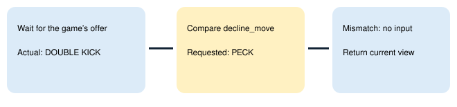

# Named move decline

> Markdown twin of [move-learn-offer-identity-v1.html](../move-learn-offer-identity-v1.html), generated from the HTML by `just explainer-twins`. The HTML is the source; edit it, not this file.

## The model names the move it is declining

With move-learn-offer-identity-v1 ON, learn_move requires decline_move when forget is “none”. A matching name allows the decline. The model still decides whether to learn a move and which existing move to replace.



*Illustrative guarded replay of the recorded4637T81 error. The original run declined Double Kick; this is the new refusal behavior, not a new gameplay result.*

## Tool contract

```
{"forget":"none","decline_move":"DOUBLE KICK"}
```

For learning, use the existing move name in forget. decline_move is optional for learning and required by runtime validation for a decline. The guard checks the native offer after waiting, after advancing pages and before each checked input. It stops if the offer changes or becomes unreadable. A refusal returns the current ordinary observation, allowing the existing comparison and reminder when their switches are ON.

OFF preserves the previous arguments, description, prompt and execution. The switch defaults OFF and depends on move-learn-tool-v1. Approved future bundle recipes enable it; control recipes retain OFF. Frozen campaigns need separate source and schema qualification.

## Game evidence and limits

Recorded run2026-10-23T11-15-17_qwen36-gpu0_4637: assistant3792 called the move PECK; call3793 declined before the first DOUBLE KICK offer3794. Source: pret/pokeemerald731ad5bf, evolution_scene.c MVSTATE states and battle_scripts_1.s BattleScript_AskToLearnMove. The existing native wait and checked press own input; this feature adds no move recommendation or automatic learning.

Status: offline regression and production factory checks. No new model calls, GPU activity or gameplay evidence. Configuration does not prove later gameplay activation.
