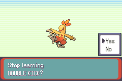

# Move-learn question

> Markdown twin of [move-learn-question-v1.html](../move-learn-question-v1.html), generated from the HTML by `just explainer-twins`. The HTML is the source; edit it, not this file.

`move-learn-question-v1` · server readout switch · bundle-only, default off · approved by the operator 2026-10-21

Run `2026-10-20T20-26-22_qwen36-gpu1_97a0` pressed B for 100+ turns from turn 779 on COMBUSKEN's DOUBLE KICK prompts. It said "answer NO to keep my current moveset" at both questions, also at turns 782/783 when the box was shown, and in battle with PECK (turns 755-769). But B = NO at "Delete a move to make room for DOUBLE KICK?" only asks "Stop learning DOUBLE KICK?", and B = NO there starts the whole flow over. This switch adds one line at a ready box: the question in the game's words and what each answer does, from the game's own flow. It recommends nothing.

Run 97a0, seq 32335: the second question's box. Its NO, and B, do not keep the moves: they go back to "COMBUSKEN is trying to learn DOUBLE KICK." Only YES here ends the flow without learning.

*Recorded frame, 240×160, unscaled pixels.*

## The two questions and where each answer goes

*pret/pokeemerald 731ad5bf: `MVSTATE_HANDLE_YES_NO` in src/evolution_scene.c; strings from src/battle_message.c (`sText_TryToLearnMove1/3`, `sText_StopLearningMove`, `sText_DidNotLearnMove`). The red path is the 97a0 loop.*

## Which box is which

The reader tells the two boxes apart by the next states the scene set before drawing the box, or by the battle prompt kind. An unknown pair or a box that is not ready gives no line.

| Owner | Read from | "Delete a move…?" | "Stop learning…?" |
|---|---|---|---|
| Evolution scene | evolution_move_confirmation, ready; (yes_next_state, no_next_state) | (5, 10) | (11, 0) |
| Trade evolution scene | same | (5, 9) | (10, 0) |
| Battle | battle prompt, ready; kind | learn_move | stop_learning_move |

## The line, exactly (recorded states)

| Fixture (raw RAM, run 97a0) | Line |
|---|---|
| evo-delete-box | `The game asks: "Delete a move to make room for DOUBLE KICK?" YES: the game lists COMBUSKEN's moves so you pick one to forget for DOUBLE KICK. NO or B: the game asks "Stop learning DOUBLE KICK?"` |
| evo-stop-box | `The game asks: "Stop learning DOUBLE KICK?" YES: the game says "COMBUSKEN did not learn DOUBLE KICK." and COMBUSKEN keeps the moves it knows. NO or B: the game starts over with "COMBUSKEN is trying to learn DOUBLE KICK."` |
| battle-delete-box | `The game asks: "Delete a move to make room for PECK?" YES: the game lists TORCHIC's moves so you pick one to forget for PECK. NO or B: the game asks "Stop learning PECK?"` |
| battle-stop-box | `The game asks: "Stop learning PECK?" YES: the game says "TORCHIC did not learn PECK." and TORCHIC keeps the moves it knows. NO or B: the game starts over with "TORCHIC is trying to learn PECK."` |

No line on the printing states (evo-intro3-printing, evo-delete-printing, evo-stop-printing), on the "trying to learn" page waiting for A (evo-intro3-waiting) or on the summary screen's forget-a-move list.

## What the model receives (97a0, "Stop learning DOUBLE KICK?" box)

Off

Screen: evolution Dialog: none Menu: evolution_move_confirmation; selected YES Interface: evolution_move_confirmation; input ready; selected YES; UP/DOWN selects YES or NO; A chooses; B answers NO Menu state: … move learning state: 4; … yes next state: 11; no next state: 0; … new move: DOUBLE KICK; options: YES | NO To answer NO, press DOWN, then A. Pressing A now answers YES. B also answers NO. Bag: …

On

Screen: evolution Dialog: none Menu: evolution_move_confirmation; selected YES Interface: evolution_move_confirmation; input ready; selected YES; UP/DOWN selects YES or NO; A chooses; B answers NO Menu state: … move learning state: 4; … yes next state: 11; no next state: 0; … new move: DOUBLE KICK; options: YES | NO To answer NO, press DOWN, then A. Pressing A now answers YES. B also answers NO. The game asks: "Stop learning DOUBLE KICK?" YES: the game says "COMBUSKEN did not learn DOUBLE KICK." and COMBUSKEN keeps the moves it knows. NO or B: the game starts over with "COMBUSKEN is trying to learn DOUBLE KICK." Bag: …

Rendered by the production reader from fixture `move-learn-evo-stop-box` (comparison switch off; the "To answer NO" line is `yes-no-answer-readout-v1`, on in the bundle). The line goes right after the YES/NO answer line. With `move-learn-comparison-v1` also on, the moves block follows it.

## Where the line comes from

*`format_readout` adds the line after the Interface line in observe, press and navigate_to results. A failed read prints `HARNESS BUG (move learning): …` instead of guessing. No timeline marks.*

## Status

Menu-line correction: a working branch. Tests: `env/tests/env/test_move_learn.py` (the four exact lines above, absences, trade and unknown pairs, OFF byte parity per archive, state JSON unchanged, visible harness-bug line). Gates passing. Not yet reviewed or landed. Pending experiment `experiments/move-learn-question-v1.json`. On in the bundle arm of bundle-v-control, bundle-cook-1h and whole-map-cook-1h; off in control. No measured runs.

## The Menu line agrees with the battle prompt

*Recorded battle-delete-box archive: a YES/NO choice is open while the battle controller is busy.*

At battle move-learning YES/NO boxes, the Menu line also names the verified question phase and highlighted YES or NO. The battle controller may still be busy; its generic interface does not override the battle-script prompt. Source: BattleScript_AskToLearnMove. With this switch OFF, the previous Menu line is retained.
