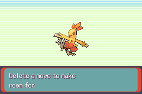
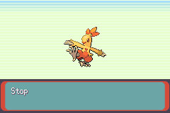
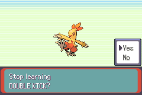

# Move-learn settle

> Markdown twin of [move-learn-settle-v1.html](../move-learn-settle-v1.html), generated from the HTML by `just explainer-twins`. The HTML is the source; edit it, not this file.

`move-learn-settle-v1` · server observation switch · bundle-only, default off · approved by Operator 2026-10-21

Run `2026-10-20T20-26-22_qwen36-gpu1_97a0` (v6 bundle) evolved TORCHIC into COMBUSKEN at turn 777. From turn 779 it pressed B for 100+ turns in a 4-turn cycle on the DOUBLE KICK prompts. Every press result was captured while "Delete a move to make room for DOUBLE KICK?" or "Stop learning DOUBLE KICK?" was still printing (the evolution scene's MVSTATE 3), so the model never saw the YES/NO box. This switch makes an observation taken in that window wait, per emulated frame, until the scene takes input.

## What the press results showed (recorded frames)

**seq 32308** · mid-print "Delete a move to make room for". MVSTATE 3: no box yet.

**seq 32326** · mid-print "Stop". MVSTATE 3: no box yet.

**seq 32335** · "Stop learning DOUBLE KICK?" with Yes/No. MVSTATE 4: the box takes input.

*Three frames from run 97a0, 240×160, unscaled pixels. The first two are what a press result looked like during the loop; the third is what the scene shows a moment later. With the switch on, a capture that lands in the first two states waits for the third.*

## The wait, frame by frame

*Driven by the vendor's own frame stepping: `FrameSettle.on_frame` runs after each emulated frame and asks the hook whether the scene is still busy. Tested with a scripted hook: busy for 4 checks gives `(4, "move_learning")`; always busy with bound 7 gives `(7, "move_learning_bound")`; hook unset or not busy gives `(0, "immediate")`.*

## When the scene counts as busy

*`move_learning_busy` in `env/pokebench_env/move_learn.py`. The predicate covers only the evolution and trade scenes. In-battle learn prompts are not held by it; in 97a0 the battle readout already showed the PECK boxes at turns 755-769.*

## Game grounding

| MVSTATE | What the scene does (src/evolution_scene.c, pokeemerald 731ad5bf) | Busy with the switch on? |
|---|---|---|
| 0 / 1 / 2 | print the "trying to learn" pages; 2 sets yes = 5, no = 10 (trade: 5, 9) | yes, while a page is being written; no once it waits for A/B |
| 3 | waits for printer 0 to go idle, then draws YES/NO in window 12 | yes (this is where 97a0's captures landed) |
| 4 | YES/NO input: A on YES → yes state, A on NO or B → no state | no: capture |
| 5 / 6 | summary screen's move select | no: capture |
| 10 (trade 9) | prints "Stop learning {move}?"; yes = 11 (trade 10), no = 0; then 3 | yes, while printing |
| 11 (trade 10) | prints "did not learn" | yes, while printing |

## What the model receives (97a0, the "Delete a move" press result)

Off (production reader on the recorded RAM of the MVSTATE 3 capture)

Screen: evolution Dialog: none Menu: no selectable menu is open Interface: evolution_move_learning; input not ready; Move-learning text is printing or animating; no menu choice is open Menu state: … move learning state: 3; … yes next state: 5; no next state: 10; … new move: DOUBLE KICK Bag: …

On (the same press result, captured once MVSTATE 4 is reached; recorded RAM of the box)

Screen: evolution Dialog: none Menu: evolution_move_confirmation; selected YES Interface: evolution_move_confirmation; input ready; selected YES; UP/DOWN selects YES or NO; A chooses; B answers NO Menu state: … move learning state: 4; … yes next state: 5; no next state: 10; … new move: DOUBLE KICK; options: YES | NO To answer NO, press DOWN, then A. Pressing A now answers YES. B also answers NO. Bag: …

Both texts come from `render` on the raw-RAM fixtures `move-learn-evo-delete-printing` and `move-learn-evo-delete-box` (copied byte for byte from run 97a0) with the question and comparison switches off. The "To answer NO" line is `yes-no-answer-readout-v1`, also on in the bundle. This switch changes no text: it changes *when* the capture happens. The state JSON gains `"settle": {"frames": N, "reason": "move_learning"}` (or `"move_learning_bound"`), as warp-arrival-settle-v1 records its waits.

## How it meets the other settles

| Settle reason | When | Bound (emulated frames) |
|---|---|---|
| `immediate` | nothing to wait for (and always with the switch off, in this scene) | 0 |
| `move_learning` | the scene became ready | 600 |
| `move_learning_bound` | still busy at the bound | 600 |
| `fade` / `fade_bound` | a palette fade or black screen; checked before move learning | 146 = (15+1)×9+2 |
| `warp` / `warp_bound` | a warp starts during a move-learning wait: the wait takes the warp's kind and bound (tested: reason `warp` at frame 5) | 300 |
| `input_hold`, `paused` | unchanged | — |

## Where the switch takes effect

*Server side only; the agent transports the switch. Tested: the production `serve.run` installs the hook with the switch on (and the hook reports busy on the recorded MVSTATE 3 RAM) and leaves it unset with the switch off. No timeline marks.*

## Status

Tests: `env/tests/env/test_move_learn.py` (busy per recorded state, FrameSettle hold, bound, off, fade and warp precedence, production hook on and off). Gates passing (`just lint`, `just coverage`; `move_learn.py` 100% lines and branches). Not yet reviewed or landed. Pending experiment `experiments/move-learn-settle-v1.json`. On in the bundle arm of bundle-v-control, bundle-cook-1h and whole-map-cook-1h; off in control. No measured runs.
