# Learn move tool

> Markdown twin of [move-learn-tool-v1.html](../move-learn-tool-v1.html), generated from the HTML by `just explainer-twins`. The HTML is the source; edit it, not this file.

`move-learn-tool-v1` · guidance · agent and game server · default OFF · proposed for the bundle arm

A new tool, `learn_move(forget)`, answers the game's move-learning prompts in one call. `forget` is one of the four moves the POKéMON knows, as the game names it, or `"none"`. The harness presses one button at a time, checks the screen before and after each press, and then checks the party's moves. It never picks the move; the model does.

## What went wrong

Bundle run `2026-10-21T13-33-54_qwen36-gpu0_ea04` looped 15 turns (turns 547–561, 3:21–3:23 PM ET) on "Delete a move to make room for DOUBLE KICK?", pressing B round Delete → Stop learning → trying to learn → can't learn more than four, with byte-identical thinking. It then reached the summary screen's forget list and pressed A on the default slot while its reasoning said it was still at the YES/NO box. That blind A forgot SCRATCH (seq 20950/20981).

## The press sequence for forget = a move



*Recorded sequences in the tests (fake game moving between ea04's states): from the Delete box with YES highlighted, forgetting slot 1–4 is A,A / A,DOWN,A / A,DOWN,DOWN,A / A,UP,UP,A. From "Stop learning …?", forgetting GROWL is B,A,A,A,DOWN,A.*

## The none path



*forget = "none" keeps the four moves. It answers NO to deleting a move and YES to stopping.*

## What the model sees

ON, the tool list gains `learn_move` (last in `playTools`, kept in every just-in-time scene) and the system prompt gains this section in every scene:

```
- learn_move: when the game asks "Delete a move to make room for …?" or "Stop learning …?", or shows the pages before them or the summary screen's list of moves to forget, call learn_move with forget set to one of the four moves the POKéMON knows (as the game names them) or "none". With a move, the harness answers YES, moves the summary highlight to that move checking it after each press, and presses A; with none, it answers NO to deleting a move and YES to stopping, and the POKéMON keeps its moves. It reports what the game printed and the party's moves afterwards. No choice is recommended. It refuses, and presses nothing, when no move-learning prompt is open or the move is not one the POKéMON knows. press still works on these prompts.
```

Results, exactly as the tests expect them (the readout follows each):

```
Learn move: COMBUSKEN forgot GROWL and learned DOUBLE KICK (checked in the party's moves); buttons pressed: B, A, A, A, DOWN, A; COMBUSKEN's moves: SCRATCH, DOUBLE KICK, FOCUS ENERGY, EMBER.
The game printed: "COMBUSKEN is trying to learn DOUBLE KICK." / "But, COMBUSKEN can't learn more than four moves." / "1, 2, and… … … Poof!"
```

```
Learn move: COMBUSKEN did not learn DOUBLE KICK and kept its moves (checked in the party's moves); buttons pressed: B, A; COMBUSKEN's moves: SCRATCH, GROWL, FOCUS ENERGY, EMBER.
The game printed: "COMBUSKEN did not learn DOUBLE KICK."
```

Refusals and stops:

| Case | Result |
|---|---|
| No prompt open | `Learn move: nothing pressed: no move-learning prompt is open; the game shows screen overworld.` |
| Not one of the four | `Learn move: nothing pressed: TACKLE is not one of COMBUSKEN's moves. The game shows COMBUSKEN's moves: SCRATCH, GROWL, FOCUS ENERGY, EMBER. Use one of these names, or "none".` (illustrative name) |
| Cursor moved two rows | `Learn move: stopped after pressing A, DOWN; expected the highlight on GROWL after DOWN, but the summary screen's list of moves to forget is open with FOCUS ENERGY highlighted; inspect the new state.` |
| Screen changed before a press | `Learn move: stopped; the screen changed before the press, so no button was sent; inspect the new state.` |

OFF: no `learn_move` tool and no prompt section. With the switch on, ordinary `press` still works on these prompts, so ON and OFF differ only by the tool.

## Where it acts

| Scene | Prompts it handles | Game state it reads |
|---|---|---|
| Evolution | the two YES/NO boxes and the two pages | evolution task tState 22, MVSTATE 3–6 and 10 |
| Battle | `learn_move` / `stop_learning_move` boxes and the sText_TryToLearnMove1/2 pages | battle script pointer in 0x082DABE3..0x082DAC2B (ROM bytes checked); learner from expGetterMonId and gMoveToLearn |
| Summary | the list of moves to forget | `summary_move_forget`, Task_HandleReplaceMoveInput; an HM refusal is reported |

The server side is `env/pokebench_env/learn_move_wait.py` (`learn_step` per emulated frame, frame-bounded `LearnWait` that parks while the run is paused; none in human mode). It is inert unless `learn_move` asks.

## Status

- RED 0dcfc846c, GREEN 2af9cefca. Not merged into main.
- Default OFF. ON in the bundle arm only of the fixed bundles (the operator, 2026-10-21 10:44 PM ET).
- Tests: `packages/agent/src/learn-move.test.ts` (fake game over ea04's recorded states) and `env/tests/env/test_learn_move_wait.py` (the nine 97a0 raw-RAM archives). No save state at a move-learn prompt exists, so it has not been driven on the emulator. Multi-model review: not run yet.
- Not measured in runs. Pending experiment: `experiments/move-learn-tool-v1.json`.
