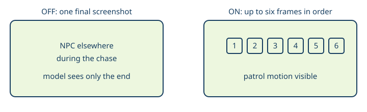

# Moving NPC frame burst

> Markdown twin of [moving-npc-frame-burst-v1.html](../moving-npc-frame-burst-v1.html), generated from the HTML by `just explainer-twins`. The HTML is the source; edit it, not this file.

`moving-npc-frame-burst-v1` · Default OFF · On in both arms of the current recipe (the operator 2026-11-01: harness support, not a treatment).

**≤6**screenshots per follow

**0**extra buttons pressed

**observe**samples only

## Why Briney’s cottage looked still

DeepSeek’s control4h run entered Mr. Briney’s House and called `navigate_to_target` on the loaded person. Every tool result carried one screenshot. Briney walks a square around the table; spaced single frames make that patrol look like a static NPC.

Illustration only. No person name is inferred from a sprite.

## What ON does

1. While `moving-npc-target-v1` follows a loaded object, call the ordinary `observe` path to capture a screenshot.
2. Sample at the start of the follow, after each bounded movement or facing step, after a target-tile drift retry, and after the final A or early return.
3. Keep at most six images. Prepend them to that `navigate_to_target` result’s content, ahead of the status text.
4. Press nothing extra. Do not invent dialogue or character names.

| OFF | ON |
|---|---|
| Follow results keep the previous single-frame content pattern (no observe burst). | Up to six chronological screenshots ride with the follow result. |
| Registry default and omitted presets stay single-frame. | Current recipe lists the id under `onInBoth` (base true, control and bundle both get the burst). |

## Wiring

Registry → preset normalize (default false) → `current.json` `onInBoth` (base true) → `followObject` in semantic navigation. Capture is a no-op when the switch is OFF or when no `observe` tool is present.

Companion fix (separate switch): `moving-npc-target-v1` stays onInBoth and no longer aborts a step solely because the NPC changed tiles before input; it prefers staying on a tile that remains a valid approach.

## Status

Branch `cursor/moving-npc-burst-and-wait`. Focused agent tests cover OFF empty burst, ON multi-image follow, registry index 318, and recipe placement. Full gates and multi-model review are recorded in the worklog before landing.
