# Step into a walking path

> Markdown twin of [moving-npc-intercept-v1.html](../moving-npc-intercept-v1.html), generated from the HTML by `just explainer-twins`. The HTML is the source; edit it, not this file.

`moving-npc-intercept-v1` · guidance switch · registry default OFF · on in both arms of the current recipe (Operator, 2026-11-03: "go, this should be on in both arms"). Needs `moving-npc-target-v1`.

## Why

After the DEVON GOODS, MR. BRINEY and PEEKO walk the same loop around the table in the cottage, nonstop. Twelve recorded runs went into the cottage after the goods; the eleven that sailed took a median of about 10 minutes and 40 turns from first entry to sailing. A direct talk takes about 3 turns. Qwen run 7da5 never sailed.

**\~10 min** median from first entry to sailing (11 runs)

**\~40 turns** median, against \~3 for a direct talk

The follow (`moving-npc-target-v1`) walks toward his *current* tile one step at a time, about 75 frames apart. He walks one tile every 16 frames, so by the time the player arrives he is about 5 tiles further on. DeepSeek 80c8 at t321 paced up and down beside the loop for 32 steps and returned "moving target attempt limit reached".

## What the game does

The cottage's map script (`Route104_MrBrineysHouse_EventScript_SetBrineyPeekoPos`) gives both of them a walk-sequence movement. When the next tile on a walk sequence is taken, the game makes that person walk in place instead (`event_object_movement.c MoveNextDirectionInSequence`). A player standing on the tile the person is about to enter stops them, right next to the player.

The catch: PEEKO walks the same loop 1 to 3 tiles ahead of BRINEY. Stepping onto the loop at a random moment stops PEEKO, and BRINEY stops behind PEEKO, out of reach. The step has to come after PEEKO has passed and before BRINEY arrives, a window of about one step (16 frames).

*The cottage loop, drawn schematically. Left: the follow aims at BRINEY's current tile and never reaches him. Right: the player waits on S, off the loop; the game server steps onto T on the first frame BRINEY is on P and T is clear of PEEKO.*

## How it works

*The two blue boxes run on the game server, frame by frame, holding the input queue. Everything else is the agent's existing navigation. Any failure returns to today's follow.*

The step-in, per emulated frame (`env/pokebench_env/intercept.py`):

1. Check the map, field control, the player's tile and elevation, and that the target slot still holds the same person.
2. If the player is not facing T, press toward T for one frame (the game turns the player in place).
3. Wait, pressing nothing, until the target's current tile is P and T is clear of every object's current and previous tile. The game tests both when deciding a collision.
4. Check T is plain floor at the player's elevation, with no warp or script tile, then hold toward T until the player's tile is T.
5. Stop with a receipt: `entered`, `blocked`, `target left`, `map changed`, `field input unavailable`, `frame budget` and similar.

The model sees what happened in plain terms, with no names: "Watched the person walk a repeating path of 12 steps without pressing anything." and "Stepped into the path at (8,3) as the person reached (7,3)." The navigate_to_target description and the overworld system-prompt line gain one sentence only when the switch is ON.

## Timing

| Thing | Frames | Source |
|---|---|---|
| Person walks one tile | 16 | walk speed, recorded RAM in 80c8 |
| Agent-side follow step to next state read | ≈ 75 | 80c8 t321, native_action frames |
| Window between PEEKO leaving T and BRINEY entering it | ≈ 16 | gap of 1–3 loop tiles in 80c8 samples |
| One 12-tile lap | 192 | 12 × 16 |
| Watch and step-in budget | 240 each | `MAX_FRAMES`; fits button_press `hold_frames` ≤ 255 |

## OFF

No watch or step-in is sent, the follow behaves exactly as before, and the tool description and system prompt keep their bytes. The game server installs the two routes only when the switch is on (`POKEBENCH_FEATURES_OFF`).

## Status

- Server tests: 49 cases with two walkers on one loop (leader 1, 2 or 3 tiles ahead), a one-frame step timing check and every stop reason. Agent tests: 10 cases including OFF bytes and production HTTP.
- Emulator rehearsal at the cottage: see the worklog's M3.
- Not done here: gates, cloud review, landing, measured runs. Operator-directed without a measured benefit claim.
