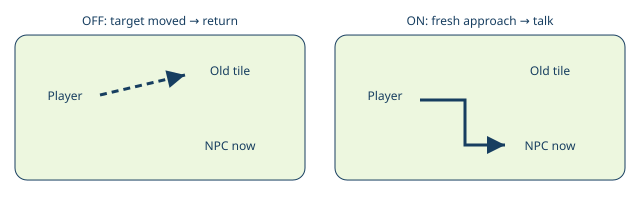

# Moving NPC target

> Markdown twin of [moving-npc-target-v1.html](../moving-npc-target-v1.html), generated from the HTML by `just explainer-twins`. The HTML is the source; edit it, not this file.

moving-npc-target-v1 · Default OFF · ON in the shared current bundle configuration for future runs.

## The same person, a new tile

The model chooses an already listed, loaded NPC by local ID. When that person walks, the tool refreshes its approach rather than abandoning the request.

Illustration only. No game route, person or next destination is selected by this feature.

## Bounded follow and checked interaction

1. Read the current object identity and tile.
2. Reuse the existing planner to choose a reachable interaction position. Execute at most one bounded movement action, then refresh.
3. Face the current target. Recheck the native recipient immediately before sending A.
4. Return after A, an interruption, an unavailable identity or route, or 32 total movement, facing or activation attempts including precondition retries.

Map, local ID, native slot, elevation and activation must remain consistent. An NPC moving during facing or immediately before A consumes an attempt and causes a replan. Battle, dialogue, menu, script, trainer-sight refusal and script-boundary stops return control.

## What stays outside this switch

Unloaded templates, fixed interactions, warps and map connections use their existing paths. OFF keeps the existing prompt, navigation and moved-target refusal. No active run is changed or restarted.

Source and evidence

Game grounding: pret/pokeemerald 731ad5bfd6e6f265508d0efcca0ba42f9dcf5881, src/field_control_avatar.c, GetInteractedObjectEventScript. The game selects the current object at the facing tile and elevation, including the tile beyond a counter. PokeBench reuses interactionRecipient and checked press rather than trusting an old tile.

Regression coverage drives production playGameTools through travel, facing, activation races, changed identity, disappearance, interruptions, wrong recipient and budget exhaustion. Native gameplay benefit remains unmeasured; merging this feature does not launch a run.

