Harness switch · observation · `named-warp-destinations-v1` · off by default

# Named warp destinations

> Markdown twin of [named-warp-destinations-v1.html](../named-warp-destinations-v1.html), generated from the HTML by `just explainer-twins`. The HTML is the source; edit it, not this file.

The readout lists every door and staircase by map ID. With this switch on, it adds a name only when the game itself displays one, such as the save-specific `PROF. BIRCH'S HOUSE 1F (map 1/2)` from Littleroot's sign. Internal map-table names alone are not shown.

## Why it exists

Mom tells the player that Prof. Birch "lives right next door". In the Think Fast 2×2 (trials 01–09), every run repeats that line correctly, then turns it into "go to Birch's lab". Outside, nothing in the readout says which building a door belongs to, so the model guesses what `map 1/2` is.

| What the recorded runs did | Count |
|---|---|
| Called the (14,8) door "Birch's Lab" (one run) | 61 thoughts |
| Called map 1/2 "Route 101" (across runs) | 29 thoughts |
| Entered May's house, then left without meeting her | 4 of 7 entrants |

Three of those four said in their reasoning that they had entered the wrong building and went back out to look for the lab. The fourth left to "go find Professor Birch". Their walk through May's door was not on purpose either: they were navigating to a listed warp that they believed was something else.

## What the model sees in Littleroot



*The red door is the rival's house. OFF, it is only "map 1/2"; ON, its label comes from the sign text the game supplies for this save. Building outlines are approximate; door and sign coordinates are exact.*

## Exact readout, before and after

Captured from the real game, started from the clock-set save and walked out of the house with the switch on. OFF is the text the 2×2 trials received.

```
OFF
Warps: (14,8) -> map 1/2 [door: approach from below and press UP toward door], …
Warp destinations are map group/number IDs, not warp indexes. Activation also …
Warp to map 1/2 at (14,8), elevation 0; movement; …; destination map 1/2 warp 1

ON
Warps: (14,8) -> PROF. BIRCH'S HOUSE 1F (map 1/2) [door: approach from below and press UP toward door], …
Warp destinations are the map you arrive on: a name the game displays when one is available, then its group/number ID in parentheses; not warp indexes. Activation also …
Warp to PROF. BIRCH'S HOUSE 1F (map 1/2) at (14,8), elevation 0; movement; …; destination PROF. BIRCH'S HOUSE 1F (map 1/2) warp 1
```

The "Warp to …" label appears when named interactions are on (as in the 2×2). With them off, only the destination at the end of that line is named. Only these three lines change; the JSON state used for grading is identical.

## Where the names come from

The game stores each map as a group and number, but those internal identifiers are not automatically player knowledge. This switch accepts only the destination names supplied by `displayed-place-names-v1`, which reads the exact sign scripts and follows the saved player-gender and `{PLAYER}` branches. The internal table remains available for map identity and navigation.

| Warp ID | Player-facing evidence | Name shown |
|---|---|---|
| `1/0` | Littleroot house sign, save-specific branch | `{PLAYER}'s HOUSE 1F` |
| `1/2` | Littleroot rival-house sign, save-specific branch | `PROF. BIRCH'S HOUSE 1F` |
| `1/4` | Littleroot lab sign | `PROF. BIRCH'S POKéMON LAB` |
| `127/127`, game's dynamic warp set | `InsideOfTruck_EventScript_SetIntroFlags` sets map 0/9 internally before MOM says “Well, this is LITTLEROOT TOWN.” | `dynamic destination`; the internal set value is not enough to reveal the town name |
| `127/127`, dynamic warp unset or not in the map table | nothing to name | unchanged: "dynamic destination" |
| not in the list | — | unchanged: bare ID |

It does not say that Birch lives in May's house. The game itself only says "next door"; connecting the two is still the model's job.

## Wiring


*The game server applies the switch; the highlighted box is the only place text changes. The Warps line and its guidance need the live map switch; the interaction candidates need world targets.*

## How it differs from map destinations

`world-destinations-v1` prints the same eligible name as a separate line at the end of the readout (`Warp destination at (14,8): PROF. BIRCH'S HOUSE 1F`), together with map bounds and connections. This switch puts the name inside the lines the model reads when it picks a door. Both consumers use the same filtered destination map.

## Status

a working branch  default OFF  bundle ON · control OFF

The revised standalone definition has no measured runs. Its prior approval is stale because the behavior and hypothesis changed. Whether the sign-backed labels improve rival-house progress remains an experiment question.
