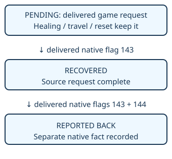

EXPERIMENTAL · DEFAULT OFF

# Remember the employee’s request

> Markdown twin of [native-instruction-tasks-v1.html](../native-instruction-tasks-v1.html), generated from the HTML by `just explainer-twins`. The HTML is the source; edit it, not this file.

## What changes?

The existing instruction ledger can automatically retain one verified game request: the Rustboro employee asks for his DEVON GOODS. The model still chooses its plans and actions. The request does not disappear when it heals, travels or starts with a cleared conversation.

## Exact trigger

All of these must match: the native authored employee-request script identity, map 0/3, an already recorded source state containing the request, the exact request-bearing page, known unfinished Goods recovery, and a successful tool result that actually delivers that page with a matching or later observation. A greeting or interaction flag alone does not qualify.

> Help me! I was robbed by TEAM AQUA!<br>
> I have to get the DEVON GOODS back!

The US Emerald script is `RustboroCity_Text_HelpMeIWasRobbed`. The native recognizer verifies ROM identity, script callsite and displayed message bytes. The interaction flag is set before the plea is displayed, so it cannot prove delivery.

## Task lifecycle



*Defeating the grunt, arriving in the tunnel or claiming success does not substitute for Goods recovery evidence. Reporting back is tracked separately; the harness does not invent a new return instruction.*

## What the model receives

Illustrative fields from the ledger’s canonical record:

```
{
  "id": "native_devon_goods_recovery",
  "title": "Recover the DEVON GOODS",
  "owner": "harness",
  "status": "open",
  "native_phase": "pending",
  "sources": [{"episode": 3, "page": 0}]
}
```

Episode numbers are successful tool-result event numbers; pages are zero-based. Full quotes remain available through `get_instruction_goals`. The issuer is historical evidence, not proof that the actor is currently present. The canonical task appears before model plans and in a dedicated task-state section, including after completion. Native proof records the delivered observation reference.

The model can add supporting plans with this task as their parent, including healing first. Reviews cannot change reserved `native_` identifiers. Existing model goals remain editable and provisional. Bookkeeping stays advisory and cannot block ordinary gameplay.

## Persistence and boundaries

The existing run event log rebuilds the same ledger in order. No second quest manager or database is added. Only delivered observations advance native phases. Failed results, unknown state, greetings, wrong scenes and duplicate dialogue cannot create or falsely complete tasks.

`native-instruction-tasks-v1` is inactive when the instruction-goal ledger is OFF. With that ledger ON, it requires advisory mode and authored scene labels. OFF preserves the existing model-maintained ledger. No route, NPC selection or game input is automated.

Implementation and offline checks are distinct from probe results. This feature remains OFF by default; gameplay benefit and the full Roxanne-to-Rusturf chain require measured evaluation.
