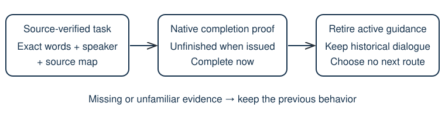

# Retire goals when the game proves the task complete

> Markdown twin of [native-task-goal-retirement-v1.html](../native-task-goal-retirement-v1.html), generated from the HTML by `just explainer-twins`. The HTML is the source; edit it, not this file.

`native-task-goal-retirement-v1` · default OFF · bundle only · recorded replay verification, gameplay benefit unmeasured.

## The recorded failure

Control 0517, source 05d401b51f, dialogue seq 7559: DAD asks, “Hm? Aren't you going to the POKéMON GYM in RUSTBORO CITY?” The same conversation separately asks the player to return with four badges. After Roxanne's defeat, state 34806 proves Rustboro Gym complete, but result 34807 still presents the first instruction as the active Story goal.

ON removes the completed first instruction from active destination and away guidance. The four-badge request and full recorded dialogue remain. It selects no next destination and sends no input.

*Only a task with both identity and completion evidence can be retired.*

## OFF and ON

| OFF | ON |
|---|---|
| Previous goal selection, text, tools and prompts. | Source-audited task matches carry native completion requirements. When fulfilled after known unfinished issuance, existing consumers suppress active destination and away warnings. |

## How it generalizes

The mechanism reuses the audited instruction-memory task rules and the existing native milestone predicates. A return-to-lab instruction completes with Pokédex receipt; the first-gym request completes with Rustboro Gym completion. It does not assume that visiting a named city completes every task there.

Unknown text, unidentified speakers, wrong maps, missing source-state references, unreadable flags, transition states and requests already complete when issued do not qualify for new retirement. Whole-episode rules require all pages to match, so extra future instructions stay conservative. Norman's source-audited first-gym page is matched separately from his later four-badge request.

This is an extensible source-verified mechanism, not automatic understanding of every quest. Other tasks need audited instruction and native completion relationships before they can participate. No hidden route facts are supplied.

## Evidence and lifecycle

Uses already-recorded state, dialogue_auto_advance and successful tool_result events. Issuance boundaries retain native predicate values, source map and player identity only when they change. Exact observed state sequence IDs qualify page references; missing samples stay unknown. Task metadata attaches to the exact delivered source page. Current completion is checked from the coherent state used for the result. Existing tool_result and decision context carry the changed text; event schema, timeline and historical recordings are unchanged.

Source: pret/pokeemerald 731ad5bfd6e6f265508d0efcca0ba42f9dcf5881, PetalburgCity_Gym_Text_NormanGoToRustboro; shared task sources are listed in milestone-memory-rules.ts. External ROM SHA-1 f3ae088181bf583e55daf962a92bb46f4f1d07b7.

## Status

Offline replay and correctness checks; no active run, model call or shared viewer restart. Review and landing are recorded separately in the feature worklog. No claim that the model will recover or gameplay becomes faster.
