# Navigate already here

> Markdown twin of [navigate-already-here-v1.html](../navigate-already-here-v1.html), generated from the HTML by `just explainer-twins`. The HTML is the source; edit it, not this file.

`navigate-already-here-v1` · guidance · default off · needs `bounded-navigation-v1`

When the model calls `navigate_to` for the tile the player already stands on, the route is empty and no button is pressed. The tool used to answer "arrived at requested coordinate", which reads like a walk happened. In run f28d the model repeated `navigate_to (10,5)` on (10,5) for about 400 turns while its thinking said it was at (10,12).

## The tile and the answer

*The new wording states only what the game shows: where the player stands. It does not suggest a next step.*

## When it applies

| Case | On |
|---|---|
| Goal is the player's tile, no press made yet | "you are already standing on (x,y) …" |
| Walk moved and then ended on the goal | "arrived at requested coordinate" (unchanged) |
| Deterministic warp chose an equivalent warp tile | unchanged |
| Standing on a directional warp that is the goal | unchanged (the warp press runs) |

## Status

Unit tests cover OFF (the recorded text), ON, a walk that moved, and the production factory. Bundle-only: it goes into the fixed bundle, not its own A/B. No measured runs yet.
