Harness switch · guidance · `navigate-first-prompt-v1` · needs `bounded-navigation-v1` · off by default

# Navigate_to first

> Markdown twin of [navigate-first-prompt-v1.html](../navigate-first-prompt-v1.html), generated from the HTML by `just explainer-twins`. The HTML is the source; edit it, not this file.

With the switch on, the model is told in three places that `navigate_to` is how it moves: the tool list in the system prompt, a new last section of the prompt, and the start of the `navigate_to` description. A short reminder is added to every third direction-only press in a row. The game, the tools and their behavior do not change.

## 1. Why: cook run #2 walked by hand

Run `2026-10-16T02-23-17_qwen36-gpu1_sh02`, Route 103. On that route the model walked by `press` for 76 overworld turns and by `navigate_to` for 56.



*Overworld turns on Route 103 in cook run #2, by how the model walked. Source: forensics report `runs/reports/cook2-navigation.html`.*

The decisive stretch came when the readout already held what was needed. Quotes of the model's thinking are its stated belief, not what the game did.



*Cook run #2, Route 103, turns 888–920. Green: the readout had the route. Red: hand walking. Blue: navigate_to stopping at its cap. Nothing told the model it could simply call again with the same destination.*

## 2. Where the model reads each change

The Qwen3.6-35B-A3B model card has no system-prompt style guide. Qwen's function-calling docs say to give each tool a description that says when to use it. The chat template served by llama-server (seen at `/props`) renders the `# Tools` JSON first, then the system prompt, then the conversation. So the tool list inside the system prompt is the model's own summary of what it can do, and the prompt's last section sits nearest the conversation.



*The order the served chat template renders. Green boxes are the four places the switch changes text. Everything else is unchanged.*

## 3. The tool list, off and on

Off (cook run #2)

```
You act through game tools:
- observe: shows the current screen and a text readout of the game state read from memory (location, coordinates, party, and an ASCII map of the surroundings).
- press: presses up to 8 buttons in order (A, B, START, SELECT, UP, DOWN, LEFT, RIGHT), then shows the new screen and state.
```

On

```
You act through game tools:
- observe: shows the current screen and a text readout of the game state read from memory (location, coordinates, party, and an ASCII map of the surroundings).
- navigate_to: walks you to a tile on the current map. This is how you move: give it the destination and it finds the route around walls, ledges, water and people.
- press: presses up to 8 buttons in order (A, B, START, SELECT, UP, DOWN, LEFT, RIGHT), then shows the new screen and state. Use press for A, B, menus, dialogue, battles and single-tile steps or turns, not for walking.
```

Off, the tool list names only observe and press. `navigate_to` appears later, in its own bullet. With the RAM readout off, the screen-only press line gets the same suffix.

### The usage rule, off and on

Off: NAVIGATE_TO_USAGE (after game evidence)

```
Use navigate_to for any walk of two or more tiles on the current map, using coordinates from the readout. To go through a door or stairs, give the warp's own coordinates as the destination; at a directional exit, arrive on its tile, then press the direction its activation describes. When navigate_to stops early, read its reason and pick a reachable tile or a different listed exit instead of falling back to long runs of single presses. Use press for talking, menus, dialogue and short adjustments.
```

On: MOVING_AROUND_LOCAL (last section)

```
Moving around: to go anywhere two or more tiles away on the current map, call navigate_to with that tile. Do not trace routes tile by tile in your thinking, and do not walk with runs of direction presses: navigate_to plans the route from the game's memory, which is more reliable than reading the ASCII map.
- To talk to someone, target a free tile next to them, then press the direction that faces them and press A.
- For a door, stairs or another listed warp, target the warp's own tile. At a directional exit, arrive on its tile, then press the direction its activation describes.
- If it refuses a tile (a ledge, wall, water or a person), choose a walkable tile beside the place you want, or the tile its reason names.
- If it stops with "command limit", call it again with the same destination; it carries on from where it stopped.
- A destination outside the local map is fine: it walks toward it as far as the local map allows. If it reports no path, choose a reachable tile in that direction.
```

With `full-map-navigation-v1` on, the section is `MOVING_AROUND_FULL`. It shares the first four lines. Its last two bullets are replaced by one:

```
- If it stops early, read its reason, then call it again or choose a reachable tile near the place you want.
```

On, the section is appended even when `game-evidence-priority-v1` is off. When `objective-tracking-v1` is on, its objective text still comes after Moving around.

### The navigate_to description

```
The main way to move: use it for every walk of two or more tiles; give the destination and it finds the route around walls, ledges, water and people. Walk toward a coordinate on the current map using bounded A*. ... (today's description, unchanged) ... After "command limit", call it again with the same destination to continue.
```

The command-limit hint is added only in local mode. The whole-map description gets the prefix only.

## 4. The reminder rule

The wrapped `press` keeps a count of direction-only presses in a row, with no other tool call between them. A press counts only when its buttons are all UP, DOWN, LEFT or RIGHT and the state it returns is the free field: started, screen `overworld`, not in battle, `field_controls_locked` exactly false, no interface owning input (`active_ui` empty), and no dialogue or message open.



*The counter in `withNavigateFirst`, with `REMINDER_EVERY=3`. Green: a direction-only press ending on the free field. Red: resets. A result without a readable state, a press without buttons, or a press that errors also resets. Any other tool call between presses, `observe` included, resets it too, so the reminder appears only after three presses in a row with nothing else between.*

The line appended to the press result:

```
Reminder: to walk two or more tiles, call navigate_to with the destination; it finds the route for you.
```

None of the new text names a destination, a character or a story step. A test checks this for MAY, BRENDAN, BIRCH, ROUTE, Rustboro, Oldale and Littleroot.

## 5. Off is the old behavior


*What the tests in `packages/agent/src/navigate-first.test.ts` pin for the off state. A further test strips the three additions from the on prompt and gets cook run #2's prompt minus `NAVIGATE_TO_USAGE`.*

The prompt change needs `bounded-navigation-v1`; the registry records that dependency. The switch is agent side only and is not sent to the game server. `playGameTools` applies the wrapper last, around navigation and dialogue auto-advance.

## 6. Status

| Item | State |
|---|---|
| Default | Off |
| Bundle | Operator wants it in the `bundle-v-control` bundle arm. The readiness thread edits the bundle file; this branch does not. |
| Review | Multi-model review pending |
| Measured runs | None. Nothing here shows it helps. |
