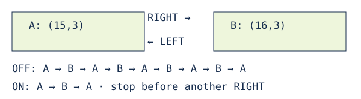

# Navigation cycle stop

> Markdown twin of [navigation-cycle-stop-v1.html](../navigation-cycle-stop-v1.html), generated from the HTML by `just explainer-twins`. The HTML is the source; edit it, not this file.

`navigation-cycle-stop-v1` · default OFF · bundle ON

## One call was walking back and forth

In GLM run 0d5d, turns 1031 and 1032 requested tile (6,5) in Stern’s Shipyard. Each call pressed RIGHT, LEFT four times, returned to (15,3), then said to call again. The model chose the destination; the tool chose those steps.

This is the recorded two-tile cycle, not a new route.

## What makes a repeated step

Within one local navigation call, the same position, facing, local terrain, player elevation, warps, matching coordinate triggers and planned route identify a repeated step. An NPC moving off the route does not reset the check; an occupancy change that changes the planned route does. A turn, a changed route or terrain, and a later call remain separate. The usual collision, input-lock, map-change and movement checks still apply. Full-map and visited-terrain navigation keep their existing convergence check.

## Truthful result

`route cycle: returned to (15,3) with the same facing, local terrain and planned route; stopped before repeating RIGHT. No onward route to (6,5) was verified; inspect the returned map and choose another waypoint`

The tool returns a fresh observation. It does not call the destination unreachable, pick a new destination, end the run, or tell the model that another identical call will make progress. This is a harness planning limitation; the game has no message for it.

## OFF, scope and evidence

OFF preserves the previous input sequence, command-limit result, tool description and system prompt. This change does not repair muddy-slope readouts or redesign navigation. The recorded native inputs and parsed raw-RAM geometry are retained in the regression fixture with source pin 5bec91dc, US ROM SHA-1 f3ae088181bf583e55daf962a92bb46f4f1d07b7 and result sequences 117276 / 117886. Game reference: pokeemerald 731ad5bf, GetCollisionAtCoords in src/event_object_movement.c.

Prepared a working branch. Deterministic regression evidence does not establish gameplay benefit. Bundle configuration does not prove a later run enabled the switch; that requires its run_start receipt.
