Harness switch · navigation-refusal-reasons-v1 · default OFF

# navigate_to says why it cannot walk

> Markdown twin of [navigation-refusal-reasons-v1.html](../navigation-refusal-reasons-v1.html), generated from the HTML by `just explainer-twins`. The HTML is the source; edit it, not this file.

When `navigate_to` refuses, the model used to get one of two generic lines. It could not tell a waiting message from a wall, or a person from water, so it retried the same call. With this switch on, the refusal names the cause and what would work instead.

## What went wrong in recorded runs

| Run | What the model did | What it was told (OFF) |
|---|---|---|
| `0c40` | Called `navigate_to(10,7)` 42 times in Birch's lab while an aide's message waited for A or B (`world_context.message.phase` = `scroll_wait` / `dismiss_wait`, `field_controls_locked` = true). (10,7) is also the lab's Machine, a solid tile. | `field input or navigation geometry unavailable`, every time |
| `c497` | Retried `navigate_to` onto a wandering NPC's own tile. | `no supported local path; choose a reachable local waypoint` |

## How the reason is chosen

Both branches read only the state snapshot the tool already has: `world_context.message` / `dialogue`, `field_controls_locked`, `active_ui`, `interaction_targets`, `world_context.objects`, and the `navigation_grid` (local) or `map_grid` (whole map) and `topology` bounds.

## A person on the target tile

### Illustrative 3×3 room, target (1,1) = MOM

Red dashed: the requested tile. Green: free tiles the planner can reach, each with the direction to face. The order is up, down, left, right of the target.

### OFF

`Navigation: no supported local path; choose a reachable local waypoint; 0 ordinary button attempts.`

### ON

`Navigation: (1,1) is MOM (person or object), which navigate_to cannot stand on; to talk to it or use it, walk to one of these free tiles, face it and press A: (1,0) facing DOWN; (1,2) facing UP; (0,1) facing RIGHT; (2,1) facing LEFT; 0 ordinary button attempts.`

A neighbour is listed only if it is walkable under the same rules the planner uses (walkable-floor-v1, one-way-tiles-v1), holds no object, is not a warp, and the planner finds a route to it. With none: "…and none of its free neighbouring tiles can be reached from here; choose a reachable waypoint nearer to it". The name comes from `interaction_targets`; an object without one is "a person or object". A face-and-press-A target on a solid tile (the lab's Machine, a PC) is named the same way, for example "Machine (background)".

## A wall, water or ledge

| Tile | Says |
|---|---|
| ledge behaviour 0x38–0x3B | a ledge, which you can only hop over in its arrow direction |
| water behaviours (surfable set) | water |
| collision ≠ 0 | a wall or other solid tile |
| other unwalkable behaviour | terrain navigate_to does not walk on (metatile behavior 0x20) |

Then: "…, not a walkable tile; the nearest walkable tile navigate_to can reach is (x,y)", searching every tile within 3 steps, nearest first, then top to bottom, left to right. None: "no walkable tile navigate_to can reach lies within 3 steps of it".

## Warp targets (pre-launch fix F7, bundle run 3f21)

Before this fix a warp target always got the generic line. In bundle qualification run `2026-10-15T23-47-41_qwen36-gpu1_3f21` that cost about eight turns: the lab door and an exit with MOM standing on it were both reachable, but the model was told only "no supported local path" and walked into walls (7,15) and (7,14).

pokeemerald `TryDoorWarp` starts a door warp only when the player walks north into an `MB_ANIMATED_DOOR` (0x69) tile, so the entry tile is always the one below. Positions and window from the recorded state of run `3f21`.

| Case (3f21) | Before | After |
|---|---|---|
| Lab door (7,16) from (5,9), T107 seq 1956; also T151, T153 | `Navigation: no supported local path; choose a reachable local waypoint; 0 ordinary button attempts.` | `Navigation: (7,16) is a door to map 1/4; the game enters a door only when you walk UP into it from the tile below, (7,17), which is outside the local map navigate_to can see from here; call navigate_to (7,17) first, then navigate_to (7,16) again; 0 ordinary button attempts.` |
| House exit (9,8) with MOM on it, T57 seq 909; also T61 seq 960 | `Navigation: no supported local path; choose a reachable local waypoint; 0 ordinary button attempts.` | `Navigation: (9,8) is a warp to map 0/9, but MOM (person or object) is standing on it, so navigate_to cannot walk onto it; wait for it to move, or use another listed warp to map 0/9: (8,8); 0 ordinary button attempts.` |

Other door cases: the entry tile has someone on it ("wait for it to move"), is below the map's last row, is not walkable, or is known but unreachable. A non-door warp with nobody on it still gets the generic text. Destinations are map ids from `interaction_targets`; the readout names them. Tests: `bundle-3f21-fixes.test.ts` (real states), `navigation-refusal-reasons.test.ts` (every branch). Off: unchanged, checked against the recorded text.

## Every text, OFF and ON

| Case | OFF (unchanged) | ON |
|---|---|---|
| Message open | field input or navigation geometry unavailable | a message is waiting for A or B; dismiss it with B, then call navigate_to again |
| Script lock, no message | same | field controls are locked by a script and no message is open; the game is acting on its own, so inspect the new state before calling navigate_to again |
| Lock unknown | same | field control state is unavailable; inspect the new state before calling navigate_to again |
| Battle | same | a battle is in progress; navigate_to walks only on the field |
| Not started / other screen | same | the game has not started yet; … / the game is not on the field (screen: X); navigate_to walks only on the field |
| Menu open | same | a menu or other interface is open (phase); close it before calling navigate_to |
| No geometry | same | this map's navigation geometry is unavailable; inspect the new state before calling navigate_to again |
| Stopped after a step | field input locked or unavailable; inspect new state | walk interrupted: &lt;one of the above&gt; |
| Outside map | no supported (local) path… | (25,3) is outside this map; its tiles run from (0,0) to (19,19); to reach another map, use a listed warp or a map connection |
| Person/object, blocked tile | no supported (local) path… | see the two sections above |

Texts are whole; nothing is shortened. The tool description and every other status are identical in both states.

## Wiring

The switch is read only from the FeatureSet given to `withNavigation`. It needs `bounded-navigation-v1`. Deleting the wiring turned the factory test red; restoring it turned it green.

## Status

- **Tests**: `packages/agent/src/navigation-refusal-reasons.test.ts`: every reason ON, OFF byte-identical, counter hint priority, factory path
- **Not done**: Multi-model review; measured runs. A pending experiment entry is registered; it runs only after readiness passes and the operator approves it.
