Harness switch · navigation-refusal-reasons-v2 · default OFF · bundle arm only

# Say when the route leaves the local map

> Markdown twin of [navigation-refusal-reasons-v2.html](../navigation-refusal-reasons-v2.html), generated from the HTML by `just explainer-twins`. The HTML is the source; edit it, not this file.

Local navigate_to plans over the 15x15 tiles around the player. When the target is inside that window and walkable but no route reaches it inside the window, today's refusal gives no reason. With this switch on, it says the route leaves the local map and names the reachable tiles on the window's edge, one per side, nearest the target first.

## Before and after

OFF

no supported local path; choose a reachable local waypoint

ON

no route to (6,4) lies inside the 15x15 local map navigate_to plans over, so any route leaves it; reachable tiles on its edge, nearest (6,4) first: (6,16) on the south edge, (14,9) on the east edge; walk to one, then call navigate_to (6,4) again

If no edge tile can be reached: "…, and navigate_to can reach no tile on that local map's edge from here; choose another target".

## show T800, Route 101

show turn 800 (state seq 19866). The local map is x 0-14, y 2-16. Ledges on rows 6 and 7 block every way north inside it. The real route goes east through x 15-16 (the model used it at turns 576-579). Green: the two reachable edge tiles the refusal names, nearest the goal first: (6,16) south, (14,9) east. x = 0 is the map's own west edge, so no west tile is named.

## e588 T1539, Route 103

e588 turn 1539 (state seq 21334), target (11,3) beside MAY. The route runs west through x 5 outside the window; the west edge tile (7,6) is listed first.

## Rule

| Step | Condition |
|---|---|
| Applies | Local mode; the planner found no path; no earlier reason (counter, refusal-reasons-v1 target reason, navigation-truth trigger reason) applies; no route reaches the target inside the window even with ledge hops, one-way tiles, walkable floor and the game's elevation rule counted and matching coordinate triggers ignored, so a route the run's own terrain switches miss (ledge-hops-v1, one-way-tiles-v1, walkable-floor-v1 or elevation-transitions-v1 off) keeps the generic text; the target tile is in the window and the player could stand on it (walkable, no person, object or warp on it); the map size is known (topology). A wall, water, person or warp target keeps the generic text even with refusal-reasons-v1 off. |
| Edge tile | A window tile with a 4-neighbour inside the map but outside the window; standable, no object or warp on it; the planner reaches it. Matching coordinate triggers are excluded (as stand tiles and on the way) only when navigation-truth-v1 and coordinate-script-conditions-v1 are also on; with v2 alone the planner's ordinary rules apply. |
| Listed | Per side (north, south, east, west) the edge tile nearest the target (Manhattan, then row, then column); sides sorted by that distance. |
| Never | Turns on whole-map navigation (`full-map-navigation-v1`), walks anywhere, or guesses tiles outside the window. |

The listing is not a route: the nearest edge tile can still be the wrong side (show T800 lists south before east). It names every side so the model can choose.

## Wiring

FeatureSet `navigation-refusal-reasons-v2` → `withNavigation` port `windowReasons` → `windowReason()` in the refusal chain of `navigate_to`. Needs `bounded-navigation-v1`. Tests: `packages/agent/src/navigation-truth.test.ts` (show T800, e588 seq 21335, a ledge route with ledge-hops-v1 off, an elevation route with elevation-transitions-v1 off, OFF, unknown bounds, factory).

## Status

- **Not done**: Measured runs. A pending experiment entry is registered; it joins the bundle arm only when its owner wires it.
